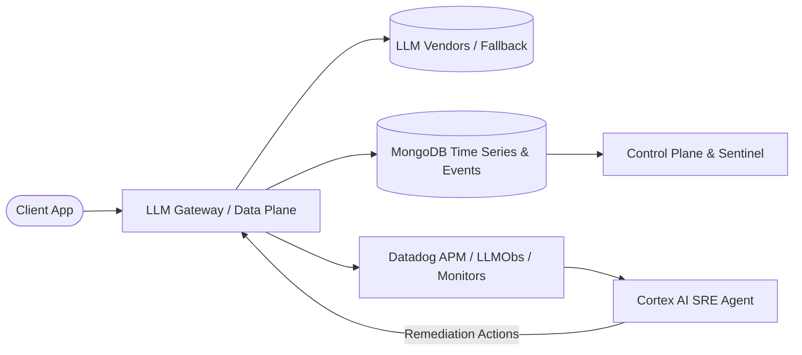
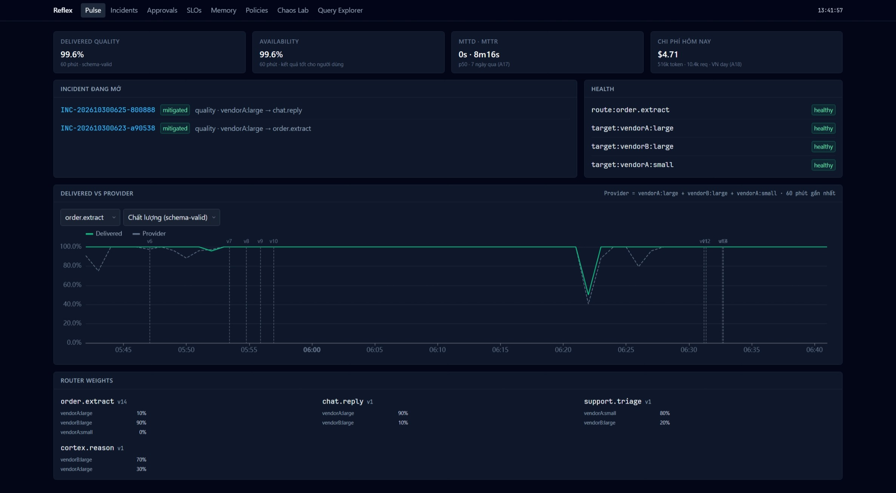
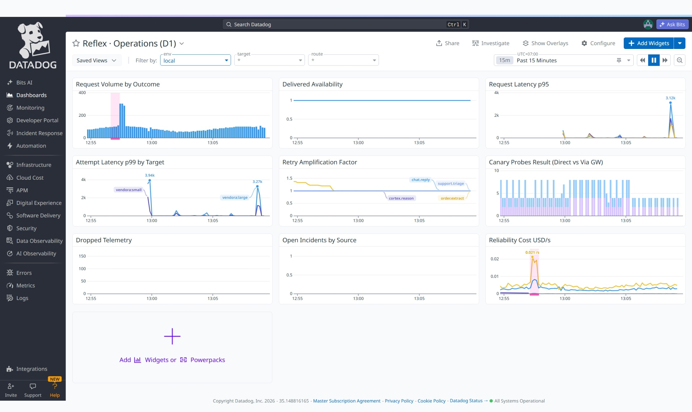
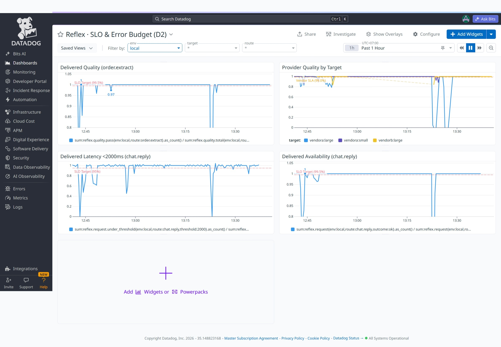
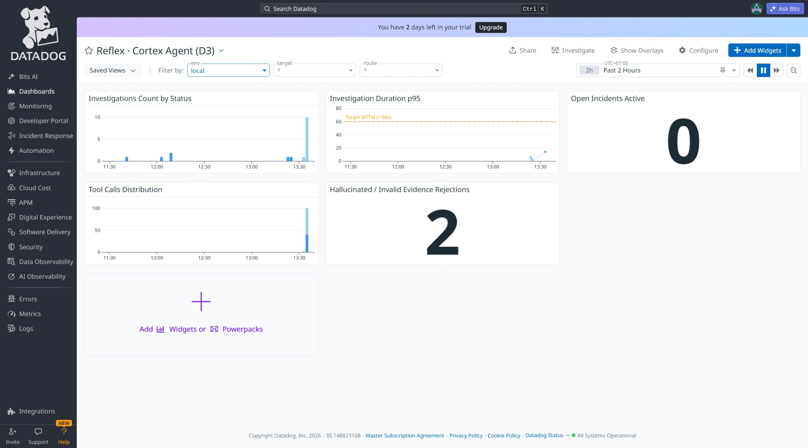
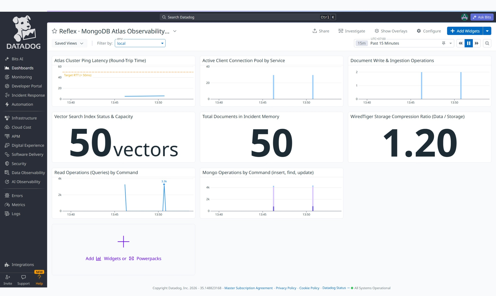
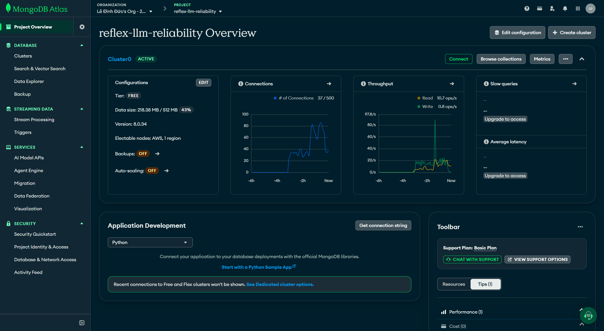

# LLM Monitor & Reliability Platform (Reflex)

> Dự án tham gia [MUGVN Hackathon 2026: Real-time Operations](https://mini-hackathon-sep-2026.mugvn.com)

---

## Đội thi: We Bare Bears
- **Lê Đình Đức** — Data Platform Engineer (*Student @ HCMUT*)
- **Bùi Hữu Lợi** — Software Engineer (*Student @ HCMUT*)

---

## Kiến trúc hệ thống
Hệ thống vận hành theo cơ chế **Dual-Loop** (Hai vòng lặp khép kín):
- **Fast-Loop (Data Plane — LLM Gateway)**: Proxy tương thích chuẩn OpenAI, độ trễ cực thấp (<5ms overhead). Tích hợp routing thông minh, circuit breaker, retry, auto-fallback và output validation (JSON schema, truncation, semantic).
- **Slow-Loop (Control Plane & Cortex AI Agent)**: Thu thập telemetry liên tục vào MongoDB Time Series, tính toán SLO multi-burn-rate, đẩy metrics/traces sang Datadog. Cortex Agent chẩn đoán nguyên nhân gốc (RCA) và tự động kích hoạt policy khắc phục (traffic shedding, model failover, prompt downgrade).

**Luồng dữ liệu:**


---

## Hình ảnh hệ thống

| Reflex Console & Cortex AI Agent | Datadog Ops Dashboard (D1) |
| :---: | :---: |
|  |  |
| **Datadog SLO & Error Budget (D2)** | **Datadog Cortex LLMObs (D3)** |
|  |  |
| **Datadog MongoDB Engine Metrics (D4)** | **MongoDB Atlas Cluster Overview** |
|  |  |

---

## Tính năng chính
- **Giám sát Telemetry Thời Gian Thực (Sub-Second Ingestion)**: Thu nạp từng request/stream qua MongoDB Time Series & DogStatsD. Đo lường tức thì P95/P99 latency, token throughput, error rate và chi phí thời gian thực theo từng route và vendor.
- **LLM Tracing & Observability Đa Chiều (Datadog APM & LLMObs)**: Distributed tracing end-to-end từ Client ➔ Gateway ➔ Vendor. Theo dõi real-time payload, span context, rate limit headers và token distribution.
- **Cảnh báo Cháy Ngân Sách Lỗi Tức Thì (Real-Time SLO Multi-Burn-Rate)**: Phát hiện vi phạm SLO sớm qua thuật toán multi-window multi-burn-rate (chuẩn Google SRE); cảnh báo ngay khi tốc độ tiêu hao error budget vượt ngưỡng cho phép thay vì phụ thuộc ngưỡng tĩnh trễ.
- **Kiểm định Chất Lượng In-Flight (Quality SLI Validation)**: Đánh giá tức thì độ hợp lệ của response ngay trên luồng stream (JSON schema, truncation, format guardrails) để phát hiện "silent failures" (lỗi trả về 200 OK nhưng nội dung rác/cắt cụt).
- **Reflex Live Console & Time Machine**: UI thời gian thực (live topology, stream metrics, incident timeline). Tích hợp Time Machine cho phép tua lại chính xác trạng thái toàn hệ thống tại thời điểm phát sinh sự cố.
- **Điều hướng & Tự Hồi Phục Tức Thì (Smart Gateway & Circuit Breaker)**: Kết nối trực tiếp với kết quả telemetry thời gian thực để tự động ngắt mạch, retry có kiểm soát và fallback tức thì khi vendor upstream gặp sự cố.
- **Cortex Autonomous SRE Agent**: AI Agent tự động tiêu thụ telemetry/traces thời gian thực, chẩn đoán nguyên nhân gốc (RCA) và tự động thực thi kịch bản khắc phục.

---

## Điểm nổi bật
- **Closed-Loop Self-Healing**: Quy trình tự động hoá toàn diện: *Detect ➔ Isolate (Breaker) ➔ Diagnose (Cortex) ➔ Mitigate (Actuator) ➔ Verify (Verifier)* không cần can thiệp thủ công.
- **Delivered SLO vs Provider SLO**: Tách biệt chất lượng thực tế người dùng nhận được khỏi biến động từ nhà cung cấp upstream (nâng độ tin cậy từ 95% upstream lên 99.9% delivered).
- **Hiệp đồng MongoDB + Datadog**:
  - **MongoDB**: Lưu trữ telemetry hiệu năng cao (Time Series Collections), phản ứng tức thì qua Change Streams, và truy vấn tương đồng sự cố qua Vector Search.
  - **Datadog**: APM Distributed Tracing, DogStatsD real-time metrics, LLM Observability và hệ thống Dashboard chuẩn SRE (D1 Ops, D2 SLO, D3 Cortex, D4 Mongo).

---

## Báo cáo kỹ thuật nộp bài (`docs/submission/report/`)

Bộ hồ sơ báo cáo kỹ thuật chính thức của dự án Reflex tham gia **MUGVN Hackathon 2026**:

| Báo cáo | Tên chuyên đề | Nội dung cốt lõi |
| :--- | :--- | :--- |
| [**README.md**](docs/submission/report/README.md) | **Tổng quan & Bảng đối chiếu 12 hạng mục** | Trang bìa, lời cảm ơn, tóm tắt điều hành, bảng đối chiếu 12 hạng mục nộp bài theo barem chấm thi và danh mục biểu đồ SVG. |
| [**01-IDEA.md**](docs/submission/report/01-IDEA.md) | **01 — Bối Cảnh, Mục Tiêu & Giải Pháp** | Khoảng mù vận hành *The Silent Brownout*, 4 mục tiêu kỹ thuật, kiến trúc Cung phản xạ hai tốc độ (Two-Speed Architecture) và 6 điểm nhấn kỹ thuật. |
| [**02-ARCHITECTURE.md**](docs/submission/report/02-ARCHITECTURE.md) | **02 — Kiến Trúc Hệ Thống & Trụ Cột Công Nghệ** | Phân tách rạch ròi Data Plane (< 2.8ms overhead) vs Control Plane, cơ chế Zero-Downtime Hot-Reload (< 1s qua Change Streams), và các quyết định kỹ thuật (ADRs). |
| [**03-MONGO.md**](docs/submission/report/03-MONGO.md) | **03 — Thiết Kế Cơ Sở Dữ Liệu MongoDB Atlas** | Động cơ dữ liệu chủ động: phân tầng Hot/Warm/Operational, 4 Time Series Collections, Incident Memory (Vector Search 64D), Change Streams và thư viện Aggregation (A1–A18). |
| [**04-DATADOG.md**](docs/submission/report/04-DATADOG.md) | **04 — Kiến Trúc Quan Sát Thời Gian Thực Datadog** | Chuẩn Unified Service Tagging, cảnh báo Multi-Window Multi-Burn-Rate (chuẩn Google SRE), Composite Monitors (M9 phân lập lỗi) và Datadog LLM Observability. |
| [**05-SRE.md**](docs/submission/report/05-SRE.md) | **05 — Vòng Lặp Tự Chữa Lành Khép Kín (Closed-Loop SRE)** | Vòng lặp 5 pha (*Detect ➔ Isolate ➔ Diagnose ➔ Mitigate ➔ Verify*), rào chắn an toàn Bounded Actions và kiểm định toán học thống kê (Wilson Score Interval, Z-test). |
| [**06-CHAOS.md**](docs/submission/report/06-CHAOS.md) | **06 — Kịch Bản Vận Hành & Giả Lập Sự Cố (Chaos)** | Kiến trúc Chaos Proxy với 5 dạng lỗi thực tế, kịch bản trọng tâm S1 (Silent Brownout), baseline 60 ngày OpenRouter, tính tất định và chống gian lận với Seed 42. |
| [**07-SUMMARY.md**](docs/submission/report/07-SUMMARY.md) | **07 — Tổng Kết Dự Án & Định Hướng Phát Triển** | Tổng kết thành tựu kỹ thuật, hạn chế và lộ trình tương lai, hướng dẫn triển khai nhanh, kịch bản demo và bảng khai báo tài nguyên/công cụ AI. |

---

## Cấu trúc tài liệu (`docs/`)

Toàn bộ tài liệu chi tiết được tổ chức theo các tầng chức năng:

| Thư mục | Nội dung chính |
| :--- | :--- |
| [`docs/00-strategy/`](docs/00-strategy/) | Bối cảnh chiến lược, phân tích rubric cuộc thi và review thiết kế |
| [`docs/10-product/`](docs/10-product/) | Tầm nhìn sản phẩm Reflex, chân dung người dùng và kịch bản sự cố mẫu (Silent Brownout, …) |
| [`docs/20-architecture/`](docs/20-architecture/) | Kiến trúc tổng thể, sequence diagrams, quyết định kỹ thuật (ADRs) và Chaos Engine |
| [`docs/30-data/`](docs/30-data/) | Mô hình dữ liệu MongoDB (Time Series, Change Streams) và danh mục pipeline Aggregation (A1–A18) |
| [`docs/40-observability/`](docs/40-observability/) | Thiết kế quan sát Datadog: metrics, traces, monitors, SLOs và dashboards |
| [`docs/50-reliability/`](docs/50-reliability/) | Động cơ tin cậy: thuật toán SLO, Recovery Engine, Cortex AI SRE và Incident Memory |
| [`docs/60-interface/`](docs/60-interface/) | Thiết kế giao diện Reflex Console (SPA React) và đặc tả Backend-For-Frontend (BFF) |
| [`docs/70-delivery/`](docs/70-delivery/) | Quy hoạch repository, kế hoạch hiện thực, chiến lược kiểm thử và quản lý rủi ro |
| [`docs/submission/`](docs/submission/) | Hồ sơ nộp bài, kịch bản thuyết trình và slide hackathon |
| [`docs/submission/report/`](docs/submission/report/) | Bộ 7 báo cáo kỹ thuật nộp bài và bảng đối chiếu 12 hạng mục |
| [`docs/v1-compact/`](docs/v1-compact/) | Bản tóm tắt cô đọng dành cho người đọc nhanh |
| [`docs/assets/`](docs/assets/) | Tài nguyên media, ảnh chụp màn hình dashboards và console |

---

## Cấu trúc repository

Chi tiết: [repository-structure](docs/70-delivery/repository-structure.md).

| Thư mục | Nội dung |
| :--- | :--- |
| `apps/gateway` | **Data plane** — OpenAI-compatible gateway (FastAPI) |
| `apps/control-plane` | **Control plane** — sentinel, incidents, policy engine, actuator, verifier, time machine, BFF |
| `apps/cortex` | AI SRE agent (Datadog LLM Observability) |
| `apps/simulation` | ShopMate traffic, mock-llm, chaos-proxy, prober, scenario runner, bench importer |
| `apps/console` | React SPA (Vite + TanStack + ECharts) |
| `packages/reflex-core` | Domain thuần, không I/O: contracts, router, breaker, retry, SLI, validators |
| `packages/reflex-mongo` | Client, repos, pipelines A1–A18, change streams, migrations |
| `packages/reflex-telemetry` | ddtrace / LLMObs / structlog / DogStatsD, tag catalog, Datadog API |
| `infra/` | Compose, nginx, Mongo search indexes, Terraform Datadog |
| `scenarios/` · `seeds/` | Scenario-as-code · dữ liệu seed |

---

## Hướng dẫn cài đặt & chạy

### 1. Yêu cầu môi trường

| Công cụ | Phiên bản | Ghi chú |
| :--- | :--- | :--- |
| Python | 3.12+ | quản lý bằng [uv](https://docs.astral.sh/uv/) |
| [Task](https://taskfile.dev) | 3.x | chạy mọi lệnh trong `Taskfile.yml` (`task --list` để xem hết) |
| Docker + Docker Compose v2 | mới | khuyến nghị ≥ 8 GB RAM nếu chạy cả Mongo local |
| Node.js + pnpm | Node 22, pnpm 10 | chỉ cần để build/dev Console |
| Terraform | 1.x | chỉ cần để tạo dashboard/monitor/SLO Datadog |

Tài khoản bên ngoài:

- **MongoDB**: dùng container `mongodb-atlas-local` (không cần tài khoản, gồm cả Vector/Atlas Search) hoặc một cluster **MongoDB Atlas** (M0 miễn phí là đủ cho demo).
- **Datadog** (trial): cần `DD_API_KEY`, `DD_APP_KEY` và `DD_SITE`. Stack vẫn chạy khi thiếu Datadog, nhưng dashboard, monitor và LLM Observability sẽ trống.
- **LLM API tương thích OpenAI** (tuỳ chọn): chỉ để Cortex suy luận bằng LLM thật. Để trống thì mọi route dùng `mock-llm`, và Cortex chuyển sang chế độ rule-based.

### 2. Cấu hình (`.env`)

```bash
cp .env.example .env
```

| Biến | Bắt buộc | Ý nghĩa |
| :--- | :---: | :--- |
| `MONGODB_URI` | khi dùng Atlas | để trống thì compose dùng `mongodb://mongo:27017/?directConnection=true` (container local) |
| `MONGODB_DB` | | tên database, mặc định `reflex` |
| `DD_API_KEY`, `DD_SITE` | khuyến nghị | Datadog Agent (APM, logs, DogStatsD); `DD_SITE` ví dụ `datadoghq.com` |
| `DD_APP_KEY` | khuyến nghị | Cortex đọc logs/spans/metrics và ghi Event; Terraform |
| `REFLEX_PROFILE` | | `demo` (cửa sổ SLO rút ngắn, mặc định) hoặc `standard` |
| `LLM_API_KEY`, `LLM_BASE_URL`, `LLM_MODEL` | tuỳ chọn | LLM thật cho Cortex; chỉ các route trong `LLM_REAL_ROUTES` (mặc định `cortex.reason`) gọi vendor thật, còn lại vẫn dùng mock |
| `REFLEX_WEBHOOK_TOKEN`, `REFLEX_WEBHOOK_URL` | khi dùng Terraform/demo | header bí mật và URL công khai tới `/hooks/datadog` (ngrok, Cloudflare Tunnel hoặc nginx TLS) |
| `REFLEX_CONSOLE_TOKEN`, `REFLEX_LAB_TOKEN` | tuỳ chọn | bearer token cho Console/BFF và cho API chạy scenario từ Console |

> Không commit `.env`. Các key vendor đặt ở `chaos-proxy`, gateway không giữ key.

### 3. Chạy nhanh (local, có Mongo trong Docker)

```bash
task install            # uv sync (Python) + pnpm install (Console)
task up                 # build và chạy toàn bộ stack bằng docker compose
task seed               # migrate Mongo, seed catalog/SLO/policy, nạp bench_ts và 50 sự cố mẫu cho Incident Memory
task scenario -- silent-brownout   # chạy kịch bản sự cố chính
```

Nếu dùng **Atlas** thay cho Mongo local (nhẹ hơn): điền `MONGODB_URI` trong `.env`, cho phép IP của bạn ở *Atlas → Network Access*, rồi chạy:

```bash
task up:atlas -- gateway-1 gateway-2 chaos-proxy mock-llm control-plane cortex prober datadog-agent console
task seed
```

Sinh traffic nền (ShopMate, 8 rps) bằng profile `traffic`:

```bash
docker compose -f infra/compose/docker-compose.yml --profile traffic up -d traffic-gen
```

Các dịch vụ sau khi `task up`:

| Dịch vụ | Địa chỉ | Vai trò |
| :--- | :--- | :--- |
| Reflex Console | http://localhost:5173 | giao diện (sơ đồ mạng, War Room, duyệt action, Time Machine) |
| Gateway 1 / 2 | http://localhost:8080 / http://localhost:8081 | Data plane, API tương thích OpenAI |
| Control-plane (BFF) | http://localhost:8090 | Sentinel, Policy Engine, API `/api/*` (OpenAPI tại `/openapi.json`) |
| MongoDB | `localhost:27017` | chỉ khi dùng Mongo local |
| `mock-llm`, `chaos-proxy`, `cortex`, `prober` | nội bộ compose | mô phỏng vendor, chèn lỗi, AI SRE, canary |

Lệnh tiện ích: `task logs -- gateway-1` (xem log), `task down` (tắt stack), `task --list` (toàn bộ lệnh).

### 4. Thử gọi gateway

Gateway tương thích OpenAI; chọn route bằng header `x-reflex-route` (bắt buộc, hoặc đặt route vào trường `model`):

```bash
curl -s http://localhost:8080/healthz
curl -si http://localhost:8080/v1/chat/completions \
  -H 'content-type: application/json' \
  -H 'x-reflex-route: order.extract' \
  -d '{"messages":[{"role":"user","content":"Đặt 2 áo thun size M giao Hà Nội"}]}'
```

Header trả về cho biết gateway đã làm gì: `x-reflex-target` (vendor được chọn), `x-reflex-attempts` (số lần thử), `x-reflex-policy-version`, `x-reflex-quality`, `x-reflex-overhead-ms`.

### 5. Chạy kịch bản sự cố (Detect → Investigate → Respond)

```bash
task scenario -- silent-brownout                 # đầy đủ (~45 phút, SLO profile standard)
uv run reflex-sim run silent-brownout --fast     # bản rút gọn ~3 phút lỗi, dùng cho demo/E2E
```

Kịch bản có sẵn trong [`scenarios/`](scenarios/): `silent-brownout`, `its-us`, `429-storm`, `cascading-failover`, `tail-latency`, `real-world-replay`. Trong lúc chạy, mở Console để xem theo thứ tự:

1. Sentinel và Datadog Monitor M3 cùng phát hiện, gộp thành một incident.
2. Cortex điều tra (các tool call, giả thuyết, bằng chứng) và đề xuất `shift_weight`.
3. Policy Engine tự duyệt (hoặc chờ bạn duyệt ở màn hình *Actions*), gateway hot-reload policy < 1 giây.
4. Verifier xuất Recovery Proof (Wilson CI + z-test), sau đó failback 10% → 50% → 100%.
5. Màn hình *Time Machine* replay sự cố để so sánh static failover với Reflex.

### 6. Kiểm thử

| Lệnh | Nội dung | Điều kiện |
| :--- | :--- | :--- |
| `task test` | unit test toàn bộ package/app | không cần Docker |
| `task test:integration` | pipeline A1–A18, change stream, hot-reload < 1s | cần `mongodb-atlas-local` (`task up` hoặc container riêng) |
| `task test:e2e` | scenario `--fast` trên compose | cần stack đang chạy |
| `task lint` | ruff, mypy, import-linter (ranh giới giữa các package) | không cần Docker |
| `task loadtest` | 50 rps × 30 phút, đo overhead gateway | stack đang chạy; không chạy vào cluster dùng chung |
| `task chaos:self` | tắt lần lượt Mongo/Datadog/Cortex/control-plane/gateway để kiểm tra fail-safe | stack đang chạy |
| `task cortex:eval` | đánh giá Cortex (xuất `cortex-eval.md`) | cần LLM key |

Console: `pnpm --dir apps/console dev` (Vite, proxy `/api` tới `localhost:8090`), `pnpm --dir apps/console typecheck`, `pnpm --dir apps/console lint`.

### 7. Triển khai Datadog (dashboard, monitor, SLO, webhook)

```bash
# .env cần: DD_API_KEY, DD_APP_KEY, DD_SITE, REFLEX_WEBHOOK_TOKEN, REFLEX_WEBHOOK_URL
task infra:datadog:plan      # terraform plan (infra/terraform, xem terraform.tfvars.example)
task infra:datadog:apply     # tạo 4 dashboard D1–D4, monitor M1–M13, 4 SLO, webhook
task infra:datadog:sync -- --yes   # ghi id SLO/monitor Datadog vào Mongo; chạy lại sau mỗi lần `task seed`
```

`REFLEX_WEBHOOK_URL` phải là URL công khai tới control-plane (`/hooks/datadog`), vì Datadog gọi webhook từ SaaS. Cách nhanh là ngrok hoặc Cloudflare Tunnel trỏ vào cổng 8090.

### 8. Chế độ demo (Atlas + nginx TLS)

```bash
task demo:up        # compose + override demo: Atlas, nginx TLS (cần REFLEX_WEBHOOK_TOKEN), vendor thật qua chaos-proxy
task demo:record    # chạy scenario chính ở chế độ quay video
task demo:reset     # dọn trạng thái runtime giữa các lần quay (dry-run; thêm `-- --yes` để xoá)
```

Chi tiết các môi trường `local` / `ci` / `demo`, topology và bảo mật webhook: [`docs/20-architecture/deployment.md`](docs/20-architecture/deployment.md).

### 9. Xử lý sự cố thường gặp

| Triệu chứng | Cách xử lý |
| :--- | :--- |
| `task seed` báo không kết nối được Mongo | Kiểm tra `MONGODB_URI`; với Atlas, thêm IP vào Network Access; với local, chờ container `mongo` healthy (lần đầu ~2 phút vì khởi động mongod + mongot) |
| Dashboard Datadog trống | Kiểm tra `DD_API_KEY`/`DD_SITE`, log của `datadog-agent`, và đã chạy `task infra:datadog:apply` |
| Console báo 401 | Đặt `REFLEX_CONSOLE_TOKEN` trong `.env` rồi `task up` lại (nginx của Console tự gắn bearer token) |
| Cortex không điều tra bằng LLM | Chưa đặt `LLM_API_KEY`; hệ thống chạy rule-based, đây là hành vi dự kiến |
| Vector Search / Atlas Search lỗi | Chạy lại `task migrate` (idempotent) để tạo search index; image Mongo local phải là `mongodb-atlas-local` |
| Monitor không gọi được webhook | `REFLEX_WEBHOOK_URL` phải truy cập được từ Internet và đúng `REFLEX_WEBHOOK_TOKEN` |
