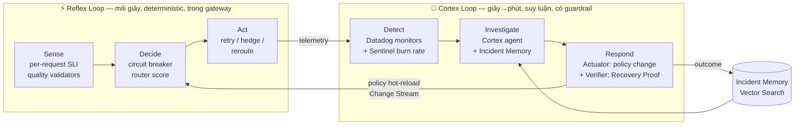

# Reflex — Tầm nhìn sản phẩm

> **Reflex: hệ thần kinh tự chữa lành cho ứng dụng LLM.**
> Một *control plane* độ tin cậy cho LLM API. Nó cảm nhận sự cố trong mili giây, suy luận nguyên nhân trong vài phút và chứng minh hệ thống đã hồi phục bằng dữ liệu.

*(Tên repo vẫn là `llm-reliability-platform`. "Reflex" là tên sản phẩm dùng khi pitch.)*

---

## 1. Bài toán

Ứng dụng LLM có những kiểu lỗi mà công cụ vận hành truyền thống không bắt được:

| Kiểu lỗi | Ví dụ | Vì sao monitor truyền thống bỏ sót |
| :--- | :--- | :--- |
| **Lỗi im lặng** | HTTP 200 nhưng output bị cắt (`finish_reason=length`), JSON sai schema, từ chối vô cớ, rỗng | Status code vẫn 200, nên uptime và error rate đều xanh |
| **Tail latency** | P50 bình thường, P99 TTFT tăng 8 lần ở một region | Monitor theo giá trị trung bình không thấy |
| **Rate-limit storm** | 429 hàng loạt khi một tenant tăng tải | Retry ngây thơ làm cơn bão tệ hơn (thundering herd) |
| **Cascading failover** | Failover dồn toàn bộ traffic sang backup → backup cũng quá tải | Failover tĩnh không tính đến sức chứa của backup |
| **Lỗi do chính mình** | Deploy gateway mới thêm 400ms | Mọi người thường đổ lỗi cho provider |
| **Chi phí vỡ trận** | Failover sang model đắt hơn 6 lần mà không ai biết | Không ai gắn chi phí vào quyết định độ tin cậy |

**Câu hỏi sản phẩm:** *Làm sao để người dùng cuối vẫn nhận câu trả lời đúng, nhanh và trong ngân sách, kể cả khi provider bên dưới đang hỏng theo những cách khó thấy?*

## 2. Ý tưởng cốt lõi — Cung phản xạ hai tốc độ

Cách hệ thần kinh xử lý một kích thích nguy hiểm có hai tầng:

- **Phản xạ tủy sống**: rụt tay khỏi lửa sau khoảng 50ms, chưa cần não suy nghĩ.
- **Vỏ não**: sau đó mới hiểu chuyện gì xảy ra, rút kinh nghiệm và điều chỉnh hành vi.

Reflex làm theo đúng cấu trúc đó:

- **Reflex Loop** chạy trong mỗi request, không phụ thuộc mạng ngoài và không phụ thuộc LLM. Nó cứu *request hiện tại*.
- **Cortex Loop** chạy trên dữ liệu tổng hợp. Nó thay đổi *chính sách* để cứu *các request tương lai*, ghi lại bài học, và lần sau xử lý nhanh hơn.
- **Cortex không bao giờ nằm trên critical path.** Nếu Cortex chết, Reflex vẫn giữ hệ thống sống. Đây là nguyên tắc thiết kế số 1.

## 3. Tám trụ cột đột phá

Xếp theo mức độ cốt lõi. **T1** là xương sống bắt buộc. **T2** là điểm tạo khác biệt. **T3** là "wow" cho chung kết.

| # | Trụ cột | Tier | Một câu |
| :--- | :--- | :---: | :--- |
| P1 | **Two-Speed Loop** (Reflex + Cortex) | T1 | Tách hành động tức thời theo luật cứng khỏi suy luận chậm; mỗi tầng có SLO riêng |
| P2 | **Quality SLI — "Beyond Uptime"** | T1 | Validator rẻ trên mỗi response (schema, truncation, refusal, empty, language) biến lỗi im lặng thành SLI đo được |
| P3 | **Dual-Ledger SLO** | T1 | Đồng thời đo *Provider SLO* (vendor cung cấp gì) và *Delivered SLO* (người dùng nhận gì). Khoảng cách giữa hai số là giá trị Reflex tạo ra |
| P4 | **Budget-Aware Adaptive Routing** | T2 | Router chấm điểm target theo health, error budget còn lại, chi phí, chất lượng và sức chứa. Error budget được dùng như một loại tiền tệ |
| P5 | **Incident Memory** | T2 | Mỗi sự cố được mã hóa thành vector 64 chiều từ *hình dạng time series*. `$vectorSearch` tìm sự cố tương tự và action từng thành công |
| P6 | **Recovery Proof** | T2 | Hồi phục được *chứng minh* bằng kiểm định thống kê trước/sau (Wilson CI, two-proportion test), sau đó ghi lại như một "chứng nhận" trong MongoDB và Datadog Event |
| P7 | **Time Machine (Counterfactual Replay)** | T3 | Phát lại dòng request đã ghi của một sự cố qua policy khác để đo budget và chi phí mà policy đó tiết kiệm được |
| P8 | **Observed Observer** | T3 | Cortex agent được trace bằng Datadog LLM Observability, và gọi LLM *qua chính Reflex gateway*: hệ thống vẫn suy luận được ngay giữa lúc LLM provider gặp sự cố |

### Tại sao đây là đột phá, không chỉ là tính năng

- **P2 + P3** thay đổi *định nghĩa* độ tin cậy cho LLM: từ "API có trả lời không" sang "người dùng có nhận được câu trả lời dùng được không".
- **P5** dùng Vector Search trên **chuỗi thời gian vận hành** chứ không phải trên văn bản. Trong một cuộc thi về Time Series và Real-time Ops, đây là cách kết hợp hai năng lực MongoDB mà ít đội nghĩ tới.
- **P7** đưa *Impact* từ cảm tính sang con số tính lại được.
- **P8** trả lời câu hỏi giám khảo chắc chắn sẽ hỏi: *"AI agent của bạn cũng là LLM, nếu nó hỏng thì sao?"*

## 4. Người dùng & giá trị

| Persona | Nhu cầu | Reflex mang lại |
| :--- | :--- | :--- |
| **App developer** | Một endpoint ổn định, không phải viết retry/fallback | OpenAI-compatible endpoint; chỉ cần đổi `base_url` |
| **SRE / On-call** | Biết sớm, điều tra nhanh, không bị alert dồn dập | Burn-rate alert, composite chẩn đoán, Cortex đưa sẵn giả thuyết kèm bằng chứng |
| **Engineering manager** | Biết độ tin cậy đang tốn bao nhiêu tiền | Cost-of-reliability: chi phí failover, chi phí hedging, budget đã dùng |
| **Platform lead** | Chọn policy đúng | Time Machine so sánh các policy trên sự cố thật |

## 5. Ứng dụng mẫu được bảo vệ (Protected Workload)

Để có "dữ liệu thực tế của hệ thống" đúng như thể lệ yêu cầu, Reflex bảo vệ một app giả lập tên **"ShopMate"**: trợ lý chăm sóc khách hàng (CSKH) cho một sàn thương mại điện tử hư cấu. Toàn bộ prompt là synthetic, không có PII. App có 3 route với yêu cầu khác nhau:

| Route | Đặc tính | Priority | Yêu cầu output |
| :--- | :--- | :---: | :--- |
| `chat.reply` | Interactive, streaming, cần TTFT thấp | P0 | Text tiếng Việt |
| `order.extract` | Trích xuất intent và order info | P0 | **JSON theo schema**, đây là nơi lỗi im lặng hiện ra rõ nhất |
| `ticket.summarize` | Batch, chịu được độ trễ | P2 | Tóm tắt ≤ 120 từ |

Ba route khác nhau cho phép demo **load shedding theo priority**, **SLO riêng theo route** và **quality validator riêng theo route**.

## 6. Phạm vi — Có và Không

**Có:** gateway OpenAI-compatible (chat completions, streaming), 3–4 provider adapter thật và 1 mock, quality validator, SLO engine, incident lifecycle, Cortex agent, Incident Memory, Time Machine, Console, Datadog as code.

**Không (có chủ đích):** UI quản lý prompt, caching semantic, guardrail nội dung độc hại, multi-tenant billing, RUM. Lý do: không phục vụ vòng Detect → Investigate → Respond.
