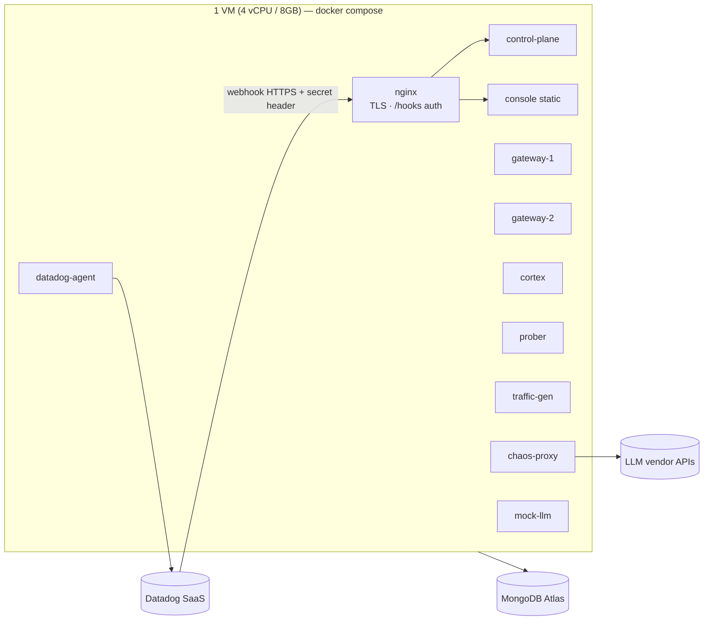

# Triển khai & Môi trường

## 1. Ba môi trường

| Env | Mục đích | MongoDB | Datadog | LLM upstream |
| :--- | :--- | :--- | :--- | :--- |
| `local` | Dev hằng ngày | `mongodb-atlas-local` (Docker) | Agent thật gửi lên trial, `env:local` | `mock-llm` (mặc định) |
| `ci` | Test tự động | `mongodb-atlas-local` (service container) | Tắt (`DD_TRACE_ENABLED=false`, StatsD no-op) | `mock-llm` |
| `demo` | Quay video, chấm điểm, chung kết | **MongoDB Atlas** | Trial, `env:demo` | Vendor thật (rẻ) + `mock-llm`, tất cả đi qua `chaos-proxy` |

> **Vì sao demo dùng cả vendor thật lẫn mock?** Vendor thật cho thấy hệ thống chạy với dữ liệu thật. Mock cho phép fault deterministic với chi phí 0đ khi phải chạy tải cao nhiều giờ. Catalog `targets` có `kind: real|mock`, và dashboard lọc được theo đó. Mọi dữ liệu mock đều có `meta.synthetic=true`.

## 2. Topology `demo`



- **Public endpoint:** dùng một VM có domain và TLS (Caddy hoặc nginx + Let's Encrypt). Phương án dự phòng là **Cloudflare Tunnel** (`cloudflared`) trỏ vào `nginx:443`.
- **Bảo mật webhook:** Datadog webhook gửi custom header `X-Reflex-Webhook-Token: $SECRET`. nginx chỉ cho `/hooks/*` đi qua khi header khớp, và control-plane kiểm tra lại. Thêm allowlist IP của Datadog webhook (lấy từ `https://ip-ranges.datadoghq.com`).
- **Atlas Network Access:** chỉ cho IP của VM. Dev local thêm IP của người dev và gỡ khi xong.

## 3. Datadog Agent (container)

```yaml
# infra/compose/docker-compose.yml (trích)
datadog-agent:
  image: gcr.io/datadoghq/agent:7
  environment:
    DD_API_KEY: ${DD_API_KEY}
    DD_SITE: ${DD_SITE}              # vd: datadoghq.com / us5.datadoghq.com
    DD_ENV: ${REFLEX_ENV}
    DD_APM_ENABLED: "true"
    DD_APM_NON_LOCAL_TRAFFIC: "true"
    DD_DOGSTATSD_NON_LOCAL_TRAFFIC: "true"
    DD_LOGS_ENABLED: "true"
    DD_LOGS_CONFIG_CONTAINER_COLLECT_ALL: "true"
    DD_CONTAINER_EXCLUDE_LOGS: "name:datadog-agent"
  volumes:
    - /var/run/docker.sock:/var/run/docker.sock:ro
    - /proc/:/host/proc/:ro
    - /sys/fs/cgroup/:/host/sys/fs/cgroup:ro
```

Mỗi service có label Docker `com.datadoghq.tags.service`, `…env`, `…version` (unified service tagging) và `com.datadoghq.ad.logs='[{"source":"python","service":"<svc>"}]'`.

## 4. Cấu hình & Secrets

| Biến | Dùng bởi | Ghi chú |
| :--- | :--- | :--- |
| `MONGODB_URI` | tất cả backend | Không commit; `.env` nằm trong gitignore |
| `DD_API_KEY`, `DD_APP_KEY`, `DD_SITE` | agent, cortex (Datadog API read), terraform | App key của Cortex chỉ cấp scope đọc (logs_read_data, apm_read, metrics_read, monitors_read) và events write |
| `VENDOR_A_API_KEY`, `VENDOR_B_API_KEY` | chaos-proxy (đặt upstream key ở proxy, gateway không giữ key) | Đặt spending cap trên console của vendor |
| `ANTHROPIC_API_KEY` (hoặc key của vendor dùng cho Cortex) | cortex gọi *qua gateway* | Gateway chuyển key qua header theo target |
| `REFLEX_WEBHOOK_TOKEN` | nginx, control-plane | Xoay vòng sau khi chung kết |
| `REFLEX_PROFILE` | control-plane | `demo` hoặc `standard` (SLO time scale) |

- Pre-commit chạy `gitleaks`, CI cũng chạy `gitleaks`. Với video demo, Console có **chế độ quay phim** che mọi chuỗi giống key.
- File `.env.example` liệt kê đủ biến, giá trị để trống.

## 5. Khởi động một lệnh

```bash
task up            # compose up: atlas-local, mock-llm, chaos-proxy, gateways, control-plane, cortex, prober, console, agent
task seed          # migrate Mongo + import bench_ts (N ngày) + seed catalog/slos/policies + incident history
task infra:datadog:apply   # terraform apply dashboards/monitors/slos/webhook
task scenario -- silent-brownout
```
