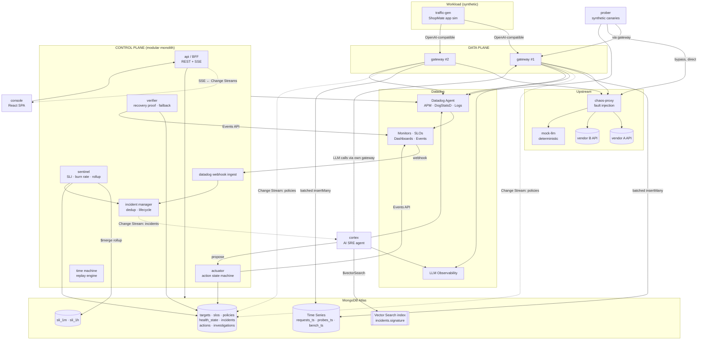
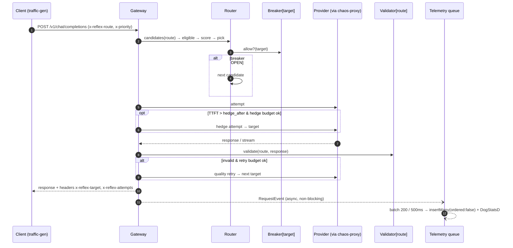
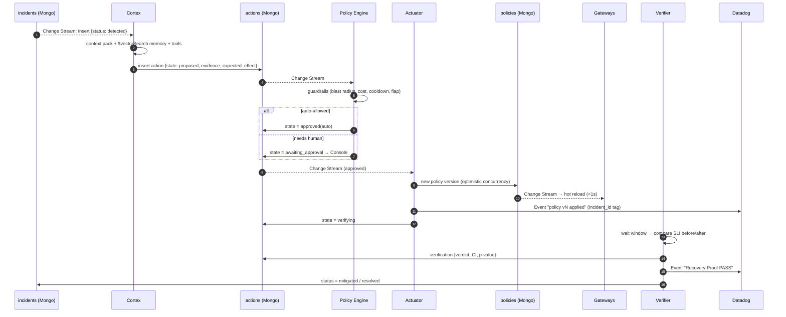

# Kiến trúc hệ thống

> Mục **#3** của hồ sơ nộp bài. Quyết định kiến trúc quan trọng nằm trong [`adr/`](adr/).

## 1. Toàn cảnh

## 2. Thành phần

| Service | Vai trò | Trạng thái | Scale | Phụ thuộc cứng |
| :--- | :--- | :--- | :--- | :--- |
| **gateway** | Data plane: nhận request OpenAI-compatible, chạy Reflex loop (router, breaker, retry, hedge, validator), phát telemetry | Stateless; state cục bộ = breaker + policy cache | Ngang (≥2 instance trong demo để thấy breaker là local còn policy là global) | Không có. Mongo hoặc Datadog sập thì gateway vẫn phục vụ bằng policy cache gần nhất |
| **control-plane** | Sentinel, incident manager, actuator, verifier, webhook ingest, BFF API, Time Machine | Stateless; mọi state nằm trong Mongo; leader election cho job định kỳ | 1–2 instance | MongoDB |
| **cortex** | AI SRE agent: điều tra, đề xuất action, viết postmortem | Stateless; resume token lưu trong Mongo | 1 | MongoDB, LLM qua gateway, Datadog API |
| **prober** | Canary tổng hợp: mỗi target 15s, đi 2 đường (qua gateway và gọi thẳng) | Stateless | 1 | — |
| **traffic-gen** | Mô phỏng workload ShopMate | Stateless | 1 | gateway |
| **chaos-proxy** | Reverse proxy chèn fault theo scenario | State = scenario đang chạy (trong Mongo `chaos_runs`) | 1 | — |
| **mock-llm** | LLM giả deterministic, sinh output theo route (JSON hợp lệ, text tiếng Việt), stream SSE | Stateless | 1 | — |
| **console** | SPA cho SRE: overview, incident war room, approvals, Time Machine, scenario control | — | Static | control-plane API |

> **Modular monolith cho control-plane:** các module tách biệt về code (package riêng, interface rõ) nhưng triển khai chung một process để giảm chi phí vận hành. Khi cần thì tách ra được mà không đổi contract. Xem [ADR-0003](adr/0003-modular-control-plane.md).

## 3. Luồng chính

### 3.1. Request path (Reflex Loop)

**Ràng buộc:** gateway không bao giờ chờ Mongo hay Datadog. Telemetry đi qua bounded queue. Khi queue đầy thì drop và tăng counter `reflex.telemetry.dropped`, có monitor riêng (M11).

### 3.2. Detection path (Cortex Loop, nửa trước)

1. **Sentinel** chạy mỗi 10s (leader-only):
   - Rollup `requests_ts` → `sli_1m` bằng `$merge` cho các phút chưa đóng ([A2](../30-data/aggregation-catalog.md#a2)).
   - Tính multi-window burn rate cho mọi SLO trong một pipeline ([A4](../30-data/aggregation-catalog.md#a4)).
   - Upsert `health_state` và push gauge lên Datadog (`reflex.slo.burn_rate`, `reflex.slo.budget_remaining`).
   - Nếu điều kiện multi-window thỏa → `incidents.open(dedup_key)`.
2. **Datadog Monitor** chạy độc lập trên metric từ DogStatsD. Khi alert thì webhook → `POST /hooks/datadog` → `incidents.open(dedup_key)`.
3. Hai nguồn **hội tụ về một incident** nhờ `dedup_key = sha1(slo_id|target|route)` cùng partial unique index. Nguồn đến sau được ghi vào `incident.signals[]`.

> **Vì sao có hai detector?** Datadog là detector *chính thức*, cần cho thể lệ và có anomaly/composite. Sentinel là detector *độc lập*, nằm cạnh dữ liệu: vẫn chạy khi Datadog trễ, và là nguồn sự thật cho Delivered SLO. Hai detector đối chiếu lẫn nhau. Khi lệch nhau quá ngưỡng thì có monitor riêng ("detector disagreement").

### 3.3. Response path (Cortex Loop, nửa sau)

## 4. Chiến lược fail-safe

| Thành phần hỏng | Hệ quả | Cơ chế bảo vệ |
| :--- | :--- | :--- |
| MongoDB | Gateway không ghi được telemetry; không đọc được policy mới | Policy cache trong RAM + snapshot ra file; telemetry ring buffer có drop counter. **Request path vẫn sống** |
| Datadog | Mất alert từ Datadog | Sentinel vẫn mở incident; metric buffer trong DogStatsD (UDP, fire-and-forget) |
| Cortex / LLM của Cortex | Không có điều tra tự động | Incident manager fallback sang **rule-based classifier** (decision tree), đề xuất action mặc định theo loại incident |
| Control-plane | Không có action mới | Gateway giữ policy cuối; breaker cục bộ vẫn hoạt động |
| Một gateway | Mất một instance | Traffic-gen dùng client-side LB qua 2 gateway (hoặc nginx đặt phía trước) |

## 5. Contract giữa các thành phần

| Contract | Định dạng | Nơi định nghĩa |
| :--- | :--- | :--- |
| Client ↔ Gateway | OpenAI Chat Completions + header `x-reflex-*` | [api-contracts](../60-interface/api-contracts.md) |
| Gateway → Mongo | `RequestEvent` (Pydantic, version `v`) | `packages/reflex-core/events.py` |
| Policy | `Policy` schema v2 (JSON Schema validator trong Mongo) | `packages/reflex-core/policy.py` + `infra/mongo/validators/` |
| Action catalog | `ActionSpec` (name, params schema, blast radius, reversible) | `packages/reflex-core/actions.py` |
| Datadog webhook | JSON payload template | `infra/datadog/webhooks.tf` |
| Tags | Danh mục tag chuẩn | [datadog-architecture §2](../40-observability/datadog-architecture.md#tags) |
