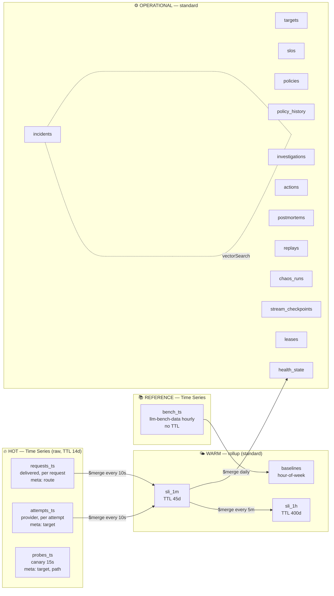

# MongoDB Data Model

> Mục **#4** của hồ sơ. Nguyên tắc: **access pattern trước, schema sau**. Mỗi collection có bảng "query nào cần nó". Collection nào không có query sử dụng thì không được tạo.

## 1. Bản đồ dữ liệu theo nhiệt độ



**Vì sao ba collection Time Series thay vì một?** Workshop nhấn mạnh: *granularity theo tần suất của một nguồn*, *metaField chỉ chứa nhãn ít thay đổi dùng để lọc*. Ba nguồn này khác nhau cả về tần suất lẫn nhãn lọc:

| Collection | Một "series" là | Tần suất mỗi series | Granularity | metaField |
| :--- | :--- | :--- | :--- | :--- |
| `requests_ts` | một route trong một env | vài event/giây | `seconds` | `{route, env, synthetic}` |
| `attempts_ts` | một target trong một env | vài event/giây | `seconds` | `{target, env, synthetic}` |
| `probes_ts` | một target trên một đường probe | 1 / 15s | `seconds` | `{target, path, env}` |
| `bench_ts` | một model của dataset | 1 / giờ | `hours` | `{model, vendor, source}` |

`requests_ts` và `attempts_ts` tách nhau vì **Delivered SLO** (người dùng nhận gì, lọc theo route) và **Provider SLO** (vendor trả gì, lọc theo target) là hai access pattern khác nhau. Nếu gộp chung thì phải `$unwind` attempts trên Time Series cho mọi truy vấn provider, và mất khả năng bỏ qua bucket theo `meta.target`.

---

## 2. Time Series Collections

### 2.1. `requests_ts` — một document cho mỗi request client

```js
db.createCollection("requests_ts", {
  timeseries: { timeField: "ts", metaField: "meta", granularity: "seconds" },
  expireAfterSeconds: 1209600            // 14 ngày (hot)
})

{
  ts: ISODate("2026-10-20T10:15:02.317Z"),      // thời điểm nhận request
  meta: { route: "order.extract", env: "demo", synthetic: true },
  v: 1,                                          // schema version
  request_id: "req_01JB…",                       // KHÔNG đặt trong meta (cardinality cao, xem workshop trang 11)
  trace_id: "6721a…",                            // nối sang Datadog APM
  session: "s_9f2…",                             // hash, dùng cho blast radius
  priority: 0,
  outcome: "ok",          // ok | error | timeout | quality_fail | shed | deadline
  final_target: "vendorB:large",
  primary_target: "vendorA:large",               // target đầu tiên router chọn
  attempts: 2,
  hedged: false,
  retry_reasons: ["quality.schema_invalid"],
  latency_ms: 1840, ttft_ms: 420,
  tokens_in: 312, tokens_out: 188,
  cost_usd: 0.00231,
  quality: { pass: true, checks: ["json_schema", "not_empty"] },
  policy_version: 17,
  incident_id: ObjectId("…") // null nếu ngoài incident; gateway gắn vào từ health_state
}
```

### 2.2. `attempts_ts` — một document cho mỗi lần gọi upstream

```js
{
  ts: ISODate("2026-10-20T10:15:02.320Z"),
  meta: { target: "vendorA:large", env: "demo", synthetic: false },
  v: 1,
  request_id: "req_01JB…", trace_id: "6721a…", span_id: "88f…",
  route: "order.extract",
  attempt_no: 1,
  kind: "primary",                // primary | retry | quality_retry | hedge | probe
  outcome: "quality_fail",        // ok | error | timeout | rate_limited | quality_fail | cancelled
  http_status: 200, error_class: null,
  finish_reason: "length",
  latency_ms: 910, ttft_ms: 600, tps: 71.2,
  tokens_in: 312, tokens_out: 64,
  quality: { pass: false, failed: ["json_schema"], truncated: true },
  cost_usd: 0.00094,
  gateway_id: "gw-1", breaker_state: "closed"
}
```

> Hedge attempt thua cuộc có `outcome: "cancelled"` và bị **loại** khỏi SLI. Nó vẫn được tính vào chi phí, để thấy rõ cái giá của hedging.

### 2.3. `probes_ts` — canary

```js
{ ts, meta: { target: "vendorA:large", path: "direct", env: "demo" },   // path: direct | via_gateway
  golden_id: "order.extract#3", outcome: "ok", latency_ms, ttft_ms,
  quality: { pass: true }, http_status: 200 }
```

### 2.4. `bench_ts` — dataset public (reference)

```js
db.createCollection("bench_ts", {
  timeseries: { timeField: "ts", metaField: "meta", granularity: "hours" }
})   // không TTL: đây là lịch sử tham chiếu

{ ts, meta: { model: "anthropic/claude-sonnet-4.6", vendor: "anthropic", source: "llm-bench-data" },
  status: "healthy", ttft_ms: 312, latency_ms: 2100, tps: 68.4, token_count: 20 }
```

### 2.5. Index bổ sung trên Time Series

| Collection | Index | Phục vụ |
| :--- | :--- | :--- |
| `requests_ts` | (tự động trên meta + ts khi tạo bằng 6.3+) | Rollup, impact |
| `requests_ts` | `{ "meta.route": 1, incident_id: 1, ts: 1 }` (sparse) | Blast radius theo incident ([A13](aggregation-catalog.md#a13)) |
| `attempts_ts` | `{ "meta.target": 1, ts: 1 }` | Rollup provider, Time Machine |
| `attempts_ts` | `{ request_id: 1 }` | Console: request drill-down (tần suất thấp) |

> Mọi pipeline trên Time Series đều bắt đầu bằng `$match` có `meta.*` và `ts` giới hạn hai đầu. Test `test_explain.py` kiểm tra `explain()` để bảo đảm bucket bị bỏ qua đúng như mong đợi.

---

## 3. Warm tier — rollup

### 3.1. `sli_1m` — một document cho mỗi (scope, key, env, phút)

```js
{
  _id: ObjectId(),
  scope: "target",                 // target | route | target_route | probe  (target_route: review F1)
  key: "vendorA:large",            // target id, route name, hoặc "vendorA:large|direct"
  env: "demo",
  ts: ISODate("2026-10-20T10:15:00Z"),   // đầu phút
  total: 482, ok: 470,
  err: { error: 4, timeout: 2, rate_limited: 6 },
  q_eligible: 168, q_good: 109,           // quality SLI
  lat_hist: [0, 3, 41, 88, …],            // 20 bucket, cộng dồn được (§3.3)
  ttft_hist: [ … ],
  p50: 820, p95: 1710, p99: 2950,         // chính xác trong phút (để hiển thị)
  ttft_p95: 610,
  retries: 51, hedges: 3, sheds: 0,
  tokens_in: 150123, tokens_out: 60012, cost_usd: 1.82,
  watermark: ISODate("…")                 // lần rollup cuối, phục vụ debug late data
}
// Unique index (bắt buộc để $merge on nhiều field):
db.sli_1m.createIndex({ scope: 1, key: 1, env: 1, ts: 1 }, { unique: true })
db.sli_1m.createIndex({ ts: 1 }, { expireAfterSeconds: 3888000 })      // 45 ngày
```

### 3.2. `sli_1h` — cùng shape với `sli_1m`, `ts` là đầu giờ, TTL 400 ngày

Được tạo từ `sli_1m` bằng phép cộng (kể cả histogram). Riêng `p50/p95/p99` trong `sli_1h` được **ước lượng từ histogram**, vì percentile không cộng dồn được.

### 3.3. Histogram cộng dồn được (mergeable histogram)

- 20 bucket log-scale, biên trên (ms): `[50, 100, 150, 200, 300, 400, 500, 750, 1000, 1500, 2000, 3000, 4000, 6000, 8000, 12000, 16000, 24000, 32000, ∞]`.
- **Ngưỡng latency của SLO phải trùng một biên bucket.** Migration kiểm tra điều này. Nhờ vậy `good_latency = Σ lat_hist[0..i]` là **chính xác**, không phải xấp xỉ.
- Percentile cho cửa sổ dài được nội suy tuyến tính trong bucket chứa nó. Sai số bị chặn bởi độ rộng bucket và được ghi rõ trên UI.

### 3.4. `baselines` — hour-of-week

```js
{ _id: { model: "anthropic/claude-sonnet-4.6", dow: 3, hour: 14 },
  lat_median: 2010, lat_p90: 3100, ttft_median: 300, err_ratio: 0.004, samples: 8, updated_at }
```

---

## 4. Operational collections

### 4.1. `targets` — catalog

```js
{
  _id: "vendorA:large",
  vendor: "vendorA", kind: "real",              // real | mock
  model_ref: { env_var: "VENDOR_A_LARGE_MODEL" }, // model ID thật nằm trong cấu hình, không hard-code
  adapter: "openai_compat",                     // openai_compat | anthropic | mock
  base_url_ref: "CHAOS_PROXY_URL/vendorA",
  price: { in_per_mtok: 3.0, out_per_mtok: 15.0, currency: "USD" },
  capabilities: { json_mode: true, tools: true, streaming: true, max_context: 200000 },
  tier: "large", capacity_hint_rps: 30,
  enabled: true, updated_at
}
```

### 4.2. `slos`

```js
{
  _id: "route:order.extract:quality",
  scope: "route", key: "order.extract",
  sli: "quality",                 // availability | latency | ttft | quality
  threshold_ms: null,             // latency/ttft: phải là biên bucket
  objective: 0.995,
  window: { standard: "30d", demo: "6h" },
  alerts: [
    { tier: "page",   long: "1h", short: "5m",  factor: 14.4, severity: "critical", hint: "auto_mitigate" },
    { tier: "ticket", long: "6h", short: "30m", factor: 6,    severity: "high",     hint: "investigate" },
    { tier: "notice", long: "3d", short: "6h",  factor: 1,    severity: "warning",  hint: "watch" }
  ],
  demo_alerts: [ { tier: "page", long: "5m", short: "1m", factor: 14.4 }, … ],
  datadog: { slo_id: "abc123", monitor_ids: ["…"] },   // được Terraform output điền vào
  owner: "team-shopmate"
}
```

### 4.3. `policies` (watched) và `policy_history`

```js
{
  _id: "order.extract",            // một policy cho mỗi route
  version: 17,                     // optimistic concurrency: update filter {_id, version: 16}
  candidates: [
    { target: "vendorA:large", weight: 0.10, role: "primary" },
    { target: "vendorB:large", weight: 0.90, role: "secondary" },
    { target: "vendorA:small", weight: 0.00, role: "brownout" }
  ],
  scoring: { w_health: 0.35, w_budget: 0.25, w_cost: 0.15, w_quality: 0.20, w_capacity: 0.05, temperature: 0.15 },
  breaker: { window_s: 20, min_requests: 20, open_error_ratio: 0.5, open_base_s: 10, open_max_s: 120, half_open_probes: 3 },
  retry: { max_attempts: 3, budget_ratio: 0.10, on: ["5xx", "timeout", "rate_limited"], respect_retry_after: true },
  rescue: { enabled: true, on: ["quality"], cross_target_only: true, max_extra_cost_ratio: 0.6 },   // review F3
  hedge: { enabled: false, after: "p95_ttft", max_extra_cost_ratio: 0.05 },
  validators: ["not_empty", "json_schema:order_v2", "no_truncation"],
  deadline_ms: 8000,
  shed: { when_all_degraded_min_priority: 1 },
  updated_by: { actor: "actuator", action_id: ObjectId("…"), reason: "shift_weight" },
  updated_at
}
```

`policy_history` lưu snapshot đầy đủ của mỗi version (`{policy_id, version, doc, at}`). Dùng cho rollback, Time Machine (biết lúc T policy là gì), và vẽ "policy timeline" trong Console.

### 4.4. `health_state` (watched) — trạng thái hiện tại, một document cho mỗi key

```js
{
  _id: "target:vendorA:large",
  status: "degraded",                // healthy | degraded | down | unknown
  sli: { availability_5m: 0.998, quality_5m: 0.652, p95_5m: 1710, ttft_p95_5m: 610 },
  burn: { "quality": { "5m": 69.6, "1m": 71.0, "30m": 22.1, "6h": 3.9 } },
  budget_remaining: { quality: 0.41, availability: 0.97 },
  score: 0.22,                       // điểm router (đã chuẩn hóa)
  breakers: { "gw-1": "open", "gw-2": "half_open" },
  open_incident_id: ObjectId("…"),
  updated_at
}
```

### 4.5. `incidents` (watched)

```js
{
  _id: ObjectId(),
  key: "INC-20261020-0007",
  dedup_key: "3f9a…",                 // sha1(slo_id|target|route)
  is_open: true,                      // unset khi resolved → partial unique index
  slo_id: "target:vendorA:large:quality",
  scope: "target", target: "vendorA:large", routes: ["order.extract"],
  sli: "quality", severity: "critical",
  status: "mitigating",   // detected → investigating → mitigating → mitigated → resolved | false_positive
  signals: [              // bounded: tối đa 50
    { source: "sentinel", at: …, burn: { "5m": 69.6, "1m": 71 } },
    { source: "datadog", at: …, monitor_id: 1234, alert_id: "…", diagnosis: "provider_side" }
  ],
  t: { first_bad_at, detected_at, acknowledged_at, mitigated_at, resolved_at },
  impact: { requests: 1830, sessions: 612, delivered_bad: 41, budget_consumed: 0.041, extra_cost_usd: 3.12 },
  diagnosis: { side: "provider", hypothesis: "server-side output truncation", confidence: 0.86, by: "cortex", investigation_id },
  signature: { v: 2, vec: [ /* 64 floats */ ], window: { from, to } },
  links: { dd_monitor: "https://…", dd_logs: "https://…", dd_traces: "https://…" },
  timeline: [ { at, kind: "detected", actor: "datadog", ref }, … ],   // $push + $slice: -200
  postmortem_id: null,
  created_at, updated_at
}
```

**Index:**
```js
db.incidents.createIndex({ dedup_key: 1 }, { unique: true, partialFilterExpression: { is_open: true } })
db.incidents.createIndex({ status: 1, "t.detected_at": -1 })
db.incidents.createIndex({ target: 1, "t.detected_at": -1 })
db.incidents.createIndex({ key: 1 }, { unique: true })
// Atlas Vector Search index (JSON, xem infra/mongo/search/incident_signature.json):
{ "fields": [
  { "type": "vector", "path": "signature.vec", "numDimensions": 64, "similarity": "cosine" },
  { "type": "filter", "path": "sli" },
  { "type": "filter", "path": "scope" },
  { "type": "filter", "path": "status" },
  { "type": "filter", "path": "signature.v" } ] }
```

**Vì sao embed `timeline` và `signals`?** Hai mảng này được đọc cùng incident trong 100% trường hợp, và đều bounded (`$slice`). **Vì sao không embed `actions` và `investigations`?** Chúng có vòng đời và state machine riêng, cần Change Stream riêng, và được query độc lập (ví dụ: tỉ lệ thành công theo loại action).

### 4.6. `investigations` — mỗi lần Cortex chạy một document

```js
{
  _id, incident_id, run_no: 1, status: "completed",      // running | completed | failed | timed_out
  model: "<cortex model id>", via_gateway_route: "cortex.reason",
  context_pack_ref: { sli_snapshot, similar_incidents: [ { id, score } ] },
  steps: [   // bounded ≤ 30
    { n: 1, tool: "mongo.sli_window", args: {…}, ms: 120, result_digest: "…", result_ref: "q_01" },
    { n: 2, tool: "dd.logs.search", args: { query: "@route:order.extract @finish_reason:length" }, ms: 840, … }
  ],
  hypotheses: [
    { id: "H1", statement: "...", confidence: 0.86,
      evidence: [ { type: "metric", ref: "q_01", claim: "quality_5m 0.65 vs baseline 0.996" },
                  { type: "log", ref: "dd_log_query_…", claim: "finish_reason=length ×40" },
                  { type: "memory", ref: "INC-…-0003", claim: "sim 0.91, resolved by shift_weight" } ] }
  ],
  recommendation: { action_type: "shift_weight", params: {…}, expected_effect: { quality_5m: ">=0.99" } },
  usage: { input_tokens, output_tokens, cost_usd, wall_ms },
  dd: { llmobs_trace_id }
}
```

### 4.7. `actions` (watched) — state machine

```js
{
  _id, incident_id, parent_action_id: null,     // failback steps trỏ về action gốc
  type: "shift_weight",
  params: { route: "order.extract", from: "vendorA:large", to: "vendorB:large", pct: 0.9 },
  state: "verifying",   // proposed → approved | awaiting_approval | rejected → executing → verifying → succeeded | failed → rolled_back
  proposed_by: { actor: "cortex", investigation_id },
  decision: { mode: "auto", by: "policy_engine", at,
              guardrails: [ { name: "blast_radius", pass: true, detail: "1 route, 35% traffic" },
                            { name: "cost_ceiling", pass: true, detail: "+$1.9/h ≤ $5/h" },
                            { name: "cooldown", pass: true }, { name: "flap_guard", pass: true } ] },
  execution: { policy_id: "order.extract", version_before: 16, version_after: 17, applied_at },
  verification: {
    window: { baseline: [from, to], after: [from, to] },
    metric: "quality", baseline: { good: 1672, n: 1679 }, after: { good: 1193, n: 1200 },
    method: "wilson+two_proportion", after_ci: [0.991, 0.997], p_value: 0.31,
    verdict: "PASS", decided_at
  },
  ttr_s: 184,   // từ detected đến verification PASS
  created_at, updated_at
}
db.actions.createIndex({ incident_id: 1, created_at: 1 })
db.actions.createIndex({ state: 1, updated_at: 1 })
db.actions.createIndex({ type: 1, "verification.verdict": 1 })
```

### 4.8. Các collection còn lại

| Collection | Nội dung | Index / ghi chú |
| :--- | :--- | :--- |
| `postmortems` | `{incident_id, title, summary, body_md, tags, embedding[1024?]}` | **Atlas Search** index (full-text tiếng Việt và tiếng Anh, analyzer `lucene.standard`) + vector index (tùy chọn) |
| `replays` | Kết quả Time Machine: `{incident_id, policies: [...], results: [{policy, delivered_sli, budget, cost, amplification}], seed}` | `{incident_id: 1}` |
| `chaos_runs` (watched) | Phase đang chạy của scenario | `{active: 1}` |
| `stream_checkpoints` | `{_id: consumer_id, token, at}` | — |
| `leases` | `{_id: "sentinel", holder, expires_at}` | TTL trên `expires_at` (dự phòng) |

---

## 5. Data lifecycle

| Tier | Dữ liệu | Giữ trong | Cơ chế |
| :--- | :--- | :--- | :--- |
| Hot | `requests_ts`, `attempts_ts`, `probes_ts` | 14 ngày | `expireAfterSeconds` (TTL xóa theo bucket, có thể trễ tới một bucket span, xem workshop trang 23) |
| Warm | `sli_1m` | 45 ngày (≥ cửa sổ SLO 30 ngày + đệm) | TTL index trên `ts` |
| Warm | `sli_1h` | 400 ngày | TTL index |
| Reference | `bench_ts`, `baselines` | Không hết hạn | — |
| Operational | incidents, actions, investigations, postmortems, policy_history | Không hết hạn (là ký ức của hệ thống) | — |
| Cold (thiết kế) | raw > 14 ngày | — | Atlas Online Archive (M10+). Khi bật thì TTL phải **dài hơn** tuổi archive, theo cảnh báo của workshop |

## 6. Validation & versioning

- Collection thường có `$jsonSchema` validator (`validationLevel: "moderate"`, `validationAction: "warn"` vì seed lịch sử còn lệch model). Schema được sinh từ Pydantic model trong `reflex-core` rồi chuẩn hoá sang dialect Mongo (`bsonType`, bỏ `default`/`format`, inline `$ref`) bởi `tools/export_schemas.py`.
- Mọi event Time Series có trường `v`. Reader xử lý được mọi version ≤ hiện tại.
- Migration idempotent: `reflex-mongo migrate` tạo collection, index, validator, search index; chạy lại nhiều lần không lỗi.

## 7. Bảng Access Pattern → Collection → Index

| # | Query | Ai gọi | Tần suất | Collection | Index / cơ chế |
| :--- | :--- | :--- | :--- | :--- | :--- |
| Q1 | Rollup phút gần nhất | sentinel | 10s | requests_ts, attempts_ts, probes_ts | meta+ts (bucket skip) |
| Q2 | Burn rate đa cửa sổ mọi SLO | sentinel | 10s | sli_1m | unique `{scope,key,env,ts}` |
| Q3 | Budget còn lại 30 ngày | sentinel, API | 1m | sli_1h ∪ sli_1m | như trên |
| Q4 | Policy hiện tại | gateway | khi khởi động + Change Stream | policies | `_id` |
| Q5 | Mở incident (dedup) | sentinel, webhook | sự kiện | incidents | partial unique `dedup_key` |
| Q6 | Incident đang mở | API, Console | 2s/SSE | incidents | `{status, t.detected_at}` |
| Q7 | Sự cố tương tự | cortex | mỗi incident | incidents | Vector index |
| Q8 | Action theo incident | API | sự kiện | actions | `{incident_id, created_at}` |
| Q9 | Blast radius | verifier, cortex | mỗi incident | requests_ts | `{meta.route, incident_id, ts}` |
| Q10 | Hiệu quả action | cortex, Console | mỗi incident | actions | `{type, verification.verdict}` |
| Q11 | Baseline hour-of-week | sentinel, cortex | 1 ngày (rebuild) / đọc theo key | bench_ts → baselines | `_id` |
| Q12 | Time Machine dataset | time machine | khi được yêu cầu | attempts_ts, policy_history | `{meta.target, ts}` |
