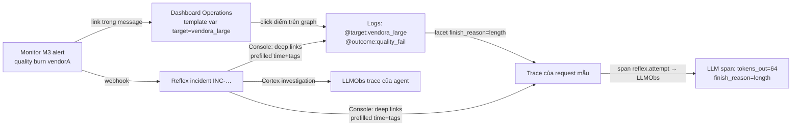

# Kiến trúc Observability trên Datadog

> Mục **#5** của hồ sơ. Datadog ở đây được dùng như **hệ thần kinh cảm giác và trí nhớ ngắn hạn**: phát hiện, cung cấp ngữ cảnh điều tra, và ghi lại hành động. Mỗi tín hiệu tồn tại để trả lời một câu hỏi trong vòng Detect → Investigate → Respond.

## 1. Signal map

| Tín hiệu | Nguồn | Datadog product | Trả lời câu hỏi |
| :--- | :--- | :--- | :--- |
| Request/attempt metrics | gateway (DogStatsD) | Metrics (distribution, count) | *Có gì đang xấu đi không? Ở đâu?* |
| SLO / burn / budget gauges | control-plane (DogStatsD) | Metrics + **SLOs** | *Có đáng đánh thức người không?* |
| Traces | mọi service (ddtrace) | **APM / Distributed Tracing** | *Request này đã đi qua đâu, chậm hay hỏng ở bước nào?* |
| LLM spans | gateway (provider calls), cortex (agent) | **LLM Observability** | *LLM đã nhận gì, trả gì, tốn bao nhiêu? Agent đã suy luận thế nào?* |
| Structured logs | mọi service (JSON stdout → Agent) | **Log Management** | *Chi tiết lỗi là gì? (finish_reason, error_class, retry_reason…)* |
| Events | actuator, verifier, scenario runner, deploy | **Events** | *Ai đã thay đổi gì, lúc nào?* (overlay lên mọi graph) |
| Monitors | Terraform | **Monitors** (metric, SLO burn, anomaly, composite, log, no-data) | *Detect* |
| Deploy version | tag `version` | **Deployment Tracking** | *Có phải do lần deploy vừa rồi không?* |

<a id="tags"></a>
## 2. Tagging chuẩn (nền tảng của correlation)

| Tag | Ví dụ | Có ở |
| :--- | :--- | :--- |
| `env` | `demo` | metric · log · trace · event (unified service tagging) |
| `service` | `reflex-gateway`, `reflex-control-plane`, `reflex-cortex`, `reflex-prober`, `reflex-chaos` | như trên |
| `version` | `1.3.2` | như trên |
| `target` | `vendora_large` *(chuẩn hóa: chữ thường, `:` → `_`)* | metric · log · span |
| `vendor` | `vendora` | metric · log · span |
| `route` | `order.extract` | metric · log · span |
| `outcome` | `ok`, `quality_fail`… | metric · log · span |
| `attempt_kind` | `primary`, `retry`, `hedge`, `quality_retry` | metric · span |
| `incident_id` | `inc-20261020-0007` | log · span · event *(không đặt làm metric tag, vì cardinality tăng theo thời gian)* |
| `policy_version` | `17` | log · span |
| `synthetic` | `true` | metric · log · span |

> **Quy tắc cardinality:** metric tag chỉ dùng tập hữu hạn (target × route × outcome × kind ≈ vài trăm series). `request_id`, `session` và `incident_id` chỉ đặt ở log và span.

## 3. Metrics

| Metric | Type | Tags | Phát từ |
| :--- | :--- | :--- | :--- |
| `reflex.request.latency` | distribution (ms) | route, outcome, final_target | gateway |
| `reflex.request.ttft` | distribution (ms) | route, final_target | gateway |
| `reflex.request.count` | count | route, outcome, priority | gateway |
| `reflex.attempt.latency` | distribution | target, route, outcome, attempt_kind | gateway |
| `reflex.attempt.count` | count | target, route, outcome, attempt_kind | gateway |
| `reflex.quality.check` | count | target, route, check, result | gateway |
| `reflex.tokens` | count | target, route, direction | gateway |
| `reflex.cost.usd` | count *(cộng dồn)* | target, route, attempt_kind | gateway |
| `reflex.breaker.state` | gauge (0/1/2) | target, gateway_id | gateway |
| `reflex.router.weight` | gauge | route, target | gateway (theo policy đang hiệu lực) |
| `reflex.retry.amplification` | gauge | route | gateway: attempts/requests trong 30s gần nhất |
| `reflex.telemetry.dropped` | count | service | gateway |
| `reflex.slo.burn_rate` | gauge | slo, window, scope | control-plane (Sentinel, A4) |
| `reflex.slo.budget_remaining` | gauge | slo | control-plane (A5) |
| `reflex.slo.delivered_vs_provider_gap` | gauge | route | control-plane |
| `reflex.incident.open` | gauge | severity, sli | control-plane |
| `reflex.action.count` | count | type, decision_mode, verdict | control-plane |
| `reflex.cortex.investigation.duration` | distribution | outcome | cortex |
| `reflex.probe.result` | count | target, path, outcome | prober |

## 4. APM — span model

```
reflex-traffic-gen  shopmate.session                         (root, synthetic client)
└─ reflex-gateway   POST /v1/chat/completions                (FastAPI auto)
   ├─ reflex-gateway  reflex.route.decide                    tags: candidates, scores, chosen, policy_version
   ├─ reflex-gateway  reflex.attempt   [kind=primary]        tags: target, breaker_state
   │  └─ httpx        POST chaos-proxy/vendorA/...           (auto) → reflex-chaos → upstream
   │      └─ reflex-chaos  chaos.apply                       tags: fault (chỉ để kiểm chứng sau)
   ├─ reflex-gateway  reflex.validate                        tags: checks, failed
   ├─ reflex-gateway  reflex.attempt   [kind=quality_retry]  tags: target=vendorB:large, retry_reason
   │  └─ httpx …
   └─ (LLMObs) llm span per attempt                          model, tokens, cost, finish_reason
```

- Trace context đi theo header W3C `traceparent` và Datadog headers qua chaos-proxy, nên trace liền mạch tới upstream mock.
- **Hedge** tạo hai span `reflex.attempt` song song. Span thua có tag `cancelled=true`.
- Control-plane: `sentinel.tick`, `pipeline.A4` (span có `resource=A4`, tag `docs_examined`, `ms`), `actuator.execute`, `verifier.prove`. Pymongo được ddtrace auto-instrument.
- Cortex: workflow span cho mỗi investigation, mỗi tool call là một span con.

**Sampling:** demo dùng 100% (`DD_TRACE_SAMPLE_RATE=1`). Thiết kế production: giữ 100% error và quality_fail bằng sampling rule theo tag, 10% request ok. SLO không bao giờ tính từ trace, vì trace bị sample. SLO tính từ metric và từ Mongo.

## 5. LLM Observability

| Ứng dụng LLMObs | Span | Dữ liệu ghi |
| :--- | :--- | :--- |
| `reflex-gateway` (ml_app) | `llm` span cho mỗi attempt | model, provider, input/output **metadata**, tokens, cost; output text chỉ ghi với route synthetic. Evaluation: kết quả của quality validator được submit qua `LLMObs.submit_evaluation` (label `quality_pass`, `schema_valid`) |
| `reflex-cortex` (ml_app) | `agent` → `workflow` / `tool` / `llm` spans | Toàn bộ chuỗi suy luận: tool nào, args nào, kết quả tóm tắt, tokens, cost. Evaluation: `root_cause_correct` (offline, so với ground truth của scenario) |

Vì vậy LLMObs đóng hai vai: (a) **AI Observability** cho chính các LLM call được bảo vệ, và (b) **Agent Observability** cho Cortex. Cả hai đều nằm trong phần "khuyến khích" của thể lệ.

## 6. Logs

- Định dạng: JSON một dòng (structlog). Field chuẩn: `timestamp, level, service, env, version, dd.trace_id, dd.span_id, event, target, route, outcome, error_class, finish_reason, retry_reason, latency_ms, request_id, incident_id, policy_version`.
- `DD_LOGS_INJECTION=true` để ddtrace tự chèn trace id. Datadog liên kết log và trace ở cả hai chiều.
- **Không log prompt hoặc response.** Chỉ log metadata. Nội dung (synthetic) chỉ có trong LLMObs.
- Log pipeline (Terraform): JSON parser, status remapper (`level`), date remapper, category processor `incident_phase` (dựa trên `event`).
- Facets: `@target`, `@route`, `@outcome`, `@finish_reason`, `@error_class`, `@retry_reason`, `@incident_id`, `@policy_version`.
- **Log-based metric:** `reflex.log.finish_reason` (count by `@finish_reason`, `@target`). Đây là tín hiệu đối chiếu thứ hai cho truncation.
- Saved views: "Quality failures", "Breaker transitions", "Policy changes", "Cortex tool calls", "Incident {{incident_id}}".

## 7. Events — vết hành động

| Event | Nguồn | Tags | Text |
| :--- | :--- | :--- | :--- |
| `reflex.policy.applied` | actuator | route, incident_id, action_type | diff của policy (from → to) |
| `reflex.recovery.proof` | verifier | incident_id, verdict | baseline vs after, CI, p-value |
| `reflex.incident.state` | incident manager | incident_id, status | chuyển trạng thái |
| `reflex.scenario.phase` | scenario runner | scenario, phase | fault đang bật (đánh dấu rõ "chaos") |
| `deploy` | CI / `task deploy` | service, version | — |

Mọi dashboard có event overlay `tags:incident_id:*` hoặc `source:reflex`. Nhờ vậy giám khảo thấy ngay *đường cong hồi phục bắt đầu đúng lúc policy v17 được áp dụng*.

## 8. Correlation — đường đi một click



Deep link do control-plane sinh ra, ví dụ:
`https://app.{DD_SITE}/logs?query=service:reflex-gateway @target:vendora_large @outcome:quality_fail&from_ts=…&to_ts=…`
`https://app.{DD_SITE}/apm/traces?query=service:reflex-gateway @incident_id:inc-…&start=…&end=…`

## 9. Những gì cố ý không làm

| Không làm | Lý do |
| :--- | :--- |
| Tính SLO từ APM trace metrics | Trace bị sample; SLO tính từ count metric và Mongo |
| Metric tag theo `request_id` hoặc `incident_id` | Bùng nổ cardinality, tốn custom metric quota |
| Alert trên số lỗi tuyệt đối | Phụ thuộc traffic; dùng burn rate có min samples |
| RUM | Không có frontend người dùng thật; Console là công cụ nội bộ |
| Log full prompt/response | Rủi ro PII ở production thật; ở đây chỉ để metadata |
