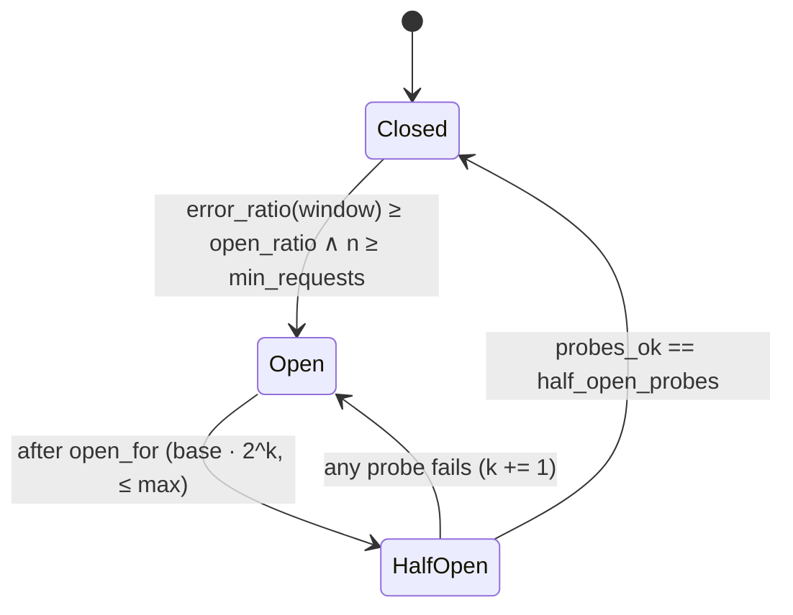

# Recovery Engine — Reflex (data plane) & Actuator/Verifier (control plane)

## 1. Router: Budget-Aware Adaptive Routing

### 1.1. Hai bước: lọc rồi chấm điểm

**Bước 1 — Eligibility (hard filter):**
- Target `enabled`, có capability mà request cần (`json_mode`, `tools`, `max_context ≥ prompt_tokens + max_tokens`).
- Breaker cục bộ không `open` (riêng `half_open` chỉ nhận số probe cho phép).
- `role` phù hợp: target `brownout` chỉ được chọn khi policy đang ở chế độ brownout hoặc khi mọi target khác không eligible.

**Bước 2 — Score:**

```
score(t) = w_health·H(t) + w_budget·B(t) + w_quality·Q(t) + w_cost·(1 − C(t)) + w_capacity·K(t)  + log(weight_policy(t))
```

| Thành phần | Định nghĩa | Nguồn | Cập nhật |
| :--- | :--- | :--- | :--- |
| `H(t)` health | EWMA của availability trên attempt của chính gateway (cục bộ, nhạy) × `health_state.score` (toàn cục) | local + Mongo | mỗi attempt / 10s |
| `B(t)` budget headroom | `budget_remaining` của Provider SLO của t (đi qua hàm sigmoid) | health_state | 10s |
| `Q(t)` quality | EWMA quality pass rate theo route | local | mỗi attempt |
| `C(t)` cost | giá ước tính của request trên t, chuẩn hóa về [0,1] trong tập candidates | targets | khi policy reload |
| `K(t)` capacity | `1 − inflight(t)/capacity_hint(t)` | local | realtime |
| `weight_policy(t)` | trọng số do actuator đặt | policies | Change Stream |

Chọn target bằng **softmax(score / temperature)** thay vì argmax: luôn giữ một lượng nhỏ traffic khám phá các target khác, để health của chúng không bị cũ. Có một đường giới hạn `explore_min_pct`.

> **Vì sao có `log(weight_policy)`?** Actuator không thay router. Nó *dịch phân phối*. Đặt `weight = 0.9` làm softmax lệch mạnh nhưng vẫn tôn trọng health tức thời. Ví dụ: nếu vendorB cũng đột ngột hỏng thì H(vendorB) giảm và traffic tự quay đi mà không cần chờ actuator.

### 1.2. Circuit breaker cục bộ (mỗi gateway × target)



- **Lỗi được tính:** 5xx, timeout, connection error, 429 (có trọng số 0.5), quality_fail (trọng số theo cấu hình, mặc định 0.5). Lỗi 4xx của client không được tính.
- Mỗi lần chuyển trạng thái phát metric `reflex.breaker.state`, một log `breaker.transition`, và một attempt event (field `breaker_state`).
- **Breaker cục bộ, policy toàn cục:** mỗi gateway tự bảo vệ trong vài giây. Actuator thay đổi phân phối cho toàn hệ thống. Không cần đồng thuận phân tán.

### 1.3. Retry có kỷ luật

| Quy tắc | Giá trị mặc định |
| :--- | :--- |
| Retry khi | 5xx, timeout, connect error, 429 (nếu `Retry-After` ≤ deadline còn lại), quality_fail (chỉ route không stream) |
| Không retry | 400/401/403/404/422, context length exceeded |
| Sang target nào | **Target khác** (điểm cao kế tiếp). Chỉ retry cùng target khi chỉ còn một target eligible và lỗi là transient |
| Backoff | full jitter `rand(0, min(cap, base·2^n))`, base 100ms, cap 2s |
| Retry budget | token bucket: retry ≤ `budget_ratio` (10%) của request trong 10s gần nhất cho mỗi route. Hết budget thì fail fast |
| Deadline | `deadline_ms` của route được truyền xuống mọi attempt; attempt mới chỉ được bắn nếu `remaining > p50(target)` |

### 1.4. Hedged requests (tail latency)

- Bật theo policy (`hedge.enabled`). Kích hoạt khi chưa nhận được token đầu sau `hedge_after` (mặc định là p95 TTFT cục bộ của target).
- Bắn attempt thứ hai sang target khác. Bên nào trả **token đầu tiên** trước thì thắng, bên kia bị hủy (`cancel` httpx stream). Với request non-stream thì bên nào xong trước thắng.
- **Cost guard:** số hedge ≤ `max_extra_cost_ratio` × chi phí của route trong cửa sổ trượt 5 phút.

### 1.5. Load shedding & brownout

- `x-priority` 0 (P0) → 2 (P2). Khi mọi candidate của một route có score < ngưỡng *hoặc* concurrency vượt limit, route P2 bị trả `503 shed` kèm `Retry-After`.
- **Brownout:** policy chuyển route sang target tier nhỏ hơn (`role: brownout`). Ví dụ `order.extract` → `vendorA:small` (rẻ hơn, schema-valid 97%). Đánh đổi chất lượng lấy tính sẵn sàng, có ghi lại.

### 1.6. Policy hot-reload

Gateway mở Change Stream `policies.watch([{$match: {operationType: {$in: ["insert", "update", "replace"]}}}], {fullDocument: "updateLookup"})`. Khi có version mới thì validate rồi swap atomically (`self._policy = new`). Resume token được lưu định kỳ. Khi khởi động, gateway đọc toàn bộ policy. Nếu Mongo không truy cập được thì dùng snapshot file gần nhất.

---

## 2. Action catalog (giới hạn, có kiểu)

| Action | Params | Blast radius | Reversible | Auto được khi |
| :--- | :--- | :---: | :---: | :--- |
| `shift_weight` | route, from, to, pct | route | ✅ | P1/P2, target `to` healthy (probe direct OK), cost delta ≤ ceiling |
| `open_circuit_global` | target, duration | mọi route dùng target | ✅ | provider_side confirmed (M9) |
| `enable_hedging` | route, after, max_cost | route | ✅ | TTFT anomaly, budget > 10% |
| `set_concurrency` | route/target, limit | route | ✅ | retry amplification > 1.5 |
| `shed_priority` | min_priority | P2 routes | ✅ | budget P0 < 25% |
| `downgrade_tier` | route, to_target | route | ✅ | không còn target cùng tier healthy |
| `failback_step` | route, to, pct ∈ {10, 50, 100} | route | ✅ | target gốc ổn định ≥ N phút (probe + canary) |
| `rollback_flag` | flag, service | service | ✅ | **luôn cần người duyệt** |
| `page_human` | reason | — | — | luôn được phép |

<a id="guardrails"></a>
## 3. Policy engine — guardrails

Action chỉ được thực thi khi qua mọi guardrail. Kết quả của từng guardrail được ghi vào `actions.decision.guardrails`.

| Guardrail | Luật |
| :--- | :--- |
| `schema` | params khớp JSON Schema của action type |
| `single_flight` | mỗi route/target chỉ có ≤ 1 action đang `executing`/`verifying` |
| `cooldown` | cùng action type trên cùng scope cách nhau ≥ 2 phút (demo: 30s) |
| `flap_guard` | nếu weight của một route đổi chiều > 3 lần trong 15 phút → chặn và `page_human` |
| `healthy_destination` | target đích có health score ≥ ngưỡng và probe direct OK trong 60s gần nhất |
| `capacity` | traffic dự kiến chuyển sang ≤ `capacity_hint` của đích × 0.8 (chặn cascading failover, S5) |
| `cost_ceiling` | Δcost/h dự kiến ≤ trần của route |
| `blast_radius` | auto chỉ khi radius ≤ mức cho phép của severity và budget tier |
| `confidence` | action từ Cortex cần `confidence ≥ 0.7` để auto, nếu không thì `awaiting_approval` |
| `human_only` | `rollback_flag` và mọi action trong protect mode không khẩn cấp |

## 4. Actuator

- Chuyển `approved → executing`: tính policy mới từ policy hiện tại + params, rồi `findOneAndUpdate({_id, version: v}, {$set: …, $inc: {version: 1}})`. Nếu xung đột thì đọc lại và tính lại (tối đa 3 lần).
- Ghi `policy_history`, gửi Datadog Event `reflex.policy.applied`, rồi chuyển action sang `verifying`.
- **Transactional outbox:** việc cập nhật policy và ghi `outbox` (event cần gửi lên Datadog) nằm trong **một transaction** (collection thường, trên replica set). Một worker đẩy outbox lên Datadog, có retry. Nhờ vậy không có policy nào được áp dụng mà thiếu event trên dashboard.

<a id="verify"></a>
## 5. Verifier — Recovery Proof

**Câu hỏi:** "SLI sau action có quay về mức bình thường chưa, và chắc đến đâu?"

1. **Cửa sổ:** `baseline` = 15 phút *trước* `first_bad_at`. `after` = `[applied_at + settle, applied_at + settle + observe]` (demo: settle 30s, observe 3 phút).
2. **Dữ liệu:** A16 trên **delivered SLI** của route bị ảnh hưởng. Với provider-side action, lấy thêm cả provider SLI của đích.
3. **Kiểm định:**
   - Tỉ lệ (availability, quality): Wilson 95% CI cho `p_after`. **PASS** nếu `CI_low ≥ objective` **hoặc** (two-proportion z-test không bác bỏ `p_after ≥ p_baseline − δ`, với δ = 0.2 × budget). **FAIL** nếu `CI_high < objective`. Các trường hợp còn lại là **INCONCLUSIVE**: kéo dài cửa sổ observe tối đa 2 lần.
   - Latency: so sánh tỉ lệ dưới ngưỡng bằng cách trên, kèm p95 ước lượng từ histogram để hiển thị.
   - Cỡ mẫu tối thiểu: `n_after ≥ 200`, nếu không đủ thì INCONCLUSIVE.
4. **Ghi:** `actions.verification`, Datadog Event `reflex.recovery.proof`, incident chuyển sang `mitigated` khi PASS.
5. **FAIL:** tự động rollback action (policy về `version_before`), rồi yêu cầu Cortex chạy lại investigation với `run_no + 1` kèm kết quả thất bại làm context.

## 6. Failback có kiểm soát

Sau khi `mitigated`:

1. Chờ target gốc **ổn định**: probe direct pass ≥ 10 phút liên tục (demo: 3 phút), và Provider SLI của nó trên traffic khám phá (explore) ≥ objective.
2. `failback_step(10%)` → verify → `50%` → verify → `100%` → verify. Mỗi bước là một action con (`parent_action_id`).
3. Bất kỳ bước nào FAIL thì quay về bước trước và đặt cooldown dài.
4. Sau bước 100% PASS và ổn định thêm M phút, incident chuyển sang `resolved`. Cortex soạn postmortem, A9 tính lại signature với cửa sổ đầy đủ.
