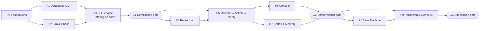

# Kế hoạch hiện thực

> Kế hoạch sắp theo **phụ thuộc kỹ thuật**, không theo lịch. Theo yêu cầu, tài liệu chưa chia task cho từng thành viên.
>
> ⚠ **Ràng buộc thể lệ:** *"Phần giải pháp cốt lõi phải được xây dựng trong giai đoạn build (17/10 – 31/10/2026)"*. Tài liệu thiết kế viết trước là hợp lệ. **Code của sản phẩm chỉ bắt đầu commit từ 17/10.** Spike (thử API) trước ngày đó phải để ngoài repo và bỏ đi sau khi xong.

## 0. Bản đồ phụ thuộc

- **G1 Compliance gate:** mọi yêu cầu *bắt buộc* của thể lệ đã có và chạy được end-to-end, dù còn thô. Sau mốc này, bài thi hợp lệ để chấm.
- **G2 Differentiation gate:** Quality SLI, Dual ledger, Recovery Proof, Cortex + Memory chạy ổn định trên scenario chính.
- **G3 Submission gate:** đủ 12 mục hồ sơ.

Nguyên tắc **"luôn có thứ để nộp"**: mỗi gate đều tạo ra một bản nộp được. Rủi ro ở các phase sau không bao giờ làm mất bài.

---

## P0 — Foundations

**Mục tiêu:** khung repo, môi trường, CI và quyết định nền tảng đã kiểm chứng.

| # | Hạng mục | Kết quả |
| :--- | :--- | :--- |
| 0.1 | Monorepo uv + pnpm + Taskfile theo [repository-structure](repository-structure.md) | `task up` chạy được khung trống |
| 0.2 | Compose: atlas-local, datadog-agent, mock-llm stub | `docker compose up` xanh |
| 0.3 | `reflex-telemetry.setup()`: ddtrace + structlog JSON + DogStatsD + LLMObs | Service "hello" xuất hiện trong APM và Logs, có tag đúng |
| 0.4 | `reflex-mongo migrate`: tạo mọi collection, TS, index, TTL, validator | Chạy lại nhiều lần không lỗi; có integration test |
| 0.5 | CI: ruff, mypy, pytest, gitleaks, import-linter | PR xanh |
| 0.6 | **Spike kiểm chứng** (kết quả ghi vào ADR): Atlas tier (Change Streams, giới hạn số search index), `$vectorSearch` trên atlas-local, `$rankFusion`, Datadog trial (LLMObs, SLO burn alert, composite, webhook custom header) | Ghi chú kiểm chứng trong `docs/20-architecture/adr/` |
| 0.7 | Atlas cluster + Network Access + user; Datadog org + API/App keys (scope tối thiểu) | `.env` local (không commit) |

**Done khi:** dev mới clone repo, chạy `task up && task seed` là thấy service trong Datadog và collection trong Mongo.

---

## P1 — Data plane MVP

**Mục tiêu:** gateway OpenAI-compatible, chạy tốt với mock + 1 vendor thật, telemetry đầy đủ.

| # | Hạng mục | Chi tiết |
| :--- | :--- | :--- |
| 1.1 | `reflex-core.events`, `ids`, `policy` (schema), `hist` | Unit test + JSON Schema export |
| 1.2 | Adapters: `mock`, `openai_compat`, `anthropic` | Non-stream + SSE stream; chuẩn hóa `usage`, `finish_reason` |
| 1.3 | Engine v0: một target theo policy, deadline, phân loại lỗi | Không có retry ở bước này |
| 1.4 | Telemetry pipeline: bounded queue → batch `insertMany(ordered:false)` vào `requests_ts` và `attempts_ts`; DogStatsD; LLMObs llm span; log | Đo overhead: p99 thêm < 3ms (benchmark ghi lại) |
| 1.5 | Policy store: load + Change Stream hot-reload + file snapshot | Test: update policy → gateway đổi hành vi trong < 1s |
| 1.6 | mock-llm: profile latency, output theo route, deterministic theo seed | Golden tests |
| 1.7 | Seeds: `targets`, `policies`, `slos` | `task seed` |

**Done khi:** `curl` stream qua gateway chạy được; trace đi liền gateway → mock; event có trong cả hai collection TS; metric có trên Datadog.

---

## P2 — Simulation & Chaos

| # | Hạng mục | Chi tiết |
| :--- | :--- | :--- |
| 2.1 | traffic-gen ShopMate: 3 route, prompt synthetic tiếng Việt, diurnal, session, priority | Cấu hình rps/mix |
| 2.2 | chaos-proxy + fault catalog (§2 của [simulation-and-chaos](../20-architecture/simulation-and-chaos.md)) | Mỗi fault có unit test; hot-reload qua `chaos_runs` |
| 2.3 | Scenario runner + expectations + Datadog `scenario.phase` events | `reflex-sim run silent-brownout --fast` |
| 2.4 | Prober: golden prompts, `direct` và `via_gateway` | `probes_ts` có dữ liệu mỗi 15s |
| 2.5 | Bench importer (`bench_ts`) + A14 baselines + A15 tìm sự cố thật | `task seed` import 60 ngày |

**Done khi:** chạy S1 (chưa có Reflex) thấy rõ quality tụt trong Mongo và Datadog.

---

## P3 — SLO engine + Datadog as code

| # | Hạng mục | Chi tiết |
| :--- | :--- | :--- |
| 3.1 | Pipelines A1, A2, A3 (rollup) + leader lease + watermark | Property test: rollup == tính trực tiếp trên raw |
| 3.2 | A4 burn rate (generator theo SLO), A5 budget, A6 anomaly, A7 blindness | Golden + explain tests |
| 3.3 | Sentinel: `health_state` upsert + gauges `reflex.slo.*` | Console chưa có; xem bằng Compass hoặc Datadog |
| 3.4 | Incident open/dedup (partial unique index), signals merge, timeline | Test race: 2 nguồn mở cùng lúc → 1 incident |
| 3.5 | Webhook ingest `/hooks/datadog` + token + idempotency | Contract test với payload mẫu |
| 3.6 | Terraform: SLO objects, monitor M1–M7, composite M9/M10, webhook, log pipeline + facets, dashboard D1 v1 | `terraform plan` sạch; `apply` lên trial |

### 🟢 G1 — Compliance gate
Kiểm tra lại toàn bộ bảng [competition-strategy §3](../00-strategy/competition-strategy.md#3-checklist-yêu-cầu-bắt-buộc--nơi-đáp-ứng). Ở thời điểm này hệ thống đã có Detect (monitor), Investigate (dashboard + logs + traces) và Respond (tối thiểu là một action thủ công `shift_weight` qua API, với hồi phục nhìn thấy trên dashboard). **Quay một video nháp ngay tại mốc này** để làm bản dự phòng.

---

## P4 — Reflex loop (data plane thông minh)

| # | Hạng mục | Chi tiết |
| :--- | :--- | :--- |
| 4.1 | `routing.py`: eligibility + score + softmax + explore | Property tests (tổng xác suất = 1, target không eligible không bao giờ được chọn) |
| 4.2 | `breaker.py` sliding window + backoff | State machine test bằng clock giả |
| 4.3 | `retry.py`: phân loại, budget, backoff, Retry-After, deadline | Test S2 ở mức unit: retry ≤ 10% |
| 4.4 | Validators (§3 của [slo](../50-reliability/slo-and-error-budget.md)) + quality retry | Mỗi validator chạy < 2ms (benchmark) |
| 4.5 | Hedging + cancel + cost guard | Trace thấy 2 span song song |
| 4.6 | Load shedding + brownout | Header và metric `sheds` |
| 4.7 | `health_sync`: gateway đọc `health_state` mỗi 10s làm input cho router | — |

**Done khi:** chạy S1 thì Delivered quality ≥ 99% *ngay cả khi chưa có control plane action*, nhờ quality retry. Chạy S2 thì amplification ≤ 1.2.

---

## P5 — Incident → Action → Verify

| # | Hạng mục | Chi tiết |
| :--- | :--- | :--- |
| 5.1 | Action catalog + JSON Schema params (`reflex-core.actions`) | — |
| 5.2 | Policy engine + guardrails (§3 của [recovery-engine](../50-reliability/recovery-engine.md#guardrails)) | Bảng test: mỗi guardrail có case pass/fail |
| 5.3 | Rule-based classifier (fallback của Cortex) → propose action | Không cần LLM đã chạy được toàn vòng |
| 5.4 | Actuator: optimistic concurrency, `policy_history`, outbox transaction, Datadog Events | Test xung đột version |
| 5.5 | Verifier: A16 + `stats.py` (Wilson, two-proportion) + rollback khi FAIL | Unit test thống kê với số liệu đã biết |
| 5.6 | Failback orchestration 10/50/100 | e2e S1 |
| 5.7 | A8 first_bad_at, A13 impact, A17 MTTx | Ghi vào incident |

**Done khi:** S1, S2, S3, S5 chạy hết vòng **tự động** bằng rule engine, kèm Recovery Proof.

---

## P6 — Console

| # | Hạng mục |
| :--- | :--- |
| 6.1 | BFF REST + SSE (fan-out Change Streams, `Last-Event-ID`) + OpenAPI → TS types |
| 6.2 | Pulse (Delivered vs Provider, budgets, health cards) |
| 6.3 | War Room (signals + overlays, timeline, actions, guardrails, proof, deep links) |
| 6.4 | Approvals (diff policy, approve/reject) |
| 6.5 | Policies timeline, Chaos Lab, Query Explorer |
| 6.6 | Chế độ trình diễn (`?present=1`, narration ribbon, demo clock) |

---

## P7 — Cortex + Incident Memory

| # | Hạng mục | Chi tiết |
| :--- | :--- | :--- |
| 7.1 | A9 signature + vector index + A10 | Integration test trên atlas-local |
| 7.2 | `task memory:bootstrap` (game days, gồm cả action sai) | ≥ 40 incident trong memory |
| 7.3 | Context pack (deterministic) | Snapshot test |
| 7.4 | Tools (read-only) + Datadog API client + sanitizer + untrusted-data wrapping | Contract test cho từng tool |
| 7.5 | Agent loop **qua gateway** (route `cortex.reason`), structured output, limit tool call và thời gian | — |
| 7.6 | Evidence validator + hạ confidence | Test với output giả có ref sai |
| 7.7 | LLMObs instrumentation (agent/workflow/tool/llm) + D3 dashboard + M13 | — |
| 7.8 | Postmortem generator + Atlas Search index | — |
| 7.9 | Eval harness `task cortex:eval` (ground truth từ scenario, anti-cheat) | Báo cáo `cortex-eval.md` |
| 7.10 | Test prompt injection (log độc hại) | Phải bị policy engine chặn |

### 🟢 G2 — Differentiation gate
S1 chạy hết vòng với Cortex. Memory recall@3 ≥ 0.8. Video bản 2.

---

## P8 — Time Machine

| # | Hạng mục |
| :--- | :--- |
| 8.1 | Refactor để router, breaker, retry trong `reflex-core` hoàn toàn pure (clock/rng inject); gateway dùng lại chính code này |
| 8.2 | World builder (aggregation trên attempts_ts + probes_ts theo cửa sổ 5s) |
| 8.3 | DES engine + variants + Monte Carlo + calibration |
| 8.4 | Capacity model (fit từ S5) |
| 8.5 | API + màn hình Time Machine + bảng ablation |

---

## P9 — Hardening & Demo kit

| # | Hạng mục |
| :--- | :--- |
| 9.1 | Chaos trên chính Reflex: kill Mongo, kill Datadog agent, kill Cortex, kill 1 gateway. Xác nhận các fail-safe ở [system-architecture §4](../20-architecture/system-architecture.md#4-chiến-lược-fail-safe) |
| 9.2 | Load test 50 rps × 30 phút, ghi lại overhead và chi phí Mongo |
| 9.3 | Benchmark pipelines (10M attempt) → `docs/30-data/benchmarks.md` |
| 9.4 | Deploy `demo` (VM + TLS + Atlas + vendor thật), soak 24h với traffic nền để có lịch sử thật trên dashboard |
| 9.5 | README quickstart cho giám khảo + `task demo:reset` (đưa demo về trạng thái sạch, có seed) |
| 9.6 | Kịch bản video + quay + dựng ([submission-kit](submission-kit.md)) |
| 9.7 | Slide chung kết + Q&A bank |
| 9.8 | Declarations (AI, dataset, thư viện) |

### 🟢 G3 — Submission gate
Kiểm tra checklist 12 mục, video, link repo, và quyền truy cập cho giám khảo đến 22/11/2026.

---

## Definition of Done chung (mọi hạng mục)

- [ ] Có test ở mức phù hợp (unit / integration / e2e) và CI xanh.
- [ ] Có telemetry: span hoặc metric hoặc log có tag chuẩn.
- [ ] Không có secret, không có PII; `gitleaks` sạch.
- [ ] Docs liên quan đã cập nhật (pipeline mới → catalog; monitor mới → runbook).
- [ ] Chạy được trong `task up` mà không cần thao tác tay.
