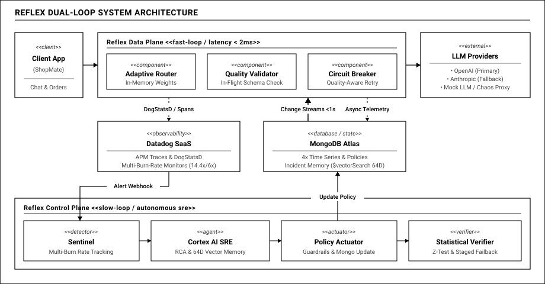

# 01 — Bối Cảnh, Mục Tiêu & Giải Pháp

## 1. BỐI CẢNH: KHOẢNG MÙ TRONG VẬN HÀNH GenAI THỜI GIAN THỰC

### 1.1. Khi LLM bước vào luồng nghiệp vụ nhịp độ cao
Nếu như năm 2023, Generative AI phần lớn dừng lại ở các chatbot hỏi đáp hỗ trợ — nơi người dùng dễ dãi chờ đợi vài giây và chấp nhận câu trả lời chưa chuẩn xác — thì bước sang giai đoạn 2025–2026, ngành công nghệ chứng kiến làn sóng chuyển dịch mạnh mẽ sang **Thương mại đàm thoại (Conversational Commerce)** và **Agentic E-commerce**. Các mô hình ngôn ngữ lớn (LLM) chính thức trở thành mắt xích xử lý trực tiếp trên luồng nghiệp vụ cốt lõi:

- **Trích xuất đơn hàng và giỏ hàng tự động:** Các nền tảng thương mại hàng đầu như Instacart (tính năng Ask Instacart tự động bóc tách nguyên liệu từ thực đơn món ăn thành giỏ hàng định lượng chuẩn), Shopify (trợ lý Sidekick và Shop App Assistant), hay Amazon (trợ lý mua sắm Rufus) đều tích hợp AI để chuyển hóa ngôn ngữ tự nhiên của khách thành dữ liệu có cấu trúc. Tại Việt Nam, làn sóng chốt đơn tự động qua mạng xã hội (Facebook Messenger, TikTok Shop, Zalo) nở rộ, nơi các trợ lý AI đọc tin nhắn của khách để trích xuất mặt hàng, số lượng, địa chỉ giao hàng và số điện thoại.
- **Hợp đồng kỹ thuật tất định (Structured Outputs):** Điểm chung của các ứng dụng này là yêu cầu mô hình AI phải trả về định dạng cấu trúc JSON tuyệt đối chính xác theo schema định sẵn. Kết quả này được các dịch vụ backend kế tiếp (hệ thống ERP, quản lý kho bãi, hoặc cổng thanh toán) trực tiếp tiêu thụ để trừ tồn kho và tạo mã thanh toán.
- **Tương tác thời gian thực nhịp độ cao:** Trải nghiệm khách hàng phụ thuộc vào luồng stream tokens mượt mà, nơi thời gian sinh từ đầu tiên và độ trễ toàn trình được tính bằng mili-giây.

Trong môi trường này, tính sẵn sàng và tính toàn vẹn dữ liệu không còn là lý thuyết giám sát hạ tầng thuần túy, mà gắn liền trực tiếp với doanh thu. Một phản hồi hỏng từ AI đồng nghĩa với một giao dịch mua sắm bị đổ vỡ.

### 1.2. Nỗi đau thực tế: "The Silent Brownout" — Sự cố suy giảm trong im lặng
Khi vận hành cổng kết nối (Gateway) điều phối giữa các nhà cung cấp mô hình lớn (OpenAI, Anthropic) và các mô hình mã nguồn mở tự triển khai, thực tế chỉ ra rằng: **Phần lớn các sự cố nghiêm trọng nhất của LLM không bao giờ làm sập máy chủ.**

Trong các hệ thống phân tán truyền thống, khi dịch vụ backend quá tải hoặc cơ sở dữ liệu gặp sự cố, hệ thống sẽ trả về mã lỗi 500, 502 hoặc 504. Các công cụ giám sát quen thuộc sẽ lập tức báo động đỏ và kích hoạt kênh trực chiến của đội ngũ kỹ sư.

Thế nhưng với các mô hình ngôn ngữ lớn, hơn 90% sự cố diễn ra hoàn toàn vô hình:
1. **Kết nối mạng báo thành công:** Máy chủ trả về mã HTTP 200 trơn tru, không có lỗi kết nối tầng mạng.
2. **Độ trễ vẫn trong ngưỡng lý tưởng:** Biểu đồ độ trễ phản hồi trên màn hình giám sát vẫn là một đường màu xanh ổn định.
3. **Nội dung bên trong bị hư hỏng:**
   - **Cắt cụt giữa chừng (Early Truncation):** Luồng dữ liệu stream đang truyền thì dừng đột ngột do bộ nhớ đệm nhà cung cấp bị nghẽn hoặc chạm giới hạn token ngầm từ phía máy chủ.
   - **Vỡ cấu trúc cú pháp:** Chuỗi dữ liệu trả về thiếu dấu ngoặc đóng, sai kiểu dữ liệu số sang văn bản, khiến bộ phân tích cú pháp của các dịch vụ nội bộ bị lỗi ngay lập tức.
   - **Từ chối ngầm (Silent Refusal):** Mô hình bất ngờ trả về chuỗi rỗng hoặc một câu xin lỗi chung chung dù yêu cầu đặt hàng của khách hoàn toàn hợp lệ.

Nghịch lý vận hành xuất hiện: Bảng điều khiển của đội SRE hiển thị hệ thống hoạt động 100% khỏe mạnh, nhưng người dùng thực tế đang nhận dữ liệu rác, hàng loạt đơn hàng bị treo và khách hàng rời bỏ dịch vụ. Chúng tôi gọi đây là hiện tượng **The Silent Brownout** — sự cố suy giảm chất lượng âm thầm.

---

## 2. MỤC TIÊU THIẾT KẾ: GIÁM SÁT ĐẾN TỪNG TOKEN DỮ LIỆU

Để xử lý bài toán vận hành thời gian thực (Real-time Operations), hệ thống không thể chỉ dựa vào các chỉ số mạng thô sơ. Reflex được thiết kế dựa trên 4 mục tiêu kỹ thuật rõ ràng:

1. **Kiểm định chất lượng ngay trên luồng dữ liệu (In-Flight Validation):** Đánh giá độ chuẩn xác của từng phản hồi ngay khi các token đang truyền qua Gateway với độ trễ cộng thêm cực thấp, chỉ dao động từ 1 đến 3 mili-giây.
2. **Cảnh báo sớm theo tốc độ tiêu hao ngân sách lỗi (Multi-Burn-Rate):** Loại bỏ các ngưỡng cảnh báo tĩnh dễ gây báo động giả. Ứng dụng mô hình cảnh báo đa cửa sổ thời gian theo chuẩn SRE của Google để phát hiện sự cố chất lượng chỉ sau 30 đến 90 giây.
3. **Tự chữa lành khép kín dưới 1 giây (Sub-Second Hot-Reload):** Khi phát hiện sự cố và sinh chính sách điều phối mới, toàn bộ quá trình cập nhật xuống các node Gateway phải diễn ra tức thì thông qua luồng sự kiện thời gian thực của MongoDB Change Streams mà không làm gián đoạn bất kỳ kết nối nào.
4. **Định lượng giá trị bảo vệ bằng số liệu đối chứng:** Phân định rõ chất lượng nguyên bản của nhà cung cấp với chất lượng thực tế bàn giao cho người dùng, đồng thời hỗ trợ tua lại lịch sử sự cố để đo lường chính xác số đơn hàng được cứu.

---

## 3. GIẢI PHÁP: MÔ HÌNH CUNG PHẢN XẠ HAI TỐC ĐỘ

### 3.1. Cảm hứng từ cơ chế sinh học
Khi thiết kế kiến trúc Reflex, chúng tôi áp dụng cơ chế tự bảo vệ tự nhiên của cơ thể:
- **Tủy sống (Phản xạ tức thời):** Khi chạm vào vật nóng, tủy sống lập tức kích hoạt phản xạ giật tay lại trong vài phần nghìn giây để bảo vệ mô tế bào mà không cần chờ não bộ phân tích.
- **Não bộ (Nhận thức sâu):** Sau khi nguy hiểm tức thời qua đi, não bộ tiếp nhận tín hiệu đau, phân tích nguyên nhân vì sao bề mặt nóng, đối chiếu ký ức và đưa ra quyết định phòng ngừa dài hạn.

Áp dụng vào hệ thống, Reflex tách biệt rạch ròi thành hai vòng lặp vận hành:

### 3.2. Vòng lặp phản xạ nhanh: Data Plane tại Gateway (Dưới 2.8ms)
Nằm trực tiếp trên đường truyền dữ liệu giữa client và các mô hình AI:
- Khi câu trả lời từ nhà cung cấp truyền về, bộ kiểm định gọn nhẹ trên Gateway lập tức kiểm tra tính toàn vẹn của JSON và độ dài phản hồi trong chưa đầy 1.5 mili-giây.
- Nếu phát hiện cấu trúc lỗi hoặc nội dung bị cắt cụt, cơ chế ngắt mạch thông minh kích hoạt việc thử lại sang mô hình dự phòng lành lặn ngay trên bộ nhớ RAM.
- Dữ liệu giám sát được đẩy bất đồng bộ về hàng đợi để ghi nhận nền, hoàn toàn không gây trễ cho trải nghiệm người dùng.

### 3.3. Vòng lặp suy luận chậm: Control Plane và AI SRE Agent (Giây đến Phút)
Một dịch vụ AI Agent độc lập chạy nền bên ngoài luồng dữ liệu, chỉ thức dậy khi nhận tín hiệu từ hệ thống giám sát Datadog:
- Khi tốc độ tiêu hao ngân sách lỗi vượt ngưỡng an toàn, Agent tiến hành điều tra đa chiều: đối chiếu vết phân tán APM và truy xuất các sự cố tương đồng trong lịch sử.
- Agent tự động đề xuất chính sách can thiệp (như giảm tải hoặc chuyển hướng sang nhà cung cấp phụ). Sau khi vượt qua các rào chắn kiểm duyệt an toàn, chính sách mới được ghi nhận vào cơ sở dữ liệu và phát tán tức thì xuống toàn bộ Gateway.

**Nguyên tắc vận hành an toàn:** Data Plane và Control Plane độc lập tuyệt đối. Nếu AI Agent gặp trục trặc hay cạn quota, Gateway vẫn tiếp tục hoạt động ổn định trên bộ nhớ RAM dựa theo chính sách hợp lệ gần nhất.

---

## 4. SÁU ĐIỂM NHẤN KỸ THUẬT NỔI BẬT

### Điểm nhấn 1: Trục dữ liệu thời gian thực trên MongoDB Atlas
Thay vì chỉ đóng vai trò lưu trữ thụ động, MongoDB Atlas được khai thác như một động cơ dữ liệu chủ động thời gian thực:
- **Hấp thụ dữ liệu đo đạc cấp giây:** Bốn bộ sưu tập chuỗi thời gian chuyên biệt thu nạp hàng ngàn sự kiện mỗi giây. Dữ liệu được tự động nén dạng cột theo chuẩn WiredTiger zstd, giúp giảm đến 88% dung lượng đĩa so với lưu trữ văn bản thông thường và giữ trọn vùng làm việc thường xuyên trên RAM.
- **Truyền phát chính sách dưới 1 giây qua Change Streams:** Khi Control Plane tạo chính sách điều phối mới, MongoDB Change Streams đẩy trực tiếp sự kiện thay đổi đến các node Gateway. Gateway thực hiện hoán đổi con trỏ cấu hình nguyên tử trên RAM chỉ trong tích tắc: không khởi động lại tiến trình, không gián đoạn dịch vụ và bảo toàn tuyệt đối các luồng stream đang phục vụ khách hàng.

### Điểm nhấn 2: Nền tảng quan sát toàn diện Datadog
Đóng vai trò trung tâm đo đạc và phát hiện sự cố nhạy bén:
- **Cảnh báo tốc độ đốt ngân sách lỗi đa cửa sổ:** Thay vì các ngưỡng cảnh báo phần trăm cố định dễ gây báo động giả, Datadog phối hợp đồng thời hai cửa sổ thời gian ngắn và dài bằng phép toán logic kết hợp. Cảnh báo chỉ kích hoạt khi cả hai cửa sổ cùng ghi nhận sự cố, giúp phát hiện suy giảm chất lượng trong vòng 30 đến 90 giây và loại bỏ hơn 95% báo động sai.
- **Phân lập nguồn gốc sự cố tức thì:** Tự động đối chiếu tín hiệu lỗi từ luồng khách hàng với kết quả thăm dò độc lập tới từng nhà cung cấp. Nhờ đó, hệ thống phân định chính xác sự cố bắt nguồn từ nhà cung cấp bên ngoài hay do dịch vụ nội bộ, tránh việc Agent điều tra sai hướng.
- **Giám sát chuyên sâu cho AI Agent (LLM Observability):** Theo dõi tường minh toàn bộ chu trình suy luận của Agent qua từng bước gọi công cụ, truy xuất cơ sở dữ liệu và lượng token sử dụng.

### Điểm nhấn 3: Quality SLI — Định nghĩa lại chuẩn mực thành công
Reflex thay đổi hoàn toàn quan niệm xem mã HTTP 200 là thành công. Một phản hồi chỉ được công nhận là hợp lệ khi đáp ứng đầy đủ cả hai khía cạnh:
1. *Tầng hạ tầng:* Mã mạng phản hồi thành công và độ trễ toàn trình nằm trong giới hạn cho phép.
2. *Tầng nội dung:* Cấu trúc JSON tuân thủ đúng schema, kết thúc tự nhiên trọn vẹn, không có chuỗi rỗng và không chứa mẫu câu từ chối phục vụ.

Chỉ số này được tính toán liên tục theo từng giây, đưa những hư hỏng ngữ nghĩa vô hình thành các biểu đồ đo lường trực quan trên màn hình giám sát.

### Điểm nhấn 4: Sổ cái kép Dual-Ledger SLO
Hệ thống theo dõi song song hai thước đo độc lập:
- **Chất lượng nhà cung cấp (Provider SLO):** Tỷ lệ thành công thô từ các mô hình AI bên ngoài.
- **Chất lượng bàn giao thực tế (Delivered SLO):** Tỷ lệ thành công thực tế mà người dùng cuối nhận được sau khi đi qua cơ chế tự bảo vệ của Reflex.

Trong một tình huống nhà cung cấp sụt giảm chất lượng nghiêm trọng từ 99% xuống 61%, người vận hành có thể thấy rõ Delivered SLO của Reflex vẫn duy trì vững vàng ở mức 99.6%. Khoảng chênh lệch lớn này là bằng chứng rõ ràng nhất về hiệu quả bảo vệ hệ thống.

### Điểm nhấn 5: Trí nhớ sự cố bằng vector 64 chiều trên MongoDB Atlas
Thay vì sử dụng các mô hình ngôn ngữ tốn kém để nhúng văn bản mô tả lỗi, Reflex vector hóa chính đồ thị suy giảm của chuỗi thời gian:
- Trích xuất biến thiên của tỷ lệ lỗi, độ trễ và thời gian sinh từ đầu tiên qua các mốc thời gian quanh thời điểm xảy ra sự cố thành một vector đặc trưng 64 chiều.
- Khi sự cố mới xuất hiện, tính năng Atlas Vector Search tìm kiếm các sự cố tương đồng trong quá khứ chỉ mất dưới 20 mili-giây, giúp Agent nhanh chóng tái sử dụng phương án xử lý đã được kiểm chứng thành công.

### Điểm nhấn 6: Mô phỏng phản thực tế qua Cỗ máy thời gian (Time Machine)
Để trả lời thuyết phục câu hỏi về tính hiệu quả so với các giải pháp gateway thông thường, Reflex tích hợp công cụ mô phỏng sự kiện:
- Lấy lại toàn bộ dữ liệu truy cập thực tế trong thời gian xảy ra sự cố và chạy song song trên ba kịch bản đối chứng: gọi trực tiếp nhà cung cấp, sử dụng gateway chuyển vùng kiểu cũ chỉ bắt lỗi mạng, và nền tảng Reflex tự chữa lành.
- Kết quả đối chiếu đưa ra con số cụ thể về số đơn hàng được cứu sống, phần trăm ngân sách lỗi được bảo toàn và chi phí vận hành được tối ưu.
