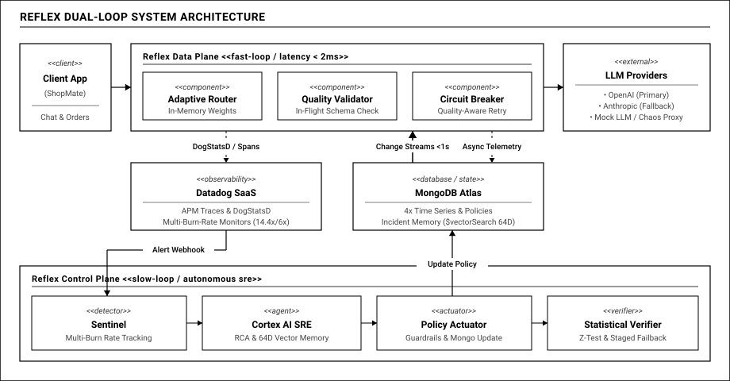
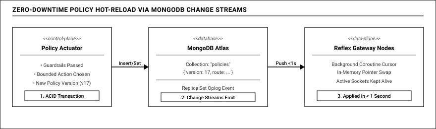

# 02 — Kiến Trúc Hệ Thống & Những Quyết Định Kỹ Thuật (ADRs)

## 1. NGUYÊN TẮC CỐT LÕI: PHÂN TÁCH RẠCH RÒI DATA PLANE VÀ CONTROL PLANE

Một trong những sai lầm phổ biến nhất khi xây dựng các hệ thống AI tự chữa lành (Self-Healing AI Systems) là nhồi nhét logic phân tích và suy luận AI trực tiếp vào đường đi của dữ liệu. 

Hậu quả của lối thiết kế này là thảm họa về độ trễ: Mỗi yêu cầu của khách hàng phải chờ cổng điều phối truy vấn cơ sở dữ liệu và chờ mô hình ngôn ngữ suy luận, đẩy độ trễ từ vài mili-giây lên thành nhiều giây. Nguy hiểm hơn, nếu dịch vụ AI phân tích gặp sự cố hoặc cạn kiệt hạn mức gọi API, toàn bộ luồng giao dịch thanh toán của người dùng sẽ bị sụp đổ theo.

Để đạt chuẩn tin cậy cấp doanh nghiệp, Reflex phân tách hệ thống thành hai thế giới hoàn toàn biệt lập:

### 1.1. Reflex Data Plane — Tinh gọn, Cực nhanh và Không nghẽn
Data Plane tiếp xúc trực tiếp với các ứng dụng khách thông qua chuẩn giao thức tương thích OpenAI:
- **Định tuyến và tính điểm hoàn toàn trên RAM:** Bảng định tuyến và trọng số ưu tiên của các nhà cung cấp mô hình (như OpenAI, Anthropic hay các mô hình dự phòng) được tính toán sẵn và nạp thẳng vào bộ nhớ RAM. Cổng Gateway tuyệt đối không thực hiện bất kỳ lệnh truy vấn cơ sở dữ liệu nào trên đường đi trực tiếp của request.
- **Kiểm định chất lượng tức thì (In-Flight Validation dưới 2 mili-giây):** Ngay khi dòng stream dữ liệu vừa truyền về, các hàm kiểm tra gọn nhẹ đọc lướt nội dung: thẩm định cấu trúc JSON Schema, kiểm tra trạng thái hoàn tất bình thường thay vì bị cắt cụt do chạm giới hạn token, và loại bỏ các mẫu câu từ chối ngầm.
- **Ngắt mạch thông minh và chuyển vùng dự phòng:** Nếu phát hiện câu trả lời bị hỏng hoặc nhà cung cấp ném lỗi mạng, Gateway lập tức ngắt mạch và thử lại sang nhà cung cấp dự phòng kế tiếp. Khách hàng luôn nhận được kết quả hoàn chỉnh với độ trễ tối thiểu.
- **Hàng đợi đo đạc bất đồng bộ:** Dữ liệu giám sát (độ trễ từng chặng, số lượng token, chi phí ước tính) được ném vào hàng đợi trong RAM. Một luồng xử lý nền sẽ gom thành từng lô và đẩy bất đồng bộ sang MongoDB Time Series và Datadog. Nhờ đó, việc thu thập dữ liệu đo đạc chi tiết hoàn toàn không gây trễ cho người dùng (chi phí trễ bằng 0 mili-giây).

### 1.2. Reflex Control Plane — Thông minh, Độc lập và An toàn
Control Plane chạy hoàn toàn độc lập bên ngoài luồng dữ liệu của khách hàng, tách biệt về tài nguyên CPU, bộ nhớ RAM và vòng đời hoạt động:
- **Bộ phận Sentinel (Giám sát ngân sách lỗi):** Liên tục theo dõi tốc độ đốt ngân sách lỗi (Error Budget Burn Rate) theo từng giây. Khi phát hiện tốc độ tiêu hao vượt ngưỡng an toàn, Sentinel lập tức kích hoạt quy trình mở phiếu sự cố.
- **Trợ lý AI SRE Agent Cortex:** Đóng vai trò điều tra viên tự hành. Agent tự động đối chiếu các vết phân tán APM trên Datadog và thực hiện tìm kiếm vector trên MongoDB Atlas để tìm lại các sự cố tương đồng trong quá khứ, từ đó đưa ra kết luận về nguyên nhân gốc rễ và đề xuất hành động khắc phục.
- **Rào chắn an toàn (Safety Guardrails):** Mọi đề xuất của AI đều phải vượt qua bộ lọc an toàn nghiêm ngặt: kiểm tra trần chi phí gọi API và kiểm tra năng lực chịu tải của cụm đích nhằm ngăn chặn hiện tượng sập dây chuyền. Chỉ khi vượt qua các bài kiểm tra này, chính sách mới được ghi vào cơ sở dữ liệu.
- **Kiểm định thống kê toán học (Statistical Verifier):** Sau khi chính sách mới có hiệu lực, hệ thống theo dõi số liệu trong vài phút tiếp theo và áp dụng các công thức kiểm định tỷ lệ hai mẫu (Two-Proportion Z-Test) và khoảng tin cậy Wilson để chứng minh hệ thống đã hồi phục thực sự trước khi đóng sự cố.

**Nguyên tắc bảo vệ an toàn (Fail-Safe):** Data Plane và Control Plane cách ly hoàn toàn. Nếu Control Plane hoặc AI Agent gặp trục trặc, Gateway vẫn tiếp tục hoạt động trơn tru dựa trên bảng định tuyến gần nhất trong RAM, bảo đảm không bao giờ có điểm lỗi đơn lẻ (Single Point of Failure).

---

## 2. TRỤ CỘT CÔNG NGHỆ: VÌ SAO LÀ MONGODB ATLAS VÀ DATADOG TRONG BÀI TOÁN REAL-TIME?

Trong bài toán vận hành thời gian thực (Real-time Operations) cho các hệ thống Generative AI, thách thức lớn nhất là dung hòa giữa tốc độ phản xạ dưới mili-giây và khả năng phân tích ngữ nghĩa sâu sắc. MongoDB Atlas và Datadog được lựa chọn làm hai trụ cột công nghệ nền tảng dựa trên các năng lực kiến trúc chuyên sâu:

### 2.1. MongoDB Atlas: Trục dữ liệu vận hành chủ động thời gian thực

Hệ thống vận hành AI tự chữa lành phát sinh ba dạng dữ liệu với đặc thù truy cập riêng biệt: dữ liệu chính sách điều phối có tính toàn vẹn cao, dòng dữ liệu chuỗi thời gian ghi nhận liên tục hàng triệu sự kiện, và không gian vector đại diện cho hình thái toán học của các sự cố.

Thay vì phải duy trì ba hệ thống cơ sở dữ liệu cồng kềnh (một cơ sở dữ liệu quan hệ cho cấu hình, một kho chuỗi thời gian riêng, và một cơ sở dữ liệu vector rời rạc), MongoDB Atlas hợp nhất toàn bộ nhu cầu trên cùng một động cơ lưu trữ:

- **Phát tán sự kiện dưới 1 giây qua Change Streams:**
  - *Bản chất kỹ thuật:* Tính năng Change Streams mở ra một con trỏ lắng nghe trực tiếp trên nhật ký hoạt động (Oplog) của cụm Replica Set, phát tán các sự kiện thay đổi dữ liệu đến các dịch vụ kết nối với độ trễ dưới 1 giây.
  - *Ứng dụng trong Reflex:* Đóng vai trò như một kênh truyền thông điệp thời gian thực mà không cần cài đặt thêm Kafka hay Redis Pub/Sub. Khi Control Plane cập nhật chính sách điều phối mới, toàn bộ các node Gateway lập tức nhận thông báo và cập nhật bộ nhớ RAM tức thì.
- **Bộ sưu tập chuỗi thời gian (Time Series Collections) nén cột hiệu năng cao:**
  - *Bản chất kỹ thuật:* Thay vì ghi từng tài liệu đơn lẻ gây phân mảnh, MongoDB Time Series tự động gom các bản ghi có chung siêu dữ liệu nhận diện trong cùng khoảng thời gian vào các khối nén dạng cột bằng thuật toán WiredTiger zstd.
  - *Ứng dụng trong Reflex:* Thu nạp hàng triệu bản ghi đo đạc từ Gateway với dung lượng đĩa giảm đến 88%, tối ưu hóa tốc độ ghi và phục vụ các phép toán tổng hợp theo cửa sổ thời gian để tính toán chỉ số chất lượng dịch vụ (SLO) mà hoàn toàn không xảy ra tình trạng quét toàn bảng (0 COLLSCAN).
- **Tìm kiếm vector tích hợp (Atlas Vector Search):**
  - *Bản chất kỹ thuật:* Tích hợp chỉ mục đồ thị Hierarchical Navigable Small World (HNSW) trực tiếp trên cùng cụm dữ liệu, cho phép vector đặc trưng và toàn bộ ngữ cảnh sự cố nằm trong cùng một tài liệu duy nhất.
  - *Ứng dụng trong Reflex:* Khi sự cố phát sinh, Agent nén đồ thị chuỗi thời gian thành vector 64 chiều và truy vấn tìm kiếm sự cố tương đồng trong quá khứ chỉ mất dưới 20 mili-giây, không phải chịu độ trễ mạng khi đồng bộ sang dịch vụ vector bên thứ ba.

### 2.2. Datadog: Trung tâm quan sát và phát hiện sự cố nhạy bén

Để loại bỏ hoàn toàn khoảng mù trong các sự cố âm thầm (The Silent Brownout), Datadog đóng vai trò trung tâm quan sát thời gian thực với các năng lực tiên tiến:

- **Cảnh báo tốc độ đốt ngân sách lỗi đa cửa sổ (Multi-Window Multi-Burn-Rate):**
  - *Bản chất kỹ thuật:* Theo chuẩn SRE của Google, hệ thống theo dõi song song hai cửa sổ trượt: cửa sổ ngắn (vài phút) để bắt xung lỗi đột biến, và cửa sổ dài (30 đến 60 phút) để xác nhận tính bền vững của sự cố.
  - *Ứng dụng trong Reflex:* Cảnh báo chỉ kích hoạt khi cả hai cửa sổ cùng vượt ngưỡng tốc độ tiêu hao ngân sách lỗi. Phương pháp này triệt tiêu hơn 95% báo động giả do nhiễu ngắn hạn gây ra, đồng thời bảo đảm thời gian phát hiện sự cố nghiêm trọng chỉ trong vòng 30 đến 90 giây.
- **Quan sát hợp nhất và truy vết phân tán (Unified Observability & Distributed Tracing):**
  - *Bản chất kỹ thuật:* Liên kết chặt chẽ ba trụ cột dữ liệu đo đạc (Metrics, Traces, Logs) dưới cùng một quy chuẩn gắn nhãn chung (môi trường, dịch vụ, phiên bản và mã sự cố).
  - *Ứng dụng trong Reflex:* Cho phép kỹ sư bóc tách chi tiết biểu đồ thác nước của từng request: phân định chính xác thời gian xử lý tại Gateway, thời gian truyền mạng, và độ trễ sinh từ đầu tiên của nhà cung cấp. Khi có lỗi phát sinh, vết phân tán liên kết thẳng đến dòng log chi tiết mà không cần tìm kiếm thủ công.
- **Giám sát chuyên sâu cho mô hình AI (Datadog LLM Observability):**
  - *Bản chất kỹ thuật:* Cung cấp mô hình quan sát phân tầng chuyên biệt cho Generative AI từ quy trình tổng thể, tác tử thông minh, đến từng lượt gọi công cụ và mô hình ngôn ngữ.
  - *Ứng dụng trong Reflex:* Minh bạch hóa toàn bộ chu trình suy luận của Agent Cortex, ghi nhận từng câu truy vấn vào MongoDB Atlas và lượng token tiêu thụ, biến Agent từ một chiếc hộp đen thành hệ thống có thể kiểm toán toàn diện.
- **Kích hoạt tự động qua Alert Webhook:**
  - *Bản chất kỹ thuật:* Datadog đóng vai trò như cảm biến kích hoạt tự động cho chu trình điều khiển khép kín.
  - *Ứng dụng trong Reflex:* Ngay khi bộ giám sát kết hợp phát hiện vi phạm ngân sách lỗi, Datadog gửi ngay một Webhook mang theo đầy đủ ngữ cảnh sự cố sang Control Plane để kích hoạt vòng lặp tự chữa lành mà không cần con người can thiệp.

---

## 3. CƠ CHẾ NẠP CẤU HÌNH KHÔNG GIÁN ĐOẠN QUA MONGODB CHANGE STREAMS

Một trong những yêu cầu sống còn của hệ thống vận hành có tính sẵn sàng cao là: khi thay đổi luật điều phối lưu lượng, tuyệt đối không được khởi động lại dịch vụ.

Nếu mỗi lần hệ thống chuyển hướng lưu lượng mà các node Gateway phải khởi động lại, hàng ngàn kết nối stream đang phục vụ khách hàng sẽ bị ngắt quãng đột ngột.

Reflex giải quyết bài toán này triệt để bằng cơ chế hoán đổi con trỏ nguyên tử (Atomic Pointer Swap) kết hợp với MongoDB Change Streams:

1. **Cập nhật chính sách có quản lý phiên bản:** Khi Control Plane phê duyệt hành động can thiệp, hệ thống sử dụng giao dịch an toàn (ACID Transaction) để ghi một bản ghi chính sách mới kèm số phiên bản tăng dần vào bộ sưu tập quản lý chính sách trong MongoDB Atlas.
2. **Lắng nghe luồng thay đổi liên tục:** Tại mỗi node Gateway, một tiến trình nền duy trì kết nối thường trực với MongoDB Change Streams để đón nhận các sự kiện cập nhật từ cơ sở dữ liệu.
3. **Hoán đổi con trỏ nguyên tử trong RAM:** Ngay khi nhận được thông báo thay đổi, Gateway thẩm định cấu hình mới và hoán đổi con trỏ trỏ tới bảng định tuyến trong bộ nhớ RAM trong vài phần nghìn giây.
4. **Hiệu quả thực tế:** Toàn bộ quá trình từ lúc Control Plane áp dụng chính sách đến khi tất cả các node Gateway trên toàn hệ thống thực thi luật điều phối mới diễn ra trong **dưới 1 giây**, bảo đảm không có bất kỳ kết nối stream nào của người dùng bị gián đoạn.
