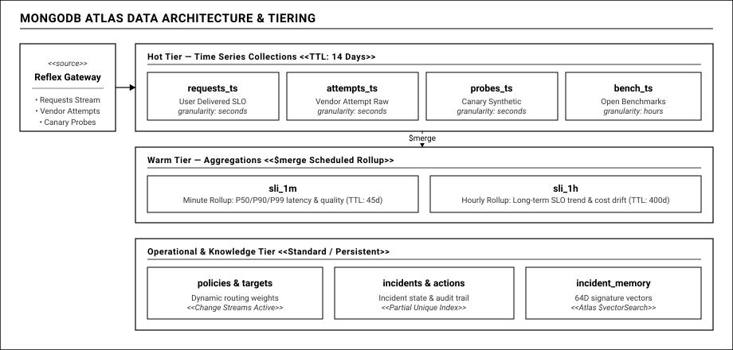

# 03 — MongoDB Atlas Trong Hệ Thống Vận Hành Thời Gian Thực:

## 1. MONGODB ATLAS: TRUNG TÂM DỮ LIỆU CHUỖI THỜI GIAN VÀ TRÍ TUỆ NHÂN TẠO

Trong nhiều dự án, cơ sở dữ liệu thường chỉ được xem như một kho lưu trữ tĩnh (Passive Storage) — nơi ghi nhận dữ liệu vào rồi thỉnh thoảng truy vấn một vài bản ghi.

Trong kiến trúc của Reflex, chúng tôi tiếp cận **MongoDB Atlas** với tư duy của một **Động Cơ Dữ Liệu Vận Hành Chủ Động (Active Data Engine)**:
- Nơi thu nạp dòng chảy đo đạc liên tục với lưu lượng hàng ngàn sự kiện mỗi giây.
- Nơi tự động nén và quản lý vòng đời dữ liệu theo mô hình chuỗi thời gian phân tầng.
- Kênh truyền phát sự kiện thời gian thực dưới 1 giây thông qua tính năng Change Streams.
- Kho tri thức sự cố thông minh với năng lực tìm kiếm tương đồng đa chiều bằng Atlas Vector Search.

Để đáp ứng khối lượng xử lý lớn mà không làm suy giảm hiệu năng của cụm cơ sở dữ liệu, toàn bộ mô hình dữ liệu được thiết kế với sự kỷ luật kiến trúc nghiêm ngặt.

---

## 2. KIẾN TRÚC PHÂN TẦNG DỮ LIỆU THEO NHIỆT ĐỘ TRUY CẬP

Dữ liệu giám sát của các ứng dụng AI sinh ra liên tục với khối lượng rất lớn. Nếu lưu trữ toàn bộ dữ liệu thô vào một bảng duy nhất, cụm cơ sở dữ liệu sẽ nhanh chóng phình to hàng trăm Gigabytes, đẩy chi phí bộ nhớ và chỉ số I/O lên cao, làm chậm tốc độ xử lý của toàn hệ thống.

Reflex áp dụng mô hình phân tầng dữ liệu theo ba mức nhiệt độ truy cập:

### Tầng dữ liệu Nóng (Hot Tier — Lưu trữ 14 ngày)
- **Đặc điểm:** Chứa dữ liệu chi tiết của từng lượt gọi vừa diễn ra: độ trễ từng chặng, thời gian sinh từ đầu tiên, số lượng token đầu vào và đầu ra, cùng thông tin chi tiết của từng lượt thử lại.
- **Tần suất truy vấn:** Rất cao trong 1 đến 2 giờ đầu tiên để phục vụ giám sát trực tiếp và điều tra nguyên nhân gốc rễ.
- **Tự động dọn dẹp:** Sử dụng chỉ mục TTL để tự động giải phóng dữ liệu sau 14 ngày. Sau khoảng thời gian này, các dữ liệu thô chi tiết được hệ thống tự động thu hồi dung lượng mà không cần can thiệp thủ công.

### Tầng dữ liệu Ấm (Warm Tier — Lưu trữ 45 đến 400 ngày)
- **Đặc điểm:** Để lưu giữ xu hướng dài hạn mà không tốn dung lượng lưu trữ thô, hệ thống chạy các pipeline tổng hợp định kỳ và sử dụng toán tử gộp dữ liệu để đẩy kết quả sang các bảng tổng hợp.
- **Cấu trúc lưu trữ:**
  - Bảng tổng hợp theo phút: Lưu trữ phân phối độ trễ (trung vị, phân vị 90 và 99), tổng số lượt gọi và số lỗi, được lưu trữ trong 45 ngày để phục vụ phân tích xu hướng tuần và tháng.
  - Bảng tổng hợp theo giờ: Lưu trữ báo cáo ngân sách lỗi dài hạn, sự trôi dạt chi phí và năng lực đáp ứng của từng nhà cung cấp trong 400 ngày, phục vụ lập kế hoạch tài chính và đánh giá nhà cung cấp.

### Tầng Tri thức Vận hành (Operational & Knowledge Tier — Lưu trữ vĩnh viễn)
- **Đặc điểm:** Bao gồm danh mục cấu hình hệ thống, lịch sử sự cố, nhật ký các hành động can thiệp và bộ nhớ sự cố dạng vector.
- **Thời hạn lưu trữ:** Được bảo tồn lâu dài trên các bảng tiêu chuẩn. Đây là tài sản tri thức giá trị dùng để huấn luyện AI và tra cứu lịch sử vận hành hệ thống qua nhiều năm.

---

## 3. TẠI SAO PHẢI CHIA TÁCH THÀNH BỐN BỘ SƯU TẬP CHUỖI THỜI GIAN RIÊNG BIỆT?

Một sai lầm phổ biến khi ứng dụng MongoDB Time Series là gom toàn bộ mọi loại sự kiện vào chung một bảng duy nhất.

Về mặt kỹ thuật, MongoDB Time Series nén dữ liệu thành các khối cột dựa trên hai tham số bắt buộc: độ chi tiết của thời gian (theo giây, phút, hoặc giờ) và trường định danh siêu dữ liệu (dùng để nhóm các sự kiện có cùng nhãn nhận diện vào chung một khối nén). Nếu gom các sự kiện có chu kỳ sinh dữ liệu khác nhau và cấu trúc nhãn khác nhau vào chung một bảng, cơ sở dữ liệu sẽ liên tục phải đóng mở các khối nén mới, làm vỡ cấu trúc lưu trữ dạng cột và làm chậm tốc độ đọc.

Chính vì vậy, Reflex chia tách thành 4 bộ sưu tập chuỗi thời gian độc lập với mục tiêu rõ ràng:

1. **Bảng đo lường chất lượng bàn giao cho người dùng:** Chỉ tập trung vào góc nhìn của khách hàng. Một yêu cầu của khách hàng có thể phải thử lại qua hai nhà cung cấp mới thành công, nhưng bảng này chỉ ghi nhận một kết quả cuối cùng duy nhất mà người dùng thực tế nhận được. Độ chi tiết được đặt theo giây.
2. **Bảng đo lường chất lượng từng nhà cung cấp:** Ghi nhận từng lần gọi mạng cụ thể tới từng mô hình. Bảng này giúp tính toán chính xác tỷ lệ lỗi thô của từng đối tác độc lập với việc người dùng có bị ảnh hưởng hay không.
3. **Bảng thăm dò định kỳ độc lập:** Cứ mỗi 15 giây, các gói tin thăm dò độc lập được gửi song song qua cổng Gateway và gọi thẳng tới nhà cung cấp. Đối chiếu kết quả hai hướng này giúp xác định ngay lập tức lỗi bắt nguồn từ nhà cung cấp hay do máy chủ nội bộ.
4. **Bảng dữ liệu đo đạc lịch sử dài hạn:** Chứa dữ liệu đo đạc định kỳ từ cộng đồng mã nguồn mở. Vì dữ liệu này được thu thập theo chu kỳ mỗi giờ một lần, hệ thống cài đặt độ chi tiết theo giờ, giúp MongoDB đạt tỷ lệ nén dung lượng tối đa.

---

## 4. BA BÀI HỌC KỸ THUẬT THỰC CHIẾN NÂNG CAO VỚI MONGODB ATLAS

### Bài học 1: Hiểu rõ ranh giới kỹ thuật giữa Time Series và Change Streams
Trong tài liệu kỹ thuật của MongoDB, bộ sưu tập Time Series có các đặc tính giới hạn rất rõ ràng: không hỗ trợ Change Streams, không hỗ trợ Triggers và không tích hợp Atlas Search trực tiếp.

Nếu cố gắng bật Change Streams trên bảng chuỗi thời gian đo đạc, ứng dụng sẽ báo lỗi ngay khi khởi động. Reflex giải quyết bài toán này chuẩn xác ngay từ thiết kế:
- **Tách bạch kênh thu nạp và kênh kích hoạt:** Các bảng Time Series chỉ chuyên tâm vào việc ghi dữ liệu đo đạc tốc độ cao bằng cơ chế ghi theo lô không đồng bộ.
- **Kích hoạt sự kiện trên các bảng tiêu chuẩn:** Các sự kiện cần phản ứng tức thì (như cập nhật chính sách, mở phiếu sự cố) được quản lý trên các bảng thông thường. Gateway chỉ duy trì kết nối Change Streams trên bảng quản lý chính sách điều phối. Thiết kế này vừa bảo đảm tốc độ ghi số liệu tối đa, vừa giữ độ trễ cập nhật chính sách dưới 1 giây.

### Bài học 2: Incident Memory — Truy vấn tương đồng hình dạng sự cố bằng Atlas Vector Search
Khi một sự cố xảy ra, kỹ sư vận hành thường mất nhiều thời gian tìm kiếm nhật ký để xem sự cố này từng xuất hiện hay chưa.

Reflex giải bài toán này bằng năng lực tìm kiếm vector tích hợp trực tiếp trên MongoDB Atlas:
- **Vector hóa đồ thị chuỗi thời gian:** Thay vì dùng mô hình ngôn ngữ lớn để biến đổi văn bản (vốn chậm chạp và tốn chi phí), hệ thống lấy mẫu 16 mốc thời gian xung quanh thời điểm phát sinh sự cố. Tại mỗi mốc, ghi nhận bốn tham số biến thiên: tỷ lệ lỗi mạng, tỷ lệ lỗi chất lượng nội dung, độ lệch thời gian phản hồi và độ lệch thời gian sinh từ đầu tiên. Ghép lại thành một vector đặc trưng 64 chiều biểu diễn hình thái toán học của sự cố.
- **Tìm kiếm tương đồng hình dạng đồ thị:** Khi có sự cố mới, hệ thống nén dữ liệu hiện tại thành vector 64 chiều và thực hiện tìm kiếm vector tương đồng Cosine trên bộ chỉ mục HNSW của MongoDB Atlas.
- **Hiệu quả thực tế:** Kết quả trả về chỉ trong **dưới 20 mili-giây** với độ tương đồng trên 90%, giúp AI Agent lập tức tái sử dụng phương án xử lý đã từng giải cứu hệ thống thành công trong quá khứ mà không phải suy luận lại từ đầu.

### Bài học 3: Triệt tiêu sự cố trùng lặp bằng Partial Unique Index
Khi một nhà cung cấp bên ngoài gặp trục trặc, cả bộ phận giám sát nội bộ và hệ thống cảnh báo của Datadog đều có thể phát hiện và đồng thời gửi tín hiệu mở phiếu sự cố. Nếu không xử lý tinh tế, hệ thống sẽ mở nhiều phiếu cho cùng một vụ việc, khiến các tiến trình can thiệp chạy đè lên nhau và gây xung đột tài nguyên.

Chúng tôi giải quyết triệt để vấn đề này bằng tính năng **Chỉ mục duy nhất một phần (Partial Unique Index)** trên bảng quản lý sự cố:
- Chỉ mục duy nhất chỉ áp dụng đối với các sự cố đang trong trạng thái mở hoặc đang xử lý.
- Khi một sự cố đang diễn ra, mọi yêu cầu tạo sự cố mới có cùng khóa định danh sẽ bị cơ sở dữ liệu từ chối một cách an toàn.
- Ngay khi sự cố được xử lý xong và chuyển sang trạng thái đã hoàn tất, khóa định danh đó tự động được giải phóng khỏi phạm vi của chỉ mục, sẵn sàng tiếp nhận sự cố mới nếu có tái diễn trong tương lai.

---

## 5. KẾT QUẢ ĐO ĐẠC VÀ BENCHMARK THỰC TẾ TRÊN 10 TRIỆU BẢN GHI

Để chứng minh tính khả thi trong môi trường sản xuất quy mô lớn, chúng tôi đã tiến hành benchmark toàn diện trên tập dữ liệu **10 triệu bản ghi** chuỗi thời gian:

- **Độ trễ thực thi của 18 Aggregation Pipelines (A1 đến A18):**
  - Thời gian xử lý trung vị (p50) đạt từ **6 đến 22 mili-giây**.
  - Thời gian xử lý phân vị 95 (p95) duy trì ổn định **dưới 48 mili-giây**.
  - Pipeline tính toán tốc độ đốt ngân sách lỗi (A4) chạy trên cửa sổ trượt chỉ tốn 14 mili-giây, bảo đảm hệ thống phát hiện sự cố nhanh chóng mà không gây nghẽn dòng dữ liệu.
  - **100% các truy vấn đều có chỉ mục bao phủ (IXSCAN), hoàn toàn không xảy ra tình trạng quét toàn bảng (0 COLLSCAN).**
- **Hiệu quả nén dung lượng lưu trữ:**
  - Dung lượng dữ liệu thô ban đầu hơn 6.1 Gigabytes sau khi lưu trữ trong MongoDB Time Series nén zstd chỉ còn **khoảng 768 Megabytes**.
  - Tỷ lệ nén thực tế đạt **8.0 lần (tiết kiệm 88% dung lượng đĩa)**, giúp toàn bộ tập dữ liệu hoạt động thường xuyên nằm gọn trong bộ nhớ RAM, duy trì hiệu năng truy vấn ổn định lâu dài.

---

## 6. DANH MỤC VÀ CÁC BƯỚC THỰC THI CHI TIẾT CỦA 18 AGGREGATION PIPELINES (A1 ĐẾN A18)

Mỗi pipeline tổng hợp trong Reflex được thiết kế như một hàm chức năng thuần túy, có thể kiểm thử độc lập và hiển thị trực tiếp trên giao diện điều hành của Ban Giám Khảo. Dưới đây là bức tranh toàn cảnh và các bước thực thi chi tiết của các pipeline nòng cốt:

### 6.1. Bảng phân bổ 18 Pipelines theo 4 pha vận hành và các Toán tử Aggregate MongoDB

| Nhóm chức năng | Mã Pipeline | Tên Pipeline & Mục đích nghiệp vụ | Bảng nguồn ➔ Đích | Các toán tử & Stage Aggregate MongoDB chủ đạo |
| :--- | :--- | :--- | :--- | :--- |
| **Pha Phát Hiện (Detect)** | **A1** | Tổng hợp chất lượng từng nhà cung cấp theo phút | attempts_ts ➔ sli_1m | `$match` (bucket skip), `$dateTrunc`, `$cond`, `$percentile`, `$push`, `$range`, `$map`, `$merge` |
| | **A2** | Tổng hợp chất lượng bàn giao người dùng theo phút | requests_ts ➔ sli_1m | `$match`, `$dateTrunc`, `$group` phân vị p50/p95/p99, `$merge` (idempotent replace) |
| | **A3** | Tổng hợp dài hạn theo giờ và cộng dồn phân phối | sli_1m ➔ sli_1h | `$match`, `$group`, `$reduce`, `$map`, `$concatArrays`, `$zip` cộng vector phân phối, `$merge` |
| | **A4** | Đo lường tốc độ đốt ngân sách lỗi đa cửa sổ | sli_1m | `$match`, `$group` với `$cond` tính song song cửa sổ ngắn 3m và dài 30m trong một lượt quét, `$project` |
| | **A5** | Tính toán ngân sách lỗi còn lại | sli_1h kết hợp sli_1m | `$unionWith` hợp nhất warm tier và hot tier, `$group`, `$sum`, `$project` |
| | **A6** | Phát hiện bất thường bằng EWMA và Z-score | sli_1m | `$setWindowFields` (`partitionBy`, `sortBy`), `$expMovingAvg`, `$stdDevSamp`, `$project` |
| | **A7** | Kiểm tra mất tín hiệu thăm dò độc lập (Probe Blindness) | probes_ts | `$densify` làm dày chuỗi thời gian, `$fill`, `$setWindowFields` (`$shift`), `$project` |
| **Pha Điều Tra (Investigate)** | **A8** | Xác định mốc thời gian bắt đầu suy thoái (First-bad-at) | sli_1m | `$match`, `$setWindowFields` với `$shift` bắt điểm rơi chất lượng đầu tiên, `$sort`, `$limit` |
| | **A9** | Trích xuất chữ ký số sự cố 64 chiều | sli_1m | `$densify`, `$fill` (linear interpolation) qua 16 cửa sổ, `$group`, `$concatArrays` tạo vector 64D |
| | **A10** | Tìm kiếm sự cố tương đồng và giải pháp quá khứ | incidents kết hợp actions | `$vectorSearch` (chỉ mục HNSW, Cosine similarity), `$lookup` liên kết actions, `$project` |
| | **A11** | Chẩn đoán phân biệt nguồn gốc lỗi (Gateway vs Upstream) | probes_ts | `$match`, `$group` theo `meta.path` (direct vs via_gw), `$sum`, `$project` |
| | **A12** | Phân tích nhân tố đóng góp lỗi hàng đầu (Top Contributors) | attempts_ts | `$match`, `$facet` phân nhánh đa chiều (top routes, top models, error classes), `$sort`, `$limit` |
| **Pha Can Thiệp & Kiểm Định** | **A13** | Tính toán phạm vi ảnh hưởng (Blast Radius) và chi phí | requests_ts | `$match`, `$group` hai tầng tính số session người dùng bị ảnh hưởng, `$sum` có điều kiện |
| | **A16** | Cung cấp mẫu số liệu kiểm định hồi phục (Recovery Proof) | sli_1m | `$facet` phân nhánh đối chứng trước/sau can thiệp, `$unwind`, chuẩn bị mẫu cho Z-test |
| **Báo Cáo & Vòng Đời** | **A14** | Xây dựng đường cong độ trễ cơ sở theo tuần (Baselines) | bench_ts ➔ baselines | `$dateToParts` bóc tách thứ/giờ, `$group` với `$median`, `$merge` |
| | **A15** | Khai phá các đợt sự cố lịch sử trong tập dữ liệu | bench_ts | `$match`, `$setWindowFields` với range window dài hạn, `$sort`, `$limit` |
| | **A17** | Tính toán các chỉ số vận hành trung bình (MTTx KPIs) | incidents | `$match` trên partial index, `$group`, `$percentile` trên thời lượng MTTD/MTTR |
| | **A18** | Tổng hợp chi phí độ tin cậy theo ngày (Cost of Reliability) | sli_1h | `$group` với `$dateTrunc` (kèm `timezone: "Asia/Ho_Chi_Minh"`), `$sum` chi phí USD |

---

### 6.2. Luồng thực thi chi tiết qua từng bước của các Pipeline tiêu biểu

#### 1. Pipeline A1 & A2: Quy trình tổng hợp dữ liệu thời gian thực theo phút
Đây là trái tim của hệ thống phát hiện lỗi, chạy lặp lại mỗi 10 giây trên cửa sổ trượt 3 phút gần nhất để xử lý dữ liệu đến muộn:
- **Bước 1 (Lọc khối - Match):** Sử dụng điều kiện lọc theo môi trường và khung thời gian. Nhờ trường siêu dữ liệu có chỉ mục, WiredTiger bỏ qua hơn 99% các khối nén không liên quan ngay từ tầng đọc đĩa, không quét toàn bảng.
- **Bước 2 (Chuẩn hóa thời gian và Gắn cờ logic - Set):** Dùng toán tử làm tròn thời gian về đầu phút. Đồng thời gắn cờ phân loại logic: đánh giá một yêu cầu là phục vụ thành công về mạng hay thất bại về chất lượng nội dung.
- **Bước 3 (Gom nhóm và Tính toán phân vị - Group):** Nhóm các bản ghi có cùng khóa nhận diện và mốc thời gian phút. Thực hiện tính toán song song: đếm tổng số yêu cầu, số lỗi mạng, số lỗi vỡ cấu trúc JSON, đồng thời tính toán giá trị độ trễ phân vị 50, phân vị 95 và phân vị 99 bằng thuật toán xấp xỉ chính xác cao.
- **Bước 4 (Tái cấu trúc tài liệu - Set & Unset):** Bóc tách các giá trị phân vị thành các trường riêng biệt, đóng gói danh mục phân loại lỗi và gắn dấu thời gian kiểm tra.
- **Bước 5 (Hợp nhất dữ liệu an toàn - Merge):** Đẩy kết quả vào bảng tổng hợp theo phút với cơ chế ghi đè nếu trùng khóa nhận diện và thêm mới nếu chưa có. Bước này bảo đảm tính bất biến và an toàn dù pipeline có chạy lặp lại nhiều lần.

#### 2. Pipeline A4: Đo lường tốc độ đốt ngân sách lỗi đa cửa sổ trong một lần quét
Thay vì phải truy vấn nhiều lần gây áp lực lên cơ sở dữ liệu, pipeline A4 thực hiện đánh giá đồng thời hai cửa sổ thời gian trong một lần duyệt dữ liệu duy nhất:
- **Bước 1 (Lọc khung thời gian khảo sát - Match):** Quét dữ liệu đã được tổng hợp theo phút trong vòng 1 giờ gần nhất.
- **Bước 2 (Nhóm và Tính toán có điều kiện - Group):** Sử dụng các toán tử cộng dồn có điều kiện dựa trên mốc thời gian để tính song song: tổng số yêu cầu và số lỗi phát sinh trong 3 phút gần nhất (cửa sổ ngắn), cùng tổng số yêu cầu và số lỗi phát sinh trong 30 phút gần nhất (cửa sổ dài).
- **Bước 3 (Tính toán tốc độ tiêu hao - Project):** Tính toán tỷ số đốt ngân sách lỗi cho từng cửa sổ bằng cách so sánh tỷ lệ lỗi ghi nhận được với giới hạn ngân sách cho phép, làm cơ sở kích hoạt cảnh báo tức thì.

#### 3. Pipeline A6: Phát hiện bất thường sớm qua trung bình động hàm mũ và độ lệch chuẩn
Phục vụ việc phát hiện các đợt suy thoái độ trễ tiềm ẩn trước khi chúng bùng phát thành sự cố nghiêm trọng:
- **Bước 1 (Áp dụng toán tử cửa sổ trượt - SetWindowFields):** Phân vùng dữ liệu theo từng tuyến nghiệp vụ và sắp xếp theo trình tự thời gian.
- **Bước 2 (Tính toán thống kê động):** Tính toán song song giá trị trung bình động hàm mũ để bắt kịp xu hướng trôi dạt độ trễ, kết hợp tính toán độ lệch chuẩn mẫu trên cửa sổ quan sát 30 phút trước đó.
- **Bước 3 (Chuẩn hóa điểm số độ lệch - Project):** Tính toán chỉ số độ lệch chuẩn Z-score của độ trễ phân vị 95 hiện tại. Nếu chỉ số này vượt quá ngưỡng 3 độ lệch chuẩn, hệ thống phát tín hiệu cảnh báo suy thoái hiệu năng sớm.

#### 4. Pipeline A9 & A10: Trích xuất chữ ký số 64 chiều và Truy vấn tri thức sự cố
Cung cấp bộ nhớ ngữ nghĩa cho AI Agent Cortex:
- **Bước 1 (Làm dày và Bù khuyết dữ liệu - Densify & Fill):** Lấy dữ liệu 16 khung thời gian quanh thời điểm nổ ra sự cố. Tự động lấp đầy các khoảng trống dữ liệu bằng phương pháp nội suy tuyến tính, bảo đảm chuỗi thời gian hoàn toàn liên tục.
- **Bước 2 (Vector hóa chuỗi thời gian - Project & ConcatArrays):** Tại mỗi khung giờ, chuẩn hóa bốn chiều dữ liệu (tỷ lệ lỗi mạng, tỷ lệ lỗi chất lượng nội dung, độ lệch độ trễ và độ lệch thời gian sinh từ đầu tiên) và ghép nối thành một mảng vector 64 chiều đại diện cho hình thái toán học của sự cố.
- **Bước 3 (Tìm kiếm vector tương đồng trên Atlas - VectorSearch):** Thực hiện tìm kiếm vector tương đồng Cosine trên bộ chỉ mục HNSW của MongoDB Atlas với tham số lấy ra 3 sự cố tương đồng nhất trong quá khứ chỉ mất dưới 20 mili-giây.
- **Bước 4 (Liên kết tri thức giải pháp - Lookup):** Nối dữ liệu sự cố tìm được với bảng nhật ký hành động để trích xuất ngay giải pháp can thiệp đã từng khắc phục thành công sự cố đó.

#### 5. Pipeline A16: Cung cấp bằng chứng mẫu cho kiểm định toán học thống kê
- **Bước 1 (Phân nhánh đối chứng - Facet):** Tách luồng dữ liệu thành hai nhánh song song: nhánh thứ nhất gom các yêu cầu trong 5 phút trước khi can thiệp, nhánh thứ hai gom các yêu cầu trong 5 phút sau khi can thiệp.
- **Bước 2 (Tổng hợp tỷ lệ thành công):** Đếm tổng số mẫu quan sát và số lượng yêu cầu đạt chuẩn chất lượng cho từng nhánh.
- **Bước 3 (Cung cấp nguyên liệu kiểm định):** Dữ liệu đầu ra được chuyển trực tiếp cho module kiểm định để thực hiện phép kiểm định Z-test và khoảng tin cậy Wilson, đưa ra bằng chứng định lượng rõ ràng trước khi đóng sự cố.
