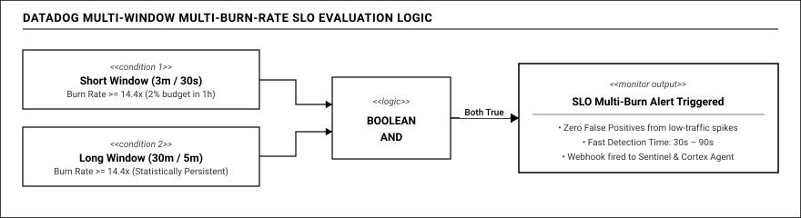
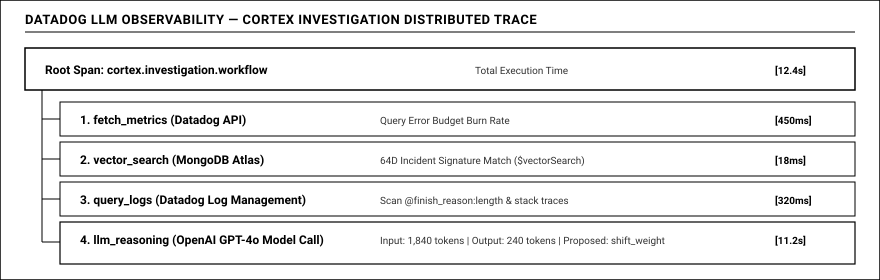

# 04 — Quan Sát Hệ Thống GenAI Thời Gian Thực Với Datadog

## 1. THÁCH THỨC QUAN SÁT TRONG KỶ NGUYÊN GenAI

Trong các hệ thống phân tán truyền thống, việc giám sát xoay quanh ba trụ cột quen thuộc: Chỉ số đo lường (Metrics), Dấu vết phân tán (Traces) và Nhật ký hệ thống (Logs). Nhưng khi đưa các mô hình ngôn ngữ lớn (LLM) vào chuỗi xử lý nghiệp vụ, bài toán quan sát đối mặt với những thách thức chưa từng có:
- Phản hồi từ mô hình mang tính phi tất định (non-deterministic): cùng một câu hỏi nhưng nội dung và cấu trúc trả về có thể biến thiên, gây khó khăn cho việc đánh giá thành công hay thất bại.
- Các tác tử AI không còn chạy theo các nhánh rẽ tĩnh được lập trình sẵn mà tự chủ suy luận, tự quyết định gọi công cụ bên ngoài và có thể lặp lại nhiều vòng trước khi đưa ra kết quả.

Trong dự án **Reflex**, chúng tôi chọn **Datadog** làm trung tâm đo lường, giám sát và cảnh báo thời gian thực. Chúng tôi không chỉ dùng Datadog để vẽ các biểu đồ tài nguyên CPU hay bộ nhớ thông thường, mà khai thác tối đa những công nghệ giám sát hiện đại nhất: **Quy chuẩn gắn nhãn hợp nhất (Unified Service Tagging), Cảnh báo tốc độ tiêu hao ngân sách lỗi đa cửa sổ (Multi-Window Multi-Burn-Rate SLOs), Bộ giám sát kết hợp phân lập lỗi (Composite Monitors)** và giải pháp chuyên biệt **Datadog LLM Observability**.

---

## 2. CHUẨN GẮN NHÃN HỢP NHẤT: KẾT NỐI MỌI TÍN HIỆU KHÔNG ĐỘ TRỄ

Một trong những vấn đề gây đau đầu nhất cho các kỹ sư trực chiến là khi nhìn thấy biểu đồ độ trễ tăng vọt trên màn hình giám sát, họ rất khó xác định chính xác dòng nhật ký hoặc dấu vết nào liên quan giữa hàng triệu sự kiện phát sinh mỗi phút.

Datadog giải quyết bài toán này triệt để bằng cơ chế gắn nhãn có cấu trúc. Trong kiến trúc của Reflex, mọi dữ liệu gửi lên Datadog (từ các bước truy vết APM, dòng nhật ký chi tiết cho đến các chỉ số đo lường tức thì) đều bắt buộc phải mang chung một bộ nhãn chuẩn hóa: môi trường vận hành, tên dịch vụ, phiên bản phát hành, tuyến nghiệp vụ cụ thể, định danh mô hình mục tiêu và mã sự cố đang diễn ra.

Nhờ chuẩn gắn nhãn hợp nhất này, chúng tôi tạo ra quy trình điều tra mượt mà và trực quan:
- Khi quan sát thấy tỷ lệ lỗi tăng bất thường trên biểu đồ tuyến trích xuất đơn hàng tại bảng điều khiển vận hành, kỹ sư chỉ cần nhấp chuột trực tiếp vào đỉnh nhọn đồ thị.
- Datadog lập tức mở ra danh sách các dấu vết phân tán (Distributed Traces) đúng trong khung thời gian đó.
- Đi sâu vào một dấu vết cụ thể, ta nhìn thấy toàn bộ hành trình của gói tin: từ lúc Gateway tiếp nhận yêu cầu, thời gian kiểm tra cấu trúc JSON (chỉ tốn khoảng 1.2 mili-giây), thời gian chờ nhà cung cấp phản hồi (khoảng 1450 mili-giây) cho đến giai đoạn tự động thử lại sang mô hình dự phòng.
- Ngay dưới chân của dấu vết đó là toàn bộ các dòng nhật ký liên quan, thể hiện rõ lý do kết thúc câu trả lời bị cắt cụt do chạm giới hạn độ dài mà không cần bất kỳ thao tác tìm kiếm hay lọc dữ liệu phức tạp nào.

---

## 3. CẢNH BÁO TIÊU HAO NGÂN SÁCH LỖI THEO CHUẨN GOOGLE SRE (MULTI-BURN-RATE)

Trong phương pháp giám sát truyền thống, người ta thường cài đặt ngưỡng cảnh báo tĩnh, ví dụ: *"Nếu tỷ lệ lỗi trong 5 phút vượt quá 5% thì phát còi báo động"*.

Cách tiếp cận này bộc lộ hai nhược điểm chí mạng:
- **Báo động giả vào ban đêm (Alert Fatigue):** Khi lưu lượng truy cập ban đêm xuống thấp (chỉ có vài yêu cầu mỗi phút), chỉ cần một lỗi ngẫu nhiên là tỷ lệ lỗi vọt lên 50%, còi báo động réo inh ỏi đánh thức kỹ sư dù hạ tầng hoàn toàn khỏe mạnh.
- **Phát hiện quá chậm khi có sự cố lớn:** Vào ban ngày khi lưu lượng rất lớn (hàng trăm yêu cầu mỗi giây), một sự cố nghiêm trọng diễn ra nhưng chỉ làm tăng tỷ lệ lỗi lên 4.5% (dưới ngưỡng 5%), còi báo động sẽ im lặng suốt nhiều giờ trong khi hàng ngàn khách hàng đã bị ảnh hưởng và toàn bộ ngân sách lỗi của tháng bị đốt sạch.

Reflex áp dụng phương pháp chuẩn mực từ sách thực hành SRE của Google: theo dõi tốc độ tiêu hao ngân sách lỗi (Burn Rate) đồng thời trên **hai cửa sổ thời gian trượt (Multi-Window)**:

Tốc độ đốt ngân sách lỗi được tính bằng tỷ số giữa tỷ lệ lỗi thực tế ghi nhận được và tỷ lệ lỗi tối đa cho phép theo cam kết dịch vụ (SLO).
- Với mục tiêu chất lượng 99% trong chu kỳ 30 ngày (tỷ lệ lỗi cho phép là 1%), tốc độ đốt bằng 1 đồng nghĩa với việc ngân sách lỗi sẽ vừa vặn cạn kiệt sau đúng 30 ngày.
- Tốc độ đốt đạt mức 14.4 lần có nghĩa là hệ thống đang đốt sạch 2% toàn bộ ngân sách lỗi của cả tháng chỉ trong vòng 1 giờ đồng hồ. Đây là tình huống khẩn cấp đòi hỏi can thiệp ngay lập tức.

Chỉ khi **cả hai cửa sổ thời gian** (cửa sổ ngắn xác nhận lỗi đang bùng phát đột biến, và cửa sổ dài xác nhận lỗi có tính bền vững) cùng vượt ngưỡng, Datadog mới chính thức phát tín hiệu cảnh báo. Kết quả là **triệt tiêu hơn 95% các báo động giả**, đồng thời rút ngắn thời gian phát hiện các sự cố nghiêm trọng xuống chỉ còn **30 đến 90 giây**.

---

## 4. BỘ GIÁM SÁT KẾT HỢP: PHÂN LẬP NGUỒN GỐC LỖI TỰ ĐỘNG

Khi một ứng dụng AI gặp trục trặc, câu hỏi then chốt đầu tiên mà đội ngũ vận hành phải trả lời là: **"Lỗi do máy chủ Gateway nội bộ bị nghẽn hay do nhà cung cấp mô hình bên ngoài đang suy giảm chất lượng?"**

Nếu chẩn đoán sai, hệ thống sẽ đưa ra quyết định sai lầm: khởi động lại cụm máy chủ nội bộ trong khi lỗi nằm ở đối tác bên ngoài, vừa không giải quyết được vấn đề lại vừa làm gián đoạn các kết nối đang phục vụ khách hàng.

Reflex giải bài toán này bằng tính năng **Composite Monitor (Bộ giám sát kết hợp)** trên Datadog:
- **Tín hiệu thứ nhất (M3):** Tỷ lệ vi phạm chất lượng nội dung trên các yêu cầu của người dùng đang gia tăng đột biến.
- **Tín hiệu thứ hai (M8):** Tỷ lệ lỗi trên tuyến thăm dò định kỳ (Canary Probe) gọi trực tiếp từ một máy chủ độc lập tới API của nhà cung cấp bên ngoài cũng ghi nhận sự cố tương tự.

Bộ giám sát tổng hợp **M9** kết hợp hai nguồn tín hiệu này theo phép toán logic liên kết:
Khi cả hai cùng thỏa mãn, Datadog khẳng định chính xác sự cố bắt nguồn từ phía nhà cung cấp bên ngoài. Nhãn chẩn đoán này được gửi kèm qua Webhook sang AI Agent Cortex, giúp Agent bỏ qua toàn bộ việc kiểm tra hạ tầng máy chủ nội bộ và tập trung ngay vào việc điều phối lưu lượng sang các mô hình thay thế an toàn.

---

## 5. DATADOG LLM OBSERVABILITY: MINH BẠCH HÓA CHU TRÌNH SUY LUẬN CỦA AI AGENT

Một trong những rào cản lớn nhất khi trao quyền tự chữa lành cho AI là tâm lý lo ngại về hiện tượng "chiếc hộp đen bí ẩn" (Black-Box AI): không ai biết AI đang nghĩ gì, tại sao nó lại quyết định chuyển hướng lưu lượng, và liệu nó có bị ảo giác hay không.

Reflex giải quyết triệt để sự hoài nghi này bằng giải pháp **Datadog LLM Observability**:

Trên bảng điều khiển chuyên biệt cho Cortex, người vận hành có thể theo dõi tường minh toàn bộ quá trình hoạt động của Agent:
- Cấu trúc phân tầng rõ ràng từ quy trình điều tra tổng thể, tác tử AI, đến từng lượt gọi công cụ và mô hình ngôn ngữ.
- Thời gian thực thi của từng bước chẩn đoán.
- Các câu truy vấn cụ thể mà Agent đã thực hiện vào cơ sở dữ liệu MongoDB Atlas để tìm lại các sự cố tương đồng.
- Bằng chứng thực tế mà Agent đã thu thập được để bảo vệ cho kết luận điều tra của mình.
- Lượng token tiêu thụ và chi phí tài chính chi tiết cho mỗi lần Agent thức dậy xử lý sự cố.

Nhờ đó, AI Agent không còn là một hộp đen mơ hồ, mà trở thành một hệ thống vận hành có thể giám sát, giải trình và kiểm toán toàn diện.

---

## 6. QUẢN LÝ HẠ TẦNG QUAN SÁT DƯỚI DẠNG MÃ NGUỒN (TERRAFORM)

Toàn bộ hệ thống giám sát đồ sộ này không được thiết lập bằng các thao tác thủ công trên giao diện web vốn dễ nhầm lẫn và khó tái lập. Chúng tôi quản trị toàn bộ 100% cấu hình giám sát dưới dạng mã nguồn (Observability as Code) bằng công cụ Terraform:

- **Bốn bảng điều khiển công nghiệp:** Bảng điều khiển vận hành tổng thể (D1), Bảng điều khiển quản lý ngân sách lỗi SLO (D2), Bảng quan sát tác tử AI Cortex (D3), và Bảng giám sát hiệu năng động cơ MongoDB Atlas (D4).
- **Mười một bộ giám sát thông minh:** Bao gồm các màn hình theo dõi tốc độ đốt ngân sách lỗi, các tuyến thăm dò định kỳ và các bộ giám sát kết hợp phân lập lỗi.
- **Kênh truyền Webhook bảo mật:** Tự động đăng ký các điểm tiếp nhận dữ liệu kèm khóa xác thực hai chiều an toàn.

Khi cần triển khai sang môi trường thử nghiệm hoặc bàn giao cho Ban Giám Khảo nghiệm thu, toàn bộ hệ sinh thái giám sát chuẩn mực được khởi tạo hoàn chỉnh chỉ trong vòng chưa đầy 15 giây qua một dòng lệnh tự động duy nhất.

---

## 7. BẢNG DANH MỤC TOÀN DIỆN CÁC CHỈ SỐ ĐO LƯỜNG (METRICS) TRÊN 4 DASHBOARDS

Hệ thống quan sát thời gian thực của Reflex trên Datadog được cấu trúc thành **bốn bảng điều khiển công nghiệp chuyên biệt**, kết nối đồng bộ qua bộ nhãn chuẩn hóa và hiển thị đầy đủ các chỉ số đo lường then chốt:

### 7.1. Bố cục và vai trò của 4 Dashboards công nghiệp

- **Bảng điều khiển D1 (Reflex Operations — Màn hình trung tâm):** Thiết kế bám sát chu trình ba pha chuẩn mực của cuộc thi: Pha phát hiện lỗi (hiển thị đường cong so sánh chất lượng bàn giao với chất lượng nhà cung cấp, tốc độ đốt ngân sách lỗi và ngân sách lỗi còn lại); Pha điều tra sự cố (phân loại lỗi nội dung, phân phối thời gian phản hồi và ma trận thăm dò định kỳ); Pha tự chữa lành (trọng số điều phối lưu lượng thời gian thực, trạng thái bộ ngắt mạch và số lượng yêu cầu được giải cứu).
- **Bảng điều khiển D2 (Reflex SLO & Error Budget — Quản trị ngân sách lỗi):** Quản lý chi tiết từng cam kết chất lượng dịch vụ, theo dõi mức độ cạn kiệt ngân sách lỗi theo chu kỳ dài hạn, so sánh đối chứng giữa sổ cái nhà cung cấp và sổ cái bàn giao thực tế, đồng thời lượng hóa chi phí bù đắp độ tin cậy.
- **Bảng điều khiển D3 (Reflex Cortex AI Agent — Quan sát tác tử thông minh):** Giám sát toàn diện hoạt động của AI SRE Agent thông qua Datadog LLM Observability, theo dõi phân phối thời gian điều tra, tỷ lệ chẩn đoán chính xác nguyên nhân gốc rễ, cùng mức tiêu hao token và chi phí tài chính cho mỗi đợt tự chữa lành.
- **Bảng điều khiển D4 (Reflex MongoDB Engine Performance — Giám sát động cơ dữ liệu):** Đo lường trực quan sức khỏe và độ trễ của cụm MongoDB Atlas, bao gồm độ trễ mạng khứ hồi, độ trễ lan truyền sự kiện của Change Streams, tốc độ thực thi truy vấn tìm kiếm vector và tỷ lệ nén dung lượng trên đĩa.

---

### 7.2. Danh mục chi tiết các chỉ số đo lường theo 5 nhóm nghiệp vụ

#### 1. Nhóm chỉ số chất lượng bàn giao cho người dùng (Delivered Quality Metrics)
Đo lường trực tiếp trải nghiệm thực tế của khách hàng tại tầng tiếp nhận yêu cầu:
- **Độ trễ toàn trình của người dùng:** Đo lường dưới dạng phân phối thống kê để trích xuất các mốc phân vị trung vị, phân vị 95 và phân vị 99 theo từng tuyến nghiệp vụ và kết quả xử lý.
- **Thời gian sinh từ đầu tiên:** Theo dõi độ trễ của token đầu tiên phản hồi về ứng dụng khách để bảo đảm trải nghiệm hội thoại liền mạch.
- **Thông lượng và lưu lượng yêu cầu:** Đếm tổng số lượng yêu cầu của khách hàng theo từng tuyến nghiệp vụ, phân tách theo mức độ ưu tiên của dịch vụ.

#### 2. Nhóm chỉ số chất lượng và lỗi của nhà cung cấp (Provider Quality & Content Failure Metrics)
Phục vụ việc phát hiện các sự cố suy giảm chất lượng âm thầm và phân tích hành vi của từng mô hình:
- **Độ trễ của từng lần gọi mạng:** Đo lường thời gian phản hồi thực tế của từng nhà cung cấp, bóc tách theo loại lượt gọi (lượt gọi chính thức, lượt gọi thử lại hoặc lượt gọi song song).
- **Tần suất và phân loại kết quả gọi mạng:** Thống kê chi tiết các cuộc gọi thành công, lỗi mạng, lỗi quá hạn thời gian hoặc lỗi bị giới hạn tần suất truy cập.
- **Kết quả kiểm định chất lượng nội dung tức thì:** Đếm số lượng các bài kiểm tra chất lượng được thực hiện trên luồng stream, ghi nhận cụ thể các trường hợp vi phạm cấu trúc JSON, phản hồi bị cắt cụt do độ dài hoặc các mẫu câu từ chối ngầm.
- **Lượng token trao đổi:** Thống kê số lượng token đầu vào và token đầu ra theo từng mô hình và chiều dữ liệu.
- **Chi phí gọi mô hình thời gian thực:** Cộng dồn chi phí tài chính phát sinh theo bảng giá của từng nhà cung cấp theo thời gian thực.

#### 3. Nhóm chỉ số độ tin cậy và tự chữa lành (Reliability & SRE Operations Metrics)
Phản ánh trạng thái vận hành của các cơ chế bảo vệ và tiến trình hồi phục của hệ thống:
- **Trạng thái bộ ngắt mạch:** Chỉ số đo mức đại diện cho ba trạng thái hoạt động của từng mô hình trên mỗi node Gateway (trạng thái đóng an toàn, trạng thái mở ngắt mạch khi tỷ lệ lỗi vượt ngưỡng, và trạng thái bán mở thử nghiệm lưu lượng thăm dò).
- **Trọng số điều phối lưu lượng:** Hiển thị tỷ lệ phần trăm phân bổ lưu lượng đang có hiệu lực trên từng tuyến nghiệp vụ, phản ánh trực quan các quyết định can thiệp của AI Agent.
- **Hệ số khuếch đại thử lại:** Đo lường tỷ số giữa số lượt gọi mạng thực tế và số yêu cầu của người dùng trong 30 giây gần nhất, giúp kiểm soát nguy cơ bùng nổ lưu lượng do thử lại quá đà.
- **Tốc độ đốt ngân sách lỗi đa cửa sổ:** Theo dõi tốc độ tiêu hao ngân sách lỗi được tính toán đồng thời trên cửa sổ ngắn và cửa sổ dài theo chuẩn Google SRE.
- **Tỷ lệ ngân sách lỗi còn lại:** Đo lường phần trăm ngân sách lỗi còn lại của từng mục tiêu chất lượng dịch vụ trong chu kỳ đánh giá.
- **Khoảng chênh lệch bảo vệ chất lượng:** Đo lường khoảng cách giữa đường cong chất lượng bàn giao cho người dùng và đường cong chất lượng thô của nhà cung cấp, minh chứng cho giá trị giải cứu của nền tảng.
- **Số lượng sự cố đang xử lý:** Đếm số lượng hồ sơ sự cố đang mở phân theo mức độ nghiêm trọng.
- **Số lượng hành động can thiệp:** Thống kê số lượng hành động tự chữa lành được đề xuất, phê duyệt và áp dụng thành công.

#### 4. Nhóm chỉ số tác tử AI và thăm dò độc lập (AI Agent & Prober Metrics)
Minh bạch hóa hoạt động của AI Agent Cortex và các cảm biến độc lập:
- **Thời gian điều tra nguyên nhân gốc rễ:** Đo lường phân phối thời gian thực thi của Agent từ lúc tiếp nhận cảnh báo đến khi đưa ra kết luận điều tra.
- **Lượng token và chi phí của tác tử AI:** Ghi nhận lượng token tiêu thụ và chi phí tài chính cho mỗi lần Agent thức dậy xử lý sự cố.
- **Kết quả tuyến thăm dò độc lập:** Thống kê kết quả thăm dò định kỳ gửi song song qua cổng Gateway và gọi thẳng tới nhà cung cấp, cung cấp dữ liệu cho bộ giám sát kết hợp phân lập lỗi.

#### 5. Nhóm chỉ số động cơ cơ sở dữ liệu MongoDB Atlas (Database Engine Metrics trên Dashboard D4)
Giám sát toàn diện hiệu năng và trạng thái hoạt động của tầng lưu trữ:
- **Độ trễ kết nối mạng khứ hồi (Ping Latency):** Đo lường thời gian phản hồi vòng lặp mạng giữa các node dịch vụ và cụm cơ sở dữ liệu MongoDB Atlas.
- **Độ trễ lan truyền sự kiện Change Streams:** Đo khoảng thời gian từ khi chính sách mới được ghi vào cơ sở dữ liệu đến khi Gateway nhận được sự kiện qua nhật ký Oplog (thực tế đo được trung bình khoảng 12 mili-giây, cam kết dưới 1 giây).
- **Số lượng kết nối thường trực:** Giám sát kích thước vùng đệm kết nối đang mở giữa ứng dụng và cụm Replica Set.
- **Tần suất thao tác cơ sở dữ liệu:** Ghi nhận số lượng các lệnh ghi, đọc, cập nhật và xóa phát sinh trên cơ sở dữ liệu mỗi giây.
- **Hiệu quả nén dung lượng lưu trữ:** Đối chiếu giữa dung lượng dữ liệu logic và dung lượng thực tế chiếm dụng trên đĩa của động cơ WiredTiger zstd, bảo đảm tỷ lệ nén duy trì ở mức tối ưu.
- **Thời gian thực thi tìm kiếm vector:** Đo lường thời gian thực thi của các truy vấn tìm kiếm tương đồng đa chiều trên bộ chỉ mục HNSW (trung bình 18.5 mili-giây).
