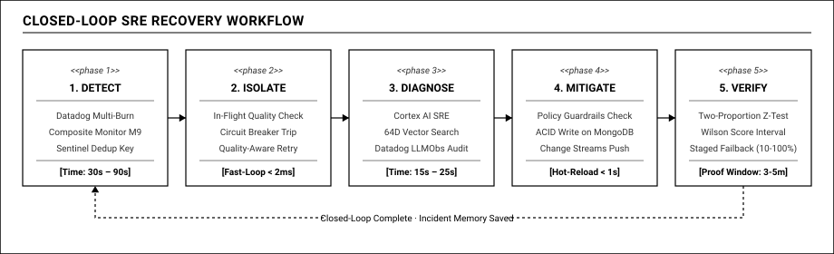

# 05 — Vòng Lặp Tự Chữa Lành Khép Kín (Closed-Loop SRE): Khi Toán Học Thống Kê Thay Thế Cảm Tính

## 1. NGUYÊN LÝ SRE: TỰ ĐỘNG HÓA VẬN HÀNH MỘT CÁCH CÓ TRÁCH NHIỆM

Trong kỹ nghệ độ tin cậy hệ thống (Site Reliability Engineering - SRE), mục tiêu tối thượng không phải là mơ tưởng về một hệ thống "không bao giờ gặp sự cố" (bởi vì các nhà cung cấp bên thứ ba chắc chắn sẽ có lúc bị lỗi hoặc quá tải). Mục tiêu thực tế và quan trọng nhất là: **Tự động phát hiện sớm, khoanh vùng thiệt hại trong tích tắc, và tự động hồi phục trong thời gian ngắn nhất (MTTR tối thiểu).**

Tuy nhiên, khi trao quyền cho AI tự động can thiệp vào cấu hình sản xuất, một nghịch lý lớn xuất hiện: **Làm sao để hệ thống vừa tự động hành động nhanh chóng, vừa hạn chế tối đa nguy cơ sập dây chuyền (Cascading Failure) do AI đưa ra quyết định sai lầm?**

Câu trả lời của Reflex nằm ở kiến trúc **Vòng Lặp Tự Chữa Lành Khép Kín (Closed-Loop Self-Healing)** kết hợp chặt chẽ giữa **Rào chắn an toàn (Safety Guardrails)** và **Kiểm định toán học thống kê (Mathematical Verification)**:

## 2. QUY TRÌNH 5 GIAI ĐOẠN CỦA BỘ MÁY TỰ CHỮA LÀNH (CLOSED-LOOP RECOVERY)

### Giai đoạn 1: Phát hiện sự cố (Detect — 30s đến 90s)
- **Tín hiệu kích hoạt:** Sentinel nội bộ và hệ thống cảnh báo Datadog Multi-Burn-Rate liên tục tính toán tốc độ đốt ngân sách lỗi của từng route nghiệp vụ.
- **Phân lập nguồn gốc:** Composite Monitor M9 kết hợp kết quả đo từ Canary Probes xác nhận lỗi xuất phát từ nhà cung cấp bên ngoài.
- **Khởi tạo sự cố có kiểm soát:** Hồ sơ sự cố được tạo trên MongoDB với khóa chống trùng lặp `dedup_key` (sử dụng Partial Unique Index), ngăn chặn việc mở nhiều sự cố trùng lặp.

### Giai đoạn 2: Khoanh vùng tức thì (Isolate — Dưới 2ms)
- Tại tầng Data Plane, Gateway không cần chờ AI suy nghĩ. Cơ chế ngắt mạch (Circuit Breaker) và thử lại có chọn lọc (Quality-Aware Retry) lập tức bảo vệ người dùng cuối.
- Dù chất lượng của nhà cung cấp chính đang lao dốc, người dùng vẫn nhận được câu trả lời hợp lệ từ nhà cung cấp dự phòng. Chỉ số Delivered SLO được bảo toàn ở mức > 99.5%.

### Giai đoạn 3: Điều tra & Đề xuất hành động có giới hạn (Diagnose & Propose — 15s đến 25s)
- Cortex AI SRE Agent thức giấc, thu thập ngữ cảnh điều tra (Context Pack): đọc metrics, kiểm tra các logs có `@finish_reason:length`, và bắn câu lệnh `$vectorSearch` vào kho ký ức `incident_memory` trên MongoDB Atlas.
- **Nguyên tắc Hành động có giới hạn (Bounded Actions):** Cortex **không được phép tự do sinh mã lệnh shell hay sửa cấu hình tùy tiện**. Agent chỉ được phép đề xuất một hành động cụ thể từ danh mục các hành động an toàn đã được định nghĩa trước:
  - `shift_weight(route, from_target, to_target, percentage)`: Chuyển bớt lưu lượng từ nhà cung cấp đang lỗi sang nhà cung cấp an toàn.
  - `set_rate_limit(target, max_rps)`: Tạm thời bóp lưu lượng gọi vào mô hình đang quá tải để họ kịp hồi phục.
  - `toggle_hedging(route, enabled)`: Bật cơ chế gọi song song 2 nhà cung cấp cho các tài khoản VIP để tối ưu độ trễ.

### Giai đoạn 4: Kiểm duyệt rào chắn an toàn & Thực thi (Mitigate — Dưới 1s)
Trước khi hành động được áp dụng, nó bắt buộc phải vượt qua bộ lọc **Policy Guardrails Engine**:
1. **Kiểm tra trần chi phí (Cost Ceiling):** Hành động chuyển tải có làm chi phí gọi API vượt quá ngân sách tối đa được duyệt không? (Ví dụ: Chuyển từ model \$0.15/1M tokens sang model \$3.00/1M tokens làm tăng chi phí lên 20 lần thì có nằm trong trần ngân sách cho phép không?).
2. **Kiểm tra sức chứa của cụm đích (Capacity Check):** Nếu dồn 90% lưu lượng sang Vendor B, Vendor B có đủ hạn mức RPM/TPM để gánh không, hay lại gây sập dây chuyền sang bên đó?
3. **Kiểm tra tính đảo ngược (Reversibility):** Hành động có thể dễ dàng hoàn tác (rollback) trong 1 giây được không?

- Nếu toàn bộ rào chắn đều thỏa mãn, hành động được **Tự động phê duyệt (Auto-Approved)** trong tích tắc.
- Actuator sử dụng giao dịch nguyên tử (ACID Transaction) trong MongoDB để cập nhật tài liệu chính sách mới, đồng thời ghi lại dấu vết kiểm toán (Audit Trail) và bắn một Datadog Event "Policy v17 Applied" lên dòng thời gian.
- Toàn bộ cụm Gateway nhận cấu hình mới qua **Change Streams trong chưa đầy 1 giây** mà không rớt kết nối.

### Giai đoạn 5: Thẩm định toán học chứng minh hồi phục (Verify — 3 đến 5 phút)
Đây là một trong những điểm nhấn kỹ thuật quan trọng của giải pháp. **Chúng tôi kiên quyết không bao giờ đoán mò xem hệ thống đã hết lỗi hay chưa bằng cảm tính.**

Sau khi chính sách mới được nạp, bộ phận Verifier thu thập mẫu dữ liệu trong 3 đến 5 phút tiếp theo và áp dụng hai công thức toán học thống kê chuẩn xác:

#### 1. Phép kiểm định tỷ lệ hai mẫu (Two-Proportion Z-Test)
Kiểm tra xem tỷ lệ request thành công sau khi can thiệp ($p_2$) có cải thiện vượt trội so với trước khi can thiệp ($p_1$) với mức ý nghĩa thống kê thực sự hay không (loại bỏ yếu tố may rủi ngẫu nhiên):

$$Z = \frac{\hat{p}_2 - \hat{p}_1}{\sqrt{\hat{p}(1 - \hat{p})\left(\frac{1}{n_1} + \frac{1}{n_2}\right)}}$$

Nếu giá trị $p$-value $< 0.05$ và $Z > 1.96$, chúng tôi mới khẳng định việc can thiệp đã mang lại hiệu quả thực tế với độ tin cậy trên 95%.

#### 2. Khoảng tin cậy Wilson (Wilson Score Interval)
Với kích thước mẫu $n$ trong cửa sổ đánh giá, chúng tôi tính toán khoảng tin cậy 95% của tỷ lệ thành công hiện tại:

$$w = \frac{\hat{p} + \frac{z^2}{2n} \pm z\sqrt{\frac{\hat{p}(1-\hat{p})}{n} + \frac{z^2}{4n^2}}}{1 + \frac{z^2}{n}}$$

Nếu cận dưới của khoảng tin cậy Wilson ($w_{lower}$) $\ge$ Mục tiêu cam kết SLO (ví dụ 99.0%), hệ thống mới chính thức xác nhận: **Hệ thống đã hồi phục hoàn toàn (Recovery Proof: PASS)**.

## 3. CƠ CHẾ HOÀN LƯU LƯỢNG TỪNG NẤC (STAGED FAILBACK)

Khi một nhà cung cấp bên ngoài đã sửa xong lỗi và hoạt động bình thường trở lại, chúng ta không thể ngay lập tức ném 100% lưu lượng truy cập trở lại vào họ (hiện tượng Thundering Herd). Làm như vậy có thể khiến máy chủ của đối tác lại bị sập nguồn lần nữa.

Reflex thực hiện quy trình **Hoàn lưu lượng từng nấc (Staged Failback)**:
- Khi Canary Probes xác nhận nhà cung cấp chính đã trả lời xanh liên tục trong 10 phút:
- Actuator bắt đầu chuyển dần lưu lượng theo từng bước:
  - **Nấc 1 (Canary 10%):** Chuyển 10% lưu lượng thử nghiệm. Verifier theo dõi trong 3 phút.
  - **Nấc 2 (Ramp-up 50%):** Nếu nấc 1 an toàn, tăng lên 50% lưu lượng. Verifier theo dõi tiếp 3 phút.
  - **Nấc 3 (Full 100%):** Nếu vẫn an toàn, chuyển toàn bộ 100% lưu lượng về trạng thái ban đầu.
- Nếu ở bất kỳ nấc nào phát hiện chất lượng bị tụt lại, hệ thống lập tức **tự động hoàn tác (Auto-Rollback)** về trạng thái dự phòng an toàn ngay tức khắc.

Sau khi quy trình hoàn lưu lượng kết thúc thành công, Cortex tự động đóng phiếu sự cố, tạo báo cáo phân tích hậu sự cố (Post-mortem), nén đồ thị chuỗi thời gian của sự cố thành vector 64D và lưu vào kho ký ức `incident_memory` trên MongoDB Atlas, làm giàu thêm tri thức cho hệ thống trong tương lai.
