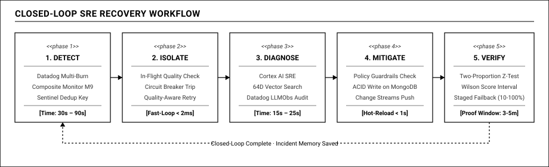

# 05 — Vòng Lặp Tự Chữa Lành Khép Kín (Closed-Loop SRE)

## 1. NGUYÊN LÝ SRE: TỰ ĐỘNG HÓA VẬN HÀNH CÓ TRÁCH NHIỆM

Trong kỹ nghệ độ tin cậy hệ thống (Site Reliability Engineering - SRE), mục tiêu tối thượng không phải là mơ tưởng về một hệ thống không bao giờ gặp lỗi (bởi vì các nhà cung cấp bên thứ ba chắc chắn sẽ có lúc bị nghẽn tải hoặc suy giảm chất lượng ngầm). Mục tiêu thực tế và quan trọng nhất là: **tự động phát hiện sớm, khoanh vùng thiệt hại trong tích tắc, và tự động hồi phục trong thời gian ngắn nhất.**

Tuy nhiên, khi trao quyền cho AI tự động can thiệp vào môi trường vận hành thực tế, một bài toán nan giải xuất hiện: làm sao để hệ thống vừa hành động nhanh chóng, vừa loại trừ hoàn toàn nguy cơ gây sập dây chuyền do AI đưa ra quyết định sai lầm hoặc bị ảo giác?

Reflex giải bài toán này bằng kiến trúc **Vòng lặp tự chữa lành khép kín (Closed-Loop Self-Healing)** kết hợp chặt chẽ giữa **Rào chắn an toàn (Safety Guardrails)** và **Kiểm định toán học thống kê (Mathematical Verification)**:

---

## 2. QUY TRÌNH 5 GIAI ĐOẠN CỦA BỘ MÁY TỰ CHỮA LÀNH

### Giai đoạn 1: Phát hiện sự cố nhạy bén (Từ 30 đến 90 giây)
- **Tín hiệu kích hoạt:** Bộ phận giám sát nội bộ phối hợp cùng hệ thống cảnh báo đa cửa sổ Multi-Burn-Rate trên Datadog để liên tục đo đạc tốc độ tiêu hao ngân sách lỗi của từng tuyến nghiệp vụ theo từng giây.
- **Phân lập nguồn gốc lỗi:** Bộ giám sát kết hợp đối chiếu kết quả đo lường từ người dùng với các tuyến thăm dò định kỳ độc lập để khẳng định lỗi bắt nguồn từ phía nhà cung cấp bên ngoài.
- **Khởi tạo sự cố có kiểm soát:** Hồ sơ sự cố được ghi nhận vào MongoDB Atlas với khóa chống trùng lặp dựa trên chỉ mục duy nhất một phần (Partial Unique Index). Cơ chế này ngăn chặn việc nhiều tiến trình mở trùng lặp hồ sơ cho cùng một sự cố.

### Giai đoạn 2: Khoanh vùng thiệt hại tức thì (Dưới 2 mili-giây)
- Tại tầng Data Plane, Gateway không cần chờ AI suy nghĩ. Cơ chế ngắt mạch thông minh và tự động thử lại dựa trên chất lượng nội dung lập tức bảo vệ người dùng cuối.
- Dù chất lượng của nhà cung cấp chính đang lao dốc, người dùng vẫn nhận được câu trả lời hoàn chỉnh từ nhà cung cấp dự phòng được chỉ định sẵn trong bộ nhớ RAM. Chỉ số chất lượng bàn giao thực tế (Delivered SLO) được bảo toàn vững chắc trên 99.5%.

### Giai đoạn 3: Điều tra và Đề xuất hành động có giới hạn (Từ 15 đến 25 giây)
- Trợ lý AI SRE Agent Cortex thức dậy, tự động thu thập gói ngữ cảnh điều tra: đối chiếu các chỉ số đo lường, kiểm tra các dòng nhật ký có dấu hiệu phản hồi bị cắt cụt do độ dài, và thực hiện tìm kiếm vector trên kho lưu trữ ký ức sự cố của MongoDB Atlas.
- **Nguyên tắc hành động có giới hạn (Bounded Actions):** Agent **tuyệt đối không được phép tự do sinh mã lệnh hoặc sửa đổi cấu hình tùy tiện**. Agent chỉ được phép đề xuất một hành động cụ thể từ danh mục các hành động an toàn đã được định nghĩa trước:
  - *Chuyển dịch trọng số lưu lượng:* Chuyển bớt tỷ lệ phần trăm lưu lượng từ mô hình đang suy giảm sang mô hình an toàn.
  - *Giới hạn tốc độ gọi:* Tạm thời bóp lưu lượng yêu cầu vào mô hình đang quá tải để phía đối tác có thời gian hồi phục.
  - *Kích hoạt gọi song song:* Bật cơ chế gọi đồng thời hai nhà cung cấp cho các tài khoản ưu tiên để triệt tiêu độ trễ đuôi.

### Giai đoạn 4: Kiểm duyệt rào chắn an toàn và Thực thi chính sách (Dưới 1 giây)
Trước khi bất kỳ hành động nào được áp dụng vào thực tế, nó bắt buộc phải vượt qua bộ lọc rào chắn an toàn:
1. **Kiểm tra trần chi phí:** Hành động chuyển hướng lưu lượng có làm chi phí gọi mô hình vượt quá ngân sách tài chính tối đa được phê duyệt hay không?
2. **Kiểm tra sức chứa của cụm đích:** Mô hình tiếp nhận lưu lượng mới có đủ hạn mức số lượng yêu cầu và số lượng token trên phút để gánh tải hay không, tránh nguy cơ gây quá tải dây chuyền.
3. **Kiểm tra tính khả nghịch:** Hành động có thể dễ dàng hoàn tác an toàn trong vòng 1 giây khi cần thiết hay không.

- Khi toàn bộ các điều kiện an toàn đều được thỏa mãn, hành động được hệ thống tự động phê duyệt trong tích tắc.
- Bộ phận thực thi sử dụng giao dịch an toàn (ACID Transaction) trong MongoDB Atlas để cập nhật tài liệu chính sách mới, đồng thời ghi lại dấu vết kiểm toán và bắn sự kiện thông báo lên dòng thời gian của Datadog.
- Toàn bộ các node Gateway đang chạy nhận cấu hình mới thông qua **MongoDB Change Streams trong chưa đầy 1 giây** mà không làm rớt bất kỳ kết nối stream nào của khách hàng.

### Giai đoạn 5: Thẩm định toán học chứng minh hồi phục (Từ 3 đến 5 phút)
Đây là một trong những điểm nhấn kỹ thuật quan trọng của giải pháp: **chúng tôi kiên quyết không đánh giá sự hồi phục của hệ thống bằng cảm tính.**

Sau khi chính sách mới được kích hoạt, bộ phận kiểm định thu thập mẫu dữ liệu trong vài phút tiếp theo và áp dụng hai công thức toán học thống kê chuẩn xác:

#### 1. Phép kiểm định tỷ lệ hai mẫu (Two-Proportion Z-Test)
Kiểm tra xem tỷ lệ yêu cầu thành công sau khi can thiệp có cải thiện vượt trội so với trước khi can thiệp với mức ý nghĩa thống kê thực sự hay không, loại bỏ hoàn toàn yếu tố may rủi ngẫu nhiên. Chỉ khi giá trị xác suất lỗi ngẫu nhiên nhỏ hơn 0.05 và chỉ số thống kê Z lớn hơn 1.96, hệ thống mới kết luận việc can thiệp mang lại hiệu quả thực tế với độ tin cậy trên 95%.

#### 2. Khoảng tin cậy Wilson (Wilson Score Interval)
Với số lượng mẫu quan sát được trong cửa sổ đánh giá, hệ thống tính toán cận dưới của khoảng tin cậy tỷ lệ thành công với độ tin cậy 95%. Nếu cận dưới này lớn hơn hoặc bằng mục tiêu cam kết chất lượng dịch vụ (ví dụ 99.0%), hệ thống mới chính thức xác nhận: **Hệ thống đã hồi phục thực sự và vượt qua bài kiểm tra toán học.**

---

## 3. CƠ CHẾ HOÀN LƯU LƯỢNG TỪNG NẤC (STAGED FAILBACK)

Khi một nhà cung cấp bên ngoài đã khắc phục xong sự cố và hoạt động ổn định trở lại, hệ thống không thể ngay lập tức chuyển 100% lưu lượng truy cập trở lại vào họ, nhằm tránh hiện tượng bầy đàn làm sập máy chủ đối tác lần nữa.

Reflex thực hiện quy trình hoàn lưu lượng thận trọng theo từng giai đoạn:
- Khi các tuyến thăm dò định kỳ xác nhận nhà cung cấp chính đã phản hồi tốt liên tục trong 10 phút, hệ thống bắt đầu mở dần lưu lượng:
  - *Nấc 1 (Thử nghiệm 10%):* Chuyển 10% lưu lượng sang nhà cung cấp chính. Bộ phận kiểm định theo dõi chặt chẽ trong 3 phút.
  - *Nấc 2 (Mở rộng 50%):* Nếu nấc 1 an toàn, tăng lưu lượng lên 50% và tiếp tục theo dõi trong 3 phút.
  - *Nấc 3 (Khôi phục 100%):* Nếu vẫn duy trì chất lượng ổn định, chuyển toàn bộ 100% lưu lượng về trạng thái ban đầu.
- Nếu ở bất kỳ nấc nào phát hiện chất lượng có dấu hiệu suy giảm trở lại, hệ thống lập tức tự động hoàn tác về trạng thái dự phòng an toàn ngay lập tức.

Sau khi quy trình hoàn lưu lượng kết thúc thành công, AI Agent Cortex tự động đóng hồ sơ sự cố, tạo báo cáo tổng kết, nén đồ thị chuỗi thời gian của sự cố thành vector 64 chiều và lưu vào kho ký ức sự cố trên MongoDB Atlas, làm giàu thêm tri thức cho hệ thống trong tương lai.
