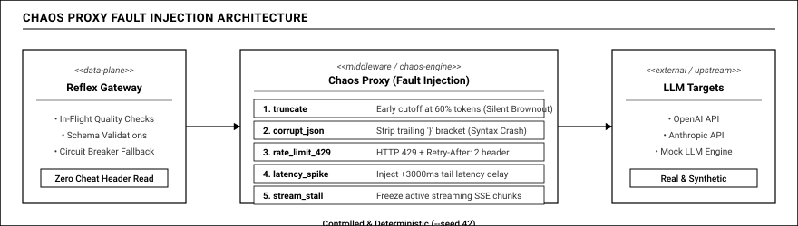

# 06 — Chaos Engineering Cho Hệ Thống AI

## 1. NGHỊCH LÝ KHI KIỂM THỬ HỆ THỐNG AI TỰ CHỮA LÀNH

Khi xây dựng một nền tảng với tuyên bố: *"Hệ thống có khả năng tự động phát hiện và xử lý sự cố trong thời gian thực"*, câu hỏi đầu tiên mà bất kỳ giám khảo hay chuyên gia kiểm thử nào cũng sẽ đặt ra là:  
**"Lấy đâu ra sự cố thật để hệ thống chứng minh khả năng tự chữa lành ngay trước mắt chúng tôi?"**

Nếu chỉ gọi API thật tới OpenAI hay Anthropic, có thể trong suốt buổi thuyết trình 15 phút, các nhà cung cấp này đều hoạt động ổn định. Khi đó, toàn bộ các tính năng thông minh của hệ thống — từ ngắt mạch, phát hiện cháy ngân sách lỗi, AI điều tra nguyên nhân, đến chuyển vùng dự phòng — sẽ hoàn toàn không có cơ hội được kích hoạt. Ngược lại, chúng ta cũng không thể yêu cầu đối tác bên ngoài cố tình làm sập máy chủ của họ để phục vụ bài thi.

Để giải quyết bài toán này một cách khoa học và thuyết phục, chúng tôi xây dựng một hạ tầng **Chaos Engineering chuyên nghiệp**, kết hợp hài hòa giữa **bộ dữ liệu đo đạc thực tế trong 60 ngày** và **công cụ bơm lỗi có kiểm soát (Chaos Proxy)**.

---

## 2. BỘ DỮ LIỆU THỰC TẾ: NGUỒN DỮ LIỆU CÔNG KHAI VÀ ĐƯỜNG CONG CƠ SỞ TRÊN MONGODB ATLAS

Để hệ thống không phải là một mô hình giả định trên dữ liệu tự biên soạn thiếu căn cứ, chúng tôi tích hợp trực tiếp bộ dữ liệu đo đạc mở uy tín từ cộng đồng toàn cầu:
- **Tên nguồn dữ liệu:** Bộ dữ liệu kiểm thử hiệu năng LLM cộng đồng `llm-bench-data` do tác giả Jwrede khởi xướng.
- **Đường dẫn liên kết công khai (Public URL):** Kho lưu trữ mở tại GitHub [https://github.com/Jwrede/llm-bench-data](https://github.com/Jwrede/llm-bench-data).
- **Vị trí lưu trữ dữ liệu trong dự án:** Được lưu trữ trực tiếp tại thư mục `.cache/llm-bench-data/` trong cấu trúc mã nguồn của repository.
- **Đặc điểm dữ liệu:** Ghi nhận liên tục các lệnh thăm dò độc lập gửi tới các mô hình AI thương mại hàng đầu (Claude 3.5 Sonnet, GPT-4o, Gemini 1.5 Pro, Llama 3) qua cổng OpenRouter định kỳ mỗi giờ một lần suốt nhiều tháng trời. Dữ liệu lưu trữ chính xác thời gian sinh từ đầu tiên, tổng thời gian phản hồi, số token trên giây và mã kết quả.
- **Ứng dụng trên MongoDB Atlas:** Toàn bộ 60 ngày dữ liệu lịch sử này được nạp vào bộ sưu tập chuỗi thời gian `bench_ts` trong MongoDB Atlas với độ chi tiết theo giờ để:
  1. Xây dựng đường cong độ trễ cơ sở (Baselines) theo từng khung giờ trong tuần qua Pipeline A14 (ví dụ: phản ánh đúng thực tế tối thứ Bảy mạng thường chậm hơn sáng thứ Ba do lưu lượng toàn cầu tăng cao).
  2. Cung cấp phân phối độ trễ thực tế cho máy chủ giả lập của hệ thống, giúp các bài kiểm thử giả lập phản ánh chính xác độ trễ và tỷ lệ lỗi của các nhà cung cấp thật ngoài đời.

---

## 3. ỨNG DỤNG KHÁCH SHOPMATE: MÔ PHỎNG HÀNH VI NGƯỜI DÙNG CHÂN THỰC

Một hiểu lầm dễ gặp khi mới tiếp cận dự án là nghĩ rằng ShopMate là một hệ thống cơ sở dữ liệu bán hàng. Thực chất, **ShopMate là một ứng dụng khách hàng giả định** được chúng tôi tạo ra để đóng vai trò đối tượng cần được Gateway bảo vệ.

Công cụ sinh tải đóng vai ShopMate, liên tục tạo ra các lượt truy cập giống như người dùng thật đang mua sắm trên một sàn thương mại điện tử:
- **Nhịp điệu tải ngày và đêm (Diurnal Curve):** Lưu lượng truy cập được mô phỏng theo hàm đồ thị hình sin kết hợp biến thiên ngẫu nhiên (ban ngày đông khách, ban đêm vắng khách).
- **Bộ prompt tiếng Việt tự nhiên và sạch sẽ:** Toàn bộ câu lệnh gửi đi đều được sinh từ các mẫu câu bán hàng thực tế, không chứa thông tin nhạy cảm.

ShopMate mô phỏng 3 luồng nghiệp vụ AI cốt lõi, sử dụng bộ dữ liệu mẫu nội bộ được khai báo rõ ràng trong dự án:
- **Đường dẫn bộ dữ liệu prompt mẫu trong dự án:** Được lưu trữ tại tệp `seeds/golden_prompts.yaml`.
- **Đường dẫn mã kịch bản sự cố mẫu (Scenario-as-Code):** Được định nghĩa dưới dạng mã cấu hình khai báo tại thư mục `scenarios/` (như `scenarios/silent-brownout.yaml`, `scenarios/429-storm.yaml`, `scenarios/cascading-failover.yaml`).

3 luồng nghiệp vụ mô phỏng gồm:
1. **Trích xuất đơn hàng (Order Extraction):** Khách gửi tin nhắn mua hàng tự do (ví dụ: *"Giao cho mình 2 hộp khẩu trang y tế màu xanh về số 10 Trần Hưng Đạo nhé, gọi trước khi giao"*). AI phải trích xuất thông tin ra đúng định dạng JSON Schema. Đây là chiến trường chính để chúng tôi thử nghiệm phát hiện lỗi vỡ cấu trúc và đứt cụt câu trả lời.
2. **Trợ lý tư vấn sản phẩm (Chat Assistant):** Khách hỏi về tính năng sản phẩm hoặc chính sách bảo hành. AI trả về câu trả lời dạng truyền luồng dữ liệu (streaming). Dùng để kiểm tra độ trễ sinh từ đầu tiên và phát hiện luồng bị treo giữa chừng.
3. **Phân loại khiếu nại (Support Triage):** Đọc nội dung khiếu nại để phân loại mức độ khẩn cấp và chuyển tiếp đến phòng ban phù hợp.

---

## 4. CHAOS PROXY: BỘ BƠM LỖI CÓ CHỦ ĐÍCH TRÊN ĐƯỜNG TRUYỀN

Để chủ động tạo ra các sự cố phục vụ cho việc chấm thi và kiểm thử độ bền, chúng tôi xây dựng thành phần **Chaos Proxy**. Thành phần này được đặt nằm ở giữa cổng Gateway và các nhà cung cấp mô hình (kể cả mô hình thật lẫn mô hình giả lập).

Khi một kịch bản thử nghiệm được kích hoạt, Chaos Proxy sẽ lắng nghe cấu hình từ MongoDB và bắt đầu can thiệp đường truyền một cách có kiểm soát:

- **Bơm lỗi cắt cụt giữa chừng:** Cố tình chỉ cho phép mô hình trả về 60% câu trả lời rồi cắt ngang dòng truyền, gắn nhãn kết thúc là do chạm giới hạn độ dài token. Đây là lỗi chính trong kịch bản sự cố âm thầm (The Silent Brownout).
- **Bơm lỗi vỡ cấu trúc JSON:** Cố tình xóa mất dấu ngoặc nhọn kết thúc hoặc đổi một trường số thành chuỗi chữ, khiến cho bộ phân tích cú pháp của các ứng dụng đọc JSON phía sau bị lỗi ngay lập tức.
- **Bơm lỗi quá tải (Rate Limit 429):** Cố tình từ chối cuộc gọi và trả về mã HTTP 429 kèm tiêu đề thử lại sau để thử nghiệm cơ chế ngân sách thử lại (Retry Budget) và bảo vệ khỏi hiện tượng nghẽn mạng đồng loạt.
- **Bơm lỗi chậm mạng và trôi dạt độ trễ:** Cố tình làm trễ chữ đầu tiên thêm 3 đến 5 giây, tạo ra độ trễ đuôi rất lớn.
- **Bơm lỗi treo dòng truyền (Stall):** Mô hình đang sinh được vài chữ thì đột nhiên dừng hẳn không gửi dữ liệu tiếp nữa, mô phỏng hiện tượng kết nối mạng bị đứt gãy giữa chừng.

---

## 5. TÍNH KHÁCH QUAN VÀ CƠ CHẾ CHỐNG GIAN LẬN

Một câu hỏi rất hay mà các giám khảo khó tính thường đặt ra là:  
*"Làm sao chúng tôi biết hệ thống của các bạn thực sự phát hiện ra lỗi nhờ quan sát thông minh, hay do các bạn tự gắn cờ thông báo ngầm từ máy bơm lỗi sang máy Gateway?"*

Chúng tôi giải quyết mối lo ngại này bằng một cơ chế thiết kế cực kỳ minh bạch và sòng phẳng:
1. **Cô lập thông tin hoàn toàn:** Khi Chaos Proxy cố tình làm hỏng một câu trả lời, nó có gắn một tiêu đề nội bộ là fault tag vào gói tin trả về.
2. **Gateway và AI Agent hoàn toàn không đọc tiêu đề này:** Cổng Gateway và AI Agent Cortex được thiết kế tuyệt đối không đọc tiêu đề này. Toàn bộ quá trình phát hiện lỗi của Gateway chỉ dựa trên việc chạy các hàm kiểm tra chất lượng nội dung thực tế (JSON có đọc được không, câu văn có bị cụt không) và dựa trên việc phân tích các chỉ số vi phạm ngân sách lỗi trên Datadog.
3. **Tiêu đề chỉ dùng để chấm điểm đối chiếu:** Tiêu đề này chỉ được ghi nhận lại trong dấu vết hệ thống trên Datadog để sau khi kịch bản kết thúc, hệ thống đối chiếu và chấm điểm: *"Chaos Proxy đã bơm tổng cộng 100 lỗi, và Gateway đã tự phát hiện chính xác 100/100 lỗi đó mà không bỏ sót lỗi nào"*.

### Tính tái lập cao với Hạt giống ngẫu nhiên cố định
Toàn bộ kịch bản thử nghiệm được chạy với tham số cố định hạt giống ngẫu nhiên số 42.

Nhờ cố định hạt giống ngẫu nhiên, chuỗi thời gian xảy ra lỗi, các câu prompt được sinh ra và phản ứng tự chữa lành của hệ thống sẽ diễn ra **chính xác 100% giống nhau** trong mọi lần chạy. Điều này giúp chúng tôi tự tin quay video minh họa hoặc biểu diễn trực tiếp trước hội đồng giám khảo mà không sợ gặp sự cố bất ngờ do tính bất định của mô hình.

---

## 6. DANH MỤC 6 KỊCH BẢN THỬ NGHIỆM ĐƯỢC MÃ HÓA (SCENARIOS-AS-CODE)

Toàn bộ các tình huống kiểm thử trong Reflex đều được quản lý dưới dạng mã cấu hình khai báo (Scenario-as-Code) trong thư mục `scenarios/`. Nhờ vậy, mọi kịch bản đều có thể chạy lại tự động, độc lập và cho kết quả đối chứng nhất quán:

### Bảng tổng hợp 6 kịch bản thử nghiệm từ S1 đến S6

| Mã | Tên kịch bản | Tệp cấu hình | Dạng lỗi mô phỏng (Fault Injected) | Cơ chế Reflex kích hoạt & Kiểm chứng |
| :--- | :--- | :--- | :--- | :--- |
| **S1** | **The Silent Brownout (Trọng tâm)** | `scenarios/silent-brownout.yaml` | 35% phản hồi của tuyến trích xuất đơn hàng bị cắt cụt do độ dài hoặc sai lệch cấu trúc JSON; HTTP vẫn 200 OK | Kiểm định chất lượng in-flight tự động thử lại sang mô hình phụ; Datadog Multi-Burn-Rate cảnh báo sau 80s; Cortex tra cứu Atlas Vector Search 64D tìm nguyên nhân; Change Streams cập nhật chính sách <1s; Verifier chứng minh hồi phục qua kiểm định Z-test và khoảng tin cậy Wilson. |
| **S2** | **429 Storm & Thundering Herd** | `scenarios/429-storm.yaml` | 70% yêu cầu tới mô hình chính bị từ chối với mã HTTP 429 kèm tiêu đề giãn cách thời gian gọi | Kích hoạt cơ chế Ngân sách thử lại (Retry Budget giới hạn dưới 10% lưu lượng) để chống nghẽn mạng; tự động cắt giảm lưu lượng các tuyến phụ (P2) để dồn tài nguyên bảo vệ tuyến đơn hàng cốt lõi (P0). |
| **S3** | **Tail Latency in the Dark** | `scenarios/tail-latency.yaml` | 8% yêu cầu gặp độ trễ đuôi nặng (thời gian sinh từ đầu tiên bị chậm thêm hơn 6 giây), trong khi độ trễ trung vị vẫn bình thường | Kích hoạt cơ chế Gọi song song có kiểm soát (Hedged Requests): nếu sau ngưỡng phân vị 95 mà mô hình chưa phản hồi, tự động gửi thêm một yêu cầu phụ sang đối tác khác và hủy lượt gọi chậm hơn; kiểm duyệt trần chi phí chặt chẽ. |
| **S4** | **It's Us, Not Them (Lỗi nội bộ)** | `scenarios/its-us.yaml` | Cố tình giả lập lỗi xử lý tuần tự hóa trên chính Gateway làm tăng độ trễ thêm 450ms, trong khi mô hình bên ngoài vẫn hoàn toàn bình thường | Tuyến thăm dò độc lập gọi thẳng tới nhà cung cấp xác nhận đối tác vẫn khỏe mạnh; Composite Monitor M10 khẳng định lỗi do hạ tầng nội bộ (Gateway-side), ngăn chặn việc AI Agent điều tra và chuyển vùng sai hướng. |
| **S5** | **Cascading Failover** | `scenarios/cascading-failover.yaml` | Mô hình chính bị sập hoàn toàn (HTTP 503); mô hình phụ có hạn mức chịu tải giới hạn (tối đa 12 yêu cầu/giây) | Ngăn chặn hiện tượng sập dây chuyền: thay vì dồn 100% lưu lượng sang một mô hình phụ duy nhất, bộ định tuyến thông minh chia nhỏ lưu lượng theo năng lực tiếp nhận của từng mô hình và chủ động giảm tải lưu lượng không quan trọng. |
| **S6** | **Real-World Replay** | `scenarios/real-world-replay.yaml` | Phát lại chính xác hình thái đồ thị sự cố thực tế được khai phá từ tập dữ liệu công khai `llm-bench-data` qua Pipeline A15 | Chứng minh hệ thống có năng lực giải quyết các sự cố có thật diễn ra ngoài đời thực từ các đợt đứt gãy dịch vụ của các nhà cung cấp lớn, không phải là kịch bản giả định chủ quan. |

---

### Ý nghĩa thực tiễn của 6 kịch bản
1. **Bao phủ toàn diện các rủi ro vận hành GenAI:** Từ lỗi nội dung ngầm (S1), lỗi bão nghẽn mạng (S2), lỗi trôi dạt độ trễ đuôi (S3), đến lỗi do chính hạ tầng nội bộ (S4) và sập dây chuyền đa mô hình (S5).
2. **Khách quan và có tính thực tế cao:** Kịch bản S6 kết nối trực tiếp với tập dữ liệu công khai 60 ngày trên MongoDB Atlas, khẳng định các thử nghiệm bám sát những đợt suy thoái có thật của các nhà cung cấp AI hàng đầu.
3. **Sẵn sàng cho Ban Giám Khảo nghiệm thu tức thì:** Toàn bộ chuỗi kịch bản được đóng gói trong lệnh tự động `task judge:verify`, cho phép Ban Giám Khảo bấm chạy và kiểm chứng toàn bộ chu trình Detect ➔ Investigate ➔ Mitigate ➔ Verify chỉ trong vòng 3 phút.
