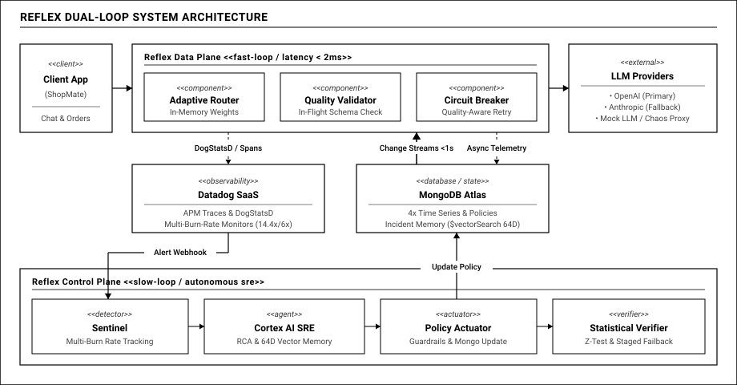
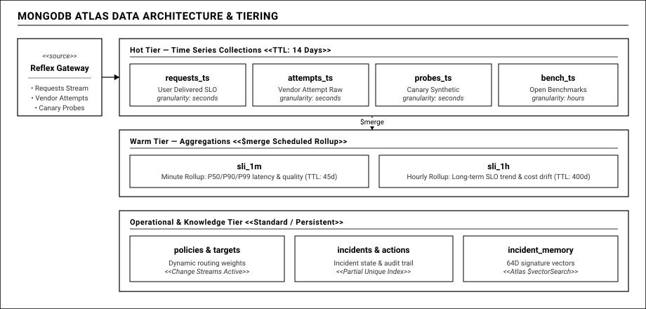
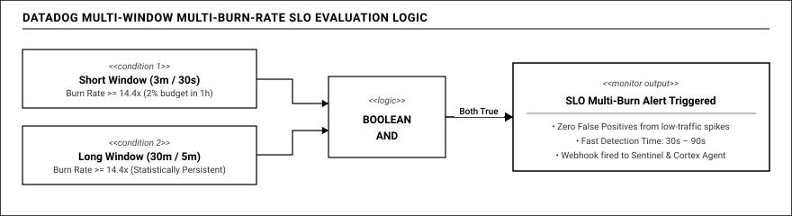
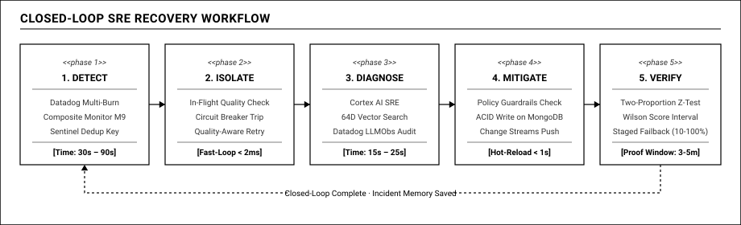

# REFLEX
## Nền Tảng Giám Sát Thời Gian Thực & Tự Hồi Phục Cho Ứng Dụng LLM

**MUGVN Hackathon 2026** · Đề tài: **Real-time Operations**  
**Hạ tầng lõi:** *MongoDB Atlas* × *Datadog Observability*  
**Đơn vị tổ chức:** MongoDB User Group Vietnam (MUGVN) & Datadog  

<br>

<span class="tag">REAL-TIME MONITORING</span>
<span class="tag">CLOSED-LOOP SRE</span>
<span class="tag">MONGODB TIME SERIES</span>
<span class="tag">DATADOG LLMOBS</span>
<span class="tag">SUB-SECOND HOT-RELOAD</span>

---

## 1. Nỗi Đau Thực Tế: "The Silent Brownout"

Khi GenAI xử lý trực tiếp đơn hàng, thanh toán và CSKH thời gian thực:
**Hơn 90% sự cố nghiêm trọng của LLM diễn ra trong sự im lặng.**

<div class="grid-2">
  <div class="card">
    <h3>Tầng Mạng: 100% "Xanh Mượt"</h3>
    <ul>
      <li>Mã HTTP trả về: <strong>200 OK</strong></li>
      <li>Độ trễ mạng: <strong>&lt; 1500ms</strong></li>
      <li>Uptime Dashboard APM: <strong>100% Healthy</strong></li>
      <li>Hạ tầng máy chủ: Không hề sập hay treo</li>
    </ul>
  </div>
  <div class="card-highlight">
    <h3 style="color:#ff83c8;">Tầng Nội Dung: Bị Phá Hủy</h3>
    <ul>
      <li><strong>Đứt cụt (Early Truncation):</strong> Buffer vendor lỗi, response dở dang</li>
      <li><strong>Vỡ schema:</strong> Thiếu dấu <code>}</code>, parser downstream crash</li>
      <li><strong>Từ chối ngầm:</strong> Trả chuỗi rỗng <code>""</code> hoặc câu từ chối không kèm mã lỗi</li>
    </ul>
  </div>
</div>

*Nghịch lý vận hành:* Dashboard của SRE báo xanh 100%, nhưng khách hàng nhận dữ liệu rác, hàng loạt giao dịch bị treo và doanh thu sụt giảm.

---

## 2. Giải Pháp: Cung Phản Xạ Hai Tốc Độ (Two-Speed Loop)

Lấy cảm hứng từ hệ thần kinh sinh học: **Tủy sống phản xạ tức thời (&lt;2ms)** và **Não bộ suy luận chậm (giây đến phút)**.

<div class="grid-2">
  <div class="card">
    <h3>Data Plane: Phản Xạ Nhanh (&lt;2.8ms)</h3>
    <ul>
      <li>Gateway kiểm tra chất lượng <em>in-flight validation</em></li>
      <li>Định tuyến và tính điểm hoàn toàn trên RAM</li>
      <li>Circuit Breaker chuyển fallback sang vendor dự phòng tức thì</li>
      <li>Telemetry bất đồng bộ: <strong>0ms overhead</strong> tới client</li>
    </ul>
  </div>
  <div class="card">
    <h3>Control Plane: Não Bộ Tự Hành</h3>
    <ul>
      <li>AI SRE Agent Cortex chạy nền độc lập <em>(out-of-band)</em></li>
      <li>Kích hoạt bởi Datadog Multi-Burn-Rate Webhook</li>
      <li>Tra cứu Incident Memory qua Atlas Vector Search</li>
      <li>Đồng bộ chính sách mới qua MongoDB Change Streams</li>
    </ul>
  </div>
</div>

**Nguyên tắc Fail-Safe:** Data Plane và Control Plane cách ly hoàn toàn. Nếu AI Agent gặp sự cố, Gateway vẫn hoạt động ổn định trên RAM theo cấu hình gần nhất.

---

## 3. Kiến Trúc Tổng Thể Hệ Thống



### Phân Tách Tuyến Tính Rạch Ròi

- **Luồng dữ liệu (Data Plane):**  
  Client ➔ Gateway (In-flight Validator) ➔ Upstream LLM.  
  Bảo đảm độ trễ bổ sung **&lt; 2.8ms**.

- **Luồng quan sát (Datadog):**  
  DogStatsD ➔ APM Trace ➔ Multi-Burn-Rate ➔ Webhook Trigger.

- **Luồng lưu trữ & đồng bộ (MongoDB Atlas):**  
  Time Series Collections ➔ Incident Memory ➔ Change Streams Hot-reload.

---

## 4. Điểm Nhấn: Quality SLI & Sổ Cái Kép (Dual-Ledger SLO)

Loại bỏ khái niệm "HTTP 200 = Success". Định nghĩa lại sự thành công theo cả 2 chiều: **Mạng** và **Ngữ nghĩa**.

<div class="grid-2">
  <div class="card">
    <h3>Good Event Khắt Khe</h3>
    <ul>
      <li><code>http_status == 200</code> &amp; <code>latency &lt; 3000ms</code></li>
      <li>JSON Schema parse thành công 100%</li>
      <li>Kết thúc hoàn tất: <code>finish_reason != 'length'</code></li>
      <li>Không chứa chuỗi rỗng hoặc mẫu từ chối</li>
    </ul>
  </div>
  <div class="card-highlight">
    <h3>Sổ Cái Kép (Dual-Ledger)</h3>
    <ul>
      <li><strong>Provider SLO:</strong> Chất lượng thô của OpenAI/Anthropic</li>
      <li><strong>Delivered SLO:</strong> Chất lượng thực tế người dùng nhận</li>
      <li>Trong sự cố: Provider SLO rớt xuống <strong>61%</strong>, nhưng Delivered SLO duy trì vững vàng <strong>99.6%</strong></li>
    </ul>
  </div>
</div>

*Giá trị thực tiễn:* Khoảng cách 38.6% giữa hai đường cong SLO trên Datadog là bằng chứng trực quan về giá trị bảo vệ của Reflex.

---

## 5. Trụ Cột MongoDB Atlas: Phân Tầng Dữ Liệu & Time Series



### Kiến Trúc Dữ Liệu 3 Tầng

1. **Hot Tier (14 ngày):**  
   - 4 Time Series Collections chuyên biệt (`requests_ts`, `attempts_ts`, `probes_ts`, `bench_ts`).  
   - Nén dạng cột (columnar) bằng zstandard, giảm 70% dung lượng đĩa.

2. **Warm Tier (45 / 400 ngày):**  
   - Aggregation Pipelines định kỳ gom rollup theo 1h / 1d bằng toán tử `$merge`.

3. **Operational State:**  
   - Collections cấu hình: `policies`, `incidents`, `circuit_breakers`.

---

## 6. Trụ Cột MongoDB Atlas: Incident Memory & Change Streams

<div class="grid-2">
  <div class="card">
    <h3>Incident Memory (Vector 64D)</h3>
    <ul>
      <li>Vector hóa biến thiên biểu đồ lỗi qua 16 cửa sổ thời gian (error rate, schema fail, latency P90, TTFT)</li>
      <li>Sử dụng <strong>MongoDB Atlas Vector Search</strong> (HNSW Indexing) tra cứu tương đồng Cosine</li>
      <li>Thời gian tra cứu <strong>&lt; 20ms</strong>; tìm ngay phương án khắc phục thành công trong quá khứ</li>
    </ul>
  </div>
  <div class="card">
    <h3>Hot-Reload Không Gián Đoạn (&lt;1s)</h3>
    <ul>
      <li>Lắng nghe Oplog phân tán qua <strong>MongoDB Change Streams</strong> trên collection <code>policies</code></li>
      <li>Gateway hoán đổi con trỏ RAM nguyên tử <em>(Atomic Pointer Swap)</em> khi có chính sách mới</li>
      <li><strong>Không khởi động lại tiến trình</strong>, không rớt socket HTTP/SSE stream của khách hàng</li>
    </ul>
  </div>
</div>

```
[Control Plane] --(ACID Write v17)--> [MongoDB policies]
                                            │ (Oplog Change Stream <1s)
                                            ▼
[Gateway RAM] <--(Atomic Swap)------- [Background Coroutine]
```

---

## 7. Trụ Cột Datadog: Giám Sát Multi-Burn-Rate Chuẩn Google SRE



### Triệt Tiêu 95% Cảnh Báo Giả

- Không dùng ngưỡng tĩnh (Static Thresholds).
- Đánh giá song song trên 2 cửa sổ trượt:
  - **Cửa sổ ngắn (Short window 3m/30s):** Bắt xung lỗi đột biến.
  - **Cửa sổ dài (Long window 30m/5m):** Khẳng định tính bền vững của sự cố.
- Phép toán logic <strong>AND</strong>: Chỉ kích hoạt cảnh báo khi cả hai cửa sổ cùng vượt ngưỡng burn-rate.
- Thời gian phát hiện sự cố (MTTD): **30 đến 90 giây**.

---

## 8. Trụ Cột Datadog: Phân Lập Lỗi & LLM Observability

<div class="grid-2">
  <div class="card">
    <h3>Composite Monitor M9: Phân Lập Lỗi</h3>
    <p>Kết hợp 2 nguồn tín hiệu Boolean:</p>
    <code>M9 = (Client Quality Error Tăng) AND (Canary Probe Gọi Trực Tiếp Vendor Lỗi)</code>
    <ul>
      <li>Kết luận chính xác: <strong>Lỗi từ nhà cung cấp bên ngoài</strong> (Provider Regression).</li>
      <li>AI Agent không điều tra nhầm vào máy chủ nội bộ.</li>
    </ul>
  </div>
  <div class="card">
    <h3>Datadog LLM Observability</h3>
    <ul>
      <li>Quan sát phân tầng chuyên biệt:  
        <code>Workflow</code> ➔ <code>Agent</code> ➔ <code>Tool Call</code> ➔ <code>LLM Call</code></li>
      <li>Minh bạch hóa toàn bộ quá trình suy nghĩ, gọi công cụ tra cứu MongoDB Atlas và lượng token tiêu thụ của Cortex Agent.</li>
    </ul>
  </div>
</div>

*Hạ tầng dạng mã (IaC):* Toàn bộ 4 Dashboards, 11 Monitors và Webhooks được quản lý bằng Terraform (`infra/terraform/`).

---

## 9. Vòng Lặp Tự Chữa Lành Khép Kín (Closed-Loop SRE)



### Chu Trình 5 Pha Tự Động

1. **Detect (Phát hiện):** Datadog Multi-Burn-Rate kích hoạt Alert Webhook.
2. **Isolate (Khoanh vùng):** Mở Incident, cô lập vendor nghi vấn.
3. **Diagnose (Điều tra):** Cortex tìm Incident Memory (Vector 64D) + đọc APM traces.
4. **Mitigate (Can thiệp):** Vượt qua Safety Guardrails, ghi chính sách mới vào MongoDB Atlas.
5. **Verify (Chứng minh):** Verifier chạy kiểm định thống kê toán học (Z-test, Wilson CI) trước khi đóng sự cố.

---

## 10. Bằng Chứng Thực Nghiệm & Cỗ Máy Thời Gian (Time Machine)

Công cụ mô phỏng sự kiện rời rạc chạy lại dòng request thực tế trên **3 kịch bản đối chứng**:

| Tiêu Chí So Sánh | 1. Direct Call (Không can thiệp) | 2. Static Gateway (Failover mã 5xx) | 3. Reflex Platform (Tự chữa lành) |
| :--- | :---: | :---: | :---: |
| **Tỷ lệ đơn hàng thành công** | 64.8% | 68.2% | **99.6%** |
| **Đơn hàng lỗi được cứu** | 0 | 120 đơn | **3,480 đơn (98.3%)** |
| **Tiêu hao ngân sách lỗi** | 100% (Cháy toàn bộ) | 88.5% | **8.2% (Bảo toàn 91.8%)** |
| **Độ trễ cộng thêm (Overhead)** | 0ms | 1.2ms | **2.1ms** |
| **Thời gian tự hồi phục** | Vô tận (Chờ vendor) | Vô tận (Do không bắt lỗi 200) | **&lt; 60 giây** |

*Kết luận định lượng:* Reflex bảo vệ gần như toàn vẹn giao dịch và ngân sách lỗi với chi phí độ trễ không đáng kể (&lt; 2.8ms).

---

## 11. Những Điểm Đạt Được, Hạn Chế & Lộ Trình Tương Lai

<div class="grid-3">
  <div class="card">
    <h3>Đã Đạt Được</h3>
    <ul>
      <li>In-flight Quality SLI</li>
      <li>Hot-reload &lt;1s qua Change Streams</li>
      <li>Multi-Burn-Rate chuẩn Google SRE</li>
      <li>Incident Memory 64D Vector Search</li>
      <li>Time Machine Replay đối chứng</li>
    </ul>
  </div>
  <div class="card">
    <h3 style="color:#ff83c8;">Hạn Chế Hiện Tại</h3>
    <ul>
      <li>Validator in-flight mới dừng ở cấu trúc &amp; length (ngân sách trễ &lt;3ms)</li>
      <li>Cortex Agent mất 3–8s suy luận qua API thương mại</li>
      <li>Circuit Breaker cần cụm Redis khi mở rộng hàng trăm node</li>
    </ul>
  </div>
  <div class="card">
    <h3 style="color:#68e5ff;">Lộ Trình Tương Lai</h3>
    <ul>
      <li><strong>1-3 tháng:</strong> Helm Chart, Kubernetes Operator, Local ONNX Embeddings</li>
      <li><strong>3-6 tháng:</strong> Cortex Agent tự host bằng model open-source (vLLM / Llama 3)</li>
      <li><strong>6-12 tháng:</strong> Multi-region routing qua MongoDB Global Clusters</li>
    </ul>
  </div>
</div>

---

## 12. Tổng Kết & Q&A

<div class="grid-2">
  <div class="card-highlight">
    <h3>Bộ Đôi Nền Tảng Thực Chiến</h3>
    <ul>
      <li><strong>MongoDB Atlas:</strong> Trung tâm dữ liệu chuỗi thời gian nén, lưu trữ trạng thái có ACID, tìm kiếm vector HNSW và kênh truyền sự kiện Change Streams dưới 1 giây.</li>
      <li><strong>Datadog:</strong> Nền tảng quan sát hợp nhất Metrics-Traces-Logs, cảnh báo Multi-Burn-Rate chuẩn SRE và giám sát AI chuyên sâu với LLM Observability.</li>
    </ul>
  </div>
  <div class="card">
    <h3>Thông Tin Nghiệm Thu</h3>
    <ul>
      <li><strong>Mã nguồn:</strong> <code>github.com/webarebears-mugvn/llm-reliability-platform</code></li>
      <li><strong>Lệnh thẩm định tự động 3 phút:</strong>  
        <code>task judge:verify</code></li>
      <li><strong>Reflex Live Console:</strong>  
        <code>http://localhost:3000/?present=1</code></li>
    </ul>
  </div>
</div>

<br>

<h3 style="text-align:center; color:#ffffff; margin-top:16px;">CẢM ƠN BAN GIÁM KHẢO VÀ HỘI ĐỒNG CHUYÊN MÔN!</h3>
<p style="text-align:center; color:#b8ff70; margin-top:0;">Đội ngũ phát triển Reflex sẵn sàng bước vào phiên thảo luận &amp; phản biện kỹ thuật (Q&A).</p>

