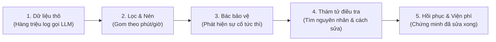

# Hướng dẫn dễ hiểu về 18 Pipeline MongoDB (Dành cho Fresher & Data Engineer)

> **Mục tiêu của thư mục này:** Chứa 18 hàm xây dựng truy vấn MongoDB Aggregation (`list[dict]`).  
> Chúng biến hàng triệu dòng dữ liệu thô (raw telemetry) khi gọi AI/LLM thành **chỉ số đo lường (SLI)**, **cảnh báo sự cố thời gian thực**, và **gợi ý cách tự sửa chữa lỗi**.

---

## 💡 Bức tranh tổng quan: Dữ liệu chảy như thế nào?

Hãy tưởng tượng bạn đang xây dựng một ứng dụng AI (như chatbot bán hàng). Khi khách hàng hỏi một câu:
1. **Khách gửi yêu cầu** → Gateway tiếp nhận.
2. **Gateway gọi model AI** (OpenAI, Claude,...). Nếu OpenAI nghẽn mạng hoặc lỗi 429, Gateway tự động gọi lại (retry) hoặc chuyển hướng sang Claude (fallback).
3. **Dữ liệu thô phát sinh ồ ạt:** Mỗi giây có hàng chục request, mỗi request lại có nhiều lần thử. Nếu lưu hết mà không xử lý thì database sẽ quá tải và không ai biết hệ thống đang khỏe hay ốm.

**18 Pipelines này chính là "Nhà máy lọc dầu" chia làm 5 công đoạn:**

---

## 📚 Giải thích chi tiết từng Pipeline (A01 → A18)

---

### Giai đoạn 1: Gom rác và tính điểm nhanh (Near-realtime Micro-batch)
*Dữ liệu thô gửi về liên tục từng giây. Cứ mỗi 10 giây, ta gom chúng lại theo từng phút để tính toán sơ bộ.*

#### [a01_attempt_rollup.py](file:///d:/Projects/llm-reliability-platform/packages/reflex-mongo/reflex_mongo/pipelines/a01_attempt_rollup.py) — A1: Tổng hợp lần gọi Vendor (Provider SLI)
- **Nói một cách dễ hiểu:** Mỗi lần Gateway gọi ra ngoài tới OpenAI hay Claude được gọi là 1 "attempt". Pipeline này gom toàn bộ các attempt trong 1 phút lại để trả lời: *"Phút vừa rồi gọi OpenAI bao nhiêu lần? Bao nhiêu lần lỗi/timeout? Trễ P95 là bao nhiêu mili-giây? Tốn bao nhiêu USD?"*.
- **Kỹ thuật hay dùng:**
  - `$dateTrunc`: Cắt mốc thời gian chẵn về đầu phút (ví dụ `10:15:32` → `10:15:00`).
  - `$percentile`: Đo độ trễ P95 (nghĩa là 95% request nhanh hơn mức này).
  - Histogram 20 bucket: Chia độ trễ vào các "xô" cố định để tiện cộng dồn về sau.
  - `$merge` với `whenMatched: "replace"`: Tính lại 3 phút gần nhất để tránh mất dữ liệu đến trễ (late data), chạy lại nhiều lần kết quả vẫn chuẩn (idempotent).
- **Chu kỳ:** Chạy ngầm 10 giây/lần.

#### [a02_request_rollup.py](file:///d:/Projects/llm-reliability-platform/packages/reflex-mongo/reflex_mongo/pipelines/a02_request_rollup.py) — A2: Tổng hợp trải nghiệm người dùng (Delivered SLI)
- **Nói một cách dễ hiểu:** Người dùng không quan tâm bạn gọi OpenAI hay Claude bao nhiêu lần, họ chỉ quan tâm: *"Tôi gửi câu hỏi và tôi có nhận được câu trả lời vừa ý không?"*. Pipeline này đo trải nghiệm thực tế đó theo từng tính năng (route như `order.extract`, `chat.support`).
- **Điểm khác với A1:** Nếu Gateway gọi OpenAI bị lỗi nhưng đã kịp fallback sang Claude thành công thì với A1 là có 1 attempt lỗi, nhưng với A2 người dùng vẫn nhận được kết quả tốt!

---

### Giai đoạn 2: Nén dữ liệu dài hạn & Đo nhịp sinh học (Silver → Gold)
*Dữ liệu phút dùng để theo dõi tức thời. Nhưng lưu từng phút cho cả năm thì rất nặng, cần nén lại thành giờ và tính baseline.*

#### [a03_hourly_rollup.py](file:///d:/Projects/llm-reliability-platform/packages/reflex-mongo/reflex_mongo/pipelines/a03_hourly_rollup.py) — A3: Nén 60 phút thành 1 giờ
- **Nói một cách dễ hiểu:** Nén 60 dòng của từng phút thành 1 dòng duy nhất của giờ đó để lưu trữ nhiều năm mà không tốn dung lượng.
- **Kỹ thuật hay dùng:** Dùng `$reduce` cộng mảng vector histogram của 60 phút lại với nhau. Nhờ histogram, ta có thể ước lượng lại P95 của cả 1 giờ mà không cần giữ lại từng log riêng lẻ.
- **Chu kỳ:** Chạy 5 phút/lần.

#### [a14_baselines.py](file:///d:/Projects/llm-reliability-platform/packages/reflex-mongo/reflex_mongo/pipelines/a14_baselines.py) — A14: Nhịp sinh học ngày/đêm (Baseline hour-of-week)
- **Nói một cách dễ hiểu:** Thứ Hai lúc 10h sáng lượng dùng nhiều nên OpenAI chậm 2 giây là bình thường; nhưng Chủ nhật 3h sáng mà chậm 2 giây là bất thường. Pipeline này quét 60 ngày dữ liệu để tính xem: *"Vào đúng thứ X, giờ Y thì độ trễ chuẩn thông thường là bao nhiêu?"*.
- **Chu kỳ:** Chạy 1 lần mỗi ngày.

#### [a18_cost_daily.py](file:///d:/Projects/llm-reliability-platform/packages/reflex-mongo/reflex_mongo/pipelines/a18_cost_daily.py) — A18: Báo cáo viện phí theo giờ Việt Nam
- **Nói một cách dễ hiểu:** Gom toàn bộ chi phí token theo từng ngày dương lịch chuẩn múi giờ `Asia/Ho_Chi_Minh` để xuất báo cáo tài chính cho sếp.
- **Kỹ thuật:** `$dateTrunc` với tham số múi giờ Việt Nam.

---

### Giai đoạn 3: Bác bảo vệ tuần tra (Phát hiện sự cố Realtime)
*Các pipeline này chạy liên tục để hú còi (bắn alert) ngay khi có dấu hiệu bất thường.*

#### [a04_burn_rate.py](file:///d:/Projects/llm-reliability-platform/packages/reflex-mongo/reflex_mongo/pipelines/a04_burn_rate.py) — A4: Tốc độ đốt ngân sách lỗi (Multi-window Burn Rate)
- **Nói một cách dễ hiểu:** Giả sử bạn cam kết hệ thống chỉ được lỗi tối đa 0.1% trong 1 tháng (Error Budget). Nếu trong 5 phút vừa qua lỗi tới 10%, bạn đang "đốt sạch hạn mức lỗi" với tốc độ gấp 100 lần bình thường! Báo động đỏ ngay lập tức!
- **Kỹ thuật hay:** Quét dữ liệu đúng 1 lần nhưng tính được cùng lúc nhiều cửa sổ (1 phút, 5 phút, 30 phút, 6 giờ) nhờ `$sum` có điều kiện `$cond`.
- **Chu kỳ:** Chạy 10 giây/lần.

#### [a05_budget_remaining.py](file:///d:/Projects/llm-reliability-platform/packages/reflex-mongo/reflex_mongo/pipelines/a05_budget_remaining.py) — A5: Ngân sách lỗi còn lại bao nhiêu %?
- **Nói một cách dễ hiểu:** Cho biết từ đầu tháng đến giờ ta còn bao nhiêu "mạng" (Error Budget). Ví dụ: *"Tháng này còn sống được 42% ngân sách lỗi"*.
- **Kỹ thuật:** `$unionWith` nối các giờ đã qua trong `sli_1h` với các phút của giờ hiện tại trong `sli_1m`.

#### [a06_anomaly.py](file:///d:/Projects/llm-reliability-platform/packages/reflex-mongo/reflex_mongo/pipelines/a06_anomaly.py) — A6: Bắt độ trễ tăng vọt (Anomaly z-score + EWMA)
- **Nói một cách dễ hiểu:** Đôi khi không có lỗi (HTTP 200) nhưng LLM trả lời cực kỳ chậm (chờ 15s mới ra chữ đầu tiên - TTFT). Pipeline tính điểm z-score: nếu độ trễ lệch hơn 3 lần độ lệch chuẩn ($z \ge 3$) so với 1 tiếng trước đó thì phát chuông cảnh báo.
- **Kỹ thuật:** `$setWindowFields` với `$stdDevSamp` và `$expMovingAvg`.

#### [a07_probe_blindness.py](file:///d:/Projects/llm-reliability-platform/packages/reflex-mongo/reflex_mongo/pipelines/a07_probe_blindness.py) — A7: Cảnh báo "mù tín hiệu"
- **Nói một cách dễ hiểu:** Không có log lỗi chưa chắc là hệ thống an toàn, có thể do máy đo (canary prober) bị chết nên không gửi tin về được! Nếu 10 phút không nhận được tín hiệu nào từ prober, pipeline sẽ coi đó là một sự cố khẩn cấp.
- **Kỹ thuật:** `$densify` tự chèn các mốc thời gian thiếu và `$fill` số 0 để tìm lỗ hổng tín hiệu.

---

### Giai đoạn 4: Bác sĩ chẩn đoán & Thám tử tìm thủ phạm (Investigate)
*Khi chuông báo động reo, các pipeline này nhảy vào điều tra nguyên nhân.*

#### [a08_first_bad_at.py](file:///d:/Projects/llm-reliability-platform/packages/reflex-mongo/reflex_mongo/pipelines/a08_first_bad_at.py) — A8: Bệnh bắt đầu phát tác từ phút nào?
- **Nói một cách dễ hiểu:** Hệ thống phát hiện sự cố lúc 10h15, nhưng thực tế lỗi đã âm ỉ từ 10h08. Pipeline này lùi lại lịch sử, tìm chính xác thời điểm "chuyển giao từ xanh sang đỏ" để tính chỉ số MTTD (thời gian phát hiện bệnh).
- **Kỹ thuật:** `$setWindowFields` với hàm `$shift` so sánh trạng thái của phút trước và phút sau.

#### [a09_signature.py](file:///d:/Projects/llm-reliability-platform/packages/reflex-mongo/reflex_mongo/pipelines/a09_signature.py) — A9: Chụp "X-quang" sự cố thành Vector 64 chiều
- **Nói một cách dễ hiểu:** Giống như chụp vân tay hay khuôn mặt. Pipeline lấy 4 thông số (tỷ lệ lỗi mạng, lỗi chất lượng, độ lệch trễ, độ lệch TTFT) trong 16 phút xung quanh sự cố rồi ghép lại thành 1 mảng gồm 64 con số (Vector Signature).

#### [a10_similar_incidents.py](file:///d:/Projects/llm-reliability-platform/packages/reflex-mongo/reflex_mongo/pipelines/a10_similar_incidents.py) — A10: Quá khứ từng bị thế này chưa và chữa bằng cách nào?
- **Nói một cách dễ hiểu:** Đem vector 64 chiều ở A9 đi tra cứu trong lịch sử. Nếu tìm thấy sự cố tương tự 80%: *"À, tuần trước cũng bị y hệt thế này, hồi đó đổi route sang Claude là hết lỗi trong 45 giây"*. Đây là đầu vào để AI SRE Agent (Cortex) tự động ra tay khắc phục.
- **Kỹ thuật:** `$vectorSearch` kết hợp `$lookup` sang bảng lịch sử hành động (`actions`).

#### [a11_side_diagnosis.py](file:///d:/Projects/llm-reliability-platform/packages/reflex-mongo/reflex_mongo/pipelines/a11_side_diagnosis.py) — A11: Lỗi tại ai? (Gateway hay Provider)
- **Nói một cách dễ hiểu:** So sánh 2 luồng canary probe:
  - Bắn trực tiếp vào OpenAI: Xấu. Bắn qua Gateway vào OpenAI: Xấu → **Lỗi do OpenAI**.
  - Bắn trực tiếp: Tốt. Bắn qua Gateway: Xấu → **Lỗi do Gateway nhà mình bị nghẽn CPU/RAM**.
- **Kỹ thuật:** `$group` theo `meta.path`.

#### [a12_top_contributors.py](file:///d:/Projects/llm-reliability-platform/packages/reflex-mongo/reflex_mongo/pipelines/a12_top_contributors.py) — A12: Tìm thủ phạm chính trong đám đông
- **Nói một cách dễ hiểu:** Khi có cả ngàn lỗi, lỗi bắt nguồn từ đâu? Do route nào? Mã lỗi gì? Hay do prompt quá dài làm tràn token?
- **Kỹ thuật:** `$facet` phân tích đồng thời theo 5 chiều (route, finish_reason, error code, gateway_id, token) trong 1 câu truy vấn duy nhất.

---

### Giai đoạn 5: Chứng minh đã khỏi bệnh & Báo cáo thiệt hại (Post-Incident)
*Sau khi đã bật circuit-breaker hoặc chuyển route, ta cần kiểm tra lại xem bệnh nhân đã thực sự khỏe chưa.*

#### [a13_blast_radius.py](file:///d:/Projects/llm-reliability-platform/packages/reflex-mongo/reflex_mongo/pipelines/a13_blast_radius.py) — A13: Thống kê thương vong & Số người được cứu
- **Nói một cách dễ hiểu:** *"Trong đợt sự cố vừa rồi, có bao nhiêu khách hàng bị ảnh hưởng? Và cơ chế tự động cứu hộ (retry/hedge) của Reflex đã cứu sống được bao nhiêu đơn hàng?"*. Đây là con số quan trọng nhất để báo cáo chiến công.

#### [a15_bench_incidents.py](file:///d:/Projects/llm-reliability-platform/packages/reflex-mongo/reflex_mongo/pipelines/a15_bench_incidents.py) — A15: Khai thác sự cố thật để tập trận (Chaos Engineering)
- **Nói một cách dễ hiểu:** Quét tập dữ liệu benchmark 60 ngày để tìm ra các đợt sập mạng có thật của các nhà cung cấp lớn trên thế giới, dùng dữ liệu đó để "tập trận giả lập" (simulation) kiểm tra sức bền của hệ thống.

#### [a16_recovery_proof.py](file:///d:/Projects/llm-reliability-platform/packages/reflex-mongo/reflex_mongo/pipelines/a16_recovery_proof.py) — A16: Xét nghiệm chứng minh đã khỏi bệnh
- **Nói một cách dễ hiểu:** Sau khi chuyển hướng sang vendor dự phòng, pipeline lấy dữ liệu 5 phút trước sự cố và 5 phút sau khi sửa để so sánh đối đầu. Chỉ khi tỷ lệ thành công trở lại bình thường thì mới công nhận là sự cố đã kết thúc (không mở lại route cũ khi chưa lành bệnh).
- **Kỹ thuật:** `$facet` chia đôi cửa sổ dữ liệu.

#### [a17_mttx.py](file:///d:/Projects/llm-reliability-platform/packages/reflex-mongo/reflex_mongo/pipelines/a17_mttx.py) — A17: Chấm điểm tốc độ phản ứng (MTTD / MTTA / MTTR)
- **Nói một cách dễ hiểu:** Tổng kết sau một tháng: Mất bao lâu để phát hiện ra lỗi (MTTD)? Mất bao lâu để kỹ sư/AI can thiệp (MTTA)? Mất bao lâu để dập tắt sự cố hoàn toàn (MTTR)?
- **Kỹ thuật:** `$percentile` trên thời lượng các incident trong tháng.

---

## 🎯 Bảng tra cứu nhanh cho Fresher

| Bạn muốn làm gì? | Hãy xem file này | Kỹ thuật cốt lõi |
| :--- | :--- | :--- |
| Muốn gom dữ liệu lẻ tẻ theo phút | [a01](file:///d:/Projects/llm-reliability-platform/packages/reflex-mongo/reflex_mongo/pipelines/a01_attempt_rollup.py) & [a02](file:///d:/Projects/llm-reliability-platform/packages/reflex-mongo/reflex_mongo/pipelines/a02_request_rollup.py) | `$dateTrunc`, `$merge` |
| Muốn nén dữ liệu theo giờ mà không mất percentile | [a03](file:///d:/Projects/llm-reliability-platform/packages/reflex-mongo/reflex_mongo/pipelines/a03_hourly_rollup.py) | `$reduce` cộng mảng histogram |
| Muốn bắt lỗi tốc độ cháy ngân sách SLO | [a04](file:///d:/Projects/llm-reliability-platform/packages/reflex-mongo/reflex_mongo/pipelines/a04_burn_rate.py) | Multi-window `$group` |
| Muốn bắt độ trễ bất thường nhảy vọt | [a06](file:///d:/Projects/llm-reliability-platform/packages/reflex-mongo/reflex_mongo/pipelines/a06_anomaly.py) | `$setWindowFields`, z-score, EWMA |
| Muốn tìm xem máy đo có bị đứt cáp không | [a07](file:///d:/Projects/llm-reliability-platform/packages/reflex-mongo/reflex_mongo/pipelines/a07_probe_blindness.py) | `$densify`, `$fill` |
| Muốn chụp ảnh sự cố và so khớp lịch sử | [a09](file:///d:/Projects/llm-reliability-platform/packages/reflex-mongo/reflex_mongo/pipelines/a09_signature.py) & [a10](file:///d:/Projects/llm-reliability-platform/packages/reflex-mongo/reflex_mongo/pipelines/a10_similar_incidents.py) | Vector 64 chiều, `$vectorSearch` |
| Muốn biết lỗi do ai, do chiều nào | [a11](file:///d:/Projects/llm-reliability-platform/packages/reflex-mongo/reflex_mongo/pipelines/a11_side_diagnosis.py) & [a12](file:///d:/Projects/llm-reliability-platform/packages/reflex-mongo/reflex_mongo/pipelines/a12_top_contributors.py) | `$group` path, `$facet` đa chiều |
| Muốn chứng minh hệ thống đã hồi phục | [a16](file:///d:/Projects/llm-reliability-platform/packages/reflex-mongo/reflex_mongo/pipelines/a16_recovery_proof.py) | Cửa sổ `$facet` đối đầu trước/sau |

---

## ⚡ Câu hỏi kiến trúc: Hệ thống Real-time Operations có dùng MQTT không?

**Câu trả lời: Không.** Dự án **không cần và không sử dụng MQTT**.

### Lý do:
- **Đặc thù bài toán:** MQTT thiết kế cho thiết bị IoT / phần cứng nhúng kết nối qua mạng di động chập chờn với băng thông hẹp. Ngược lại, đây là hệ thống **Cloud / Microservices LLM Observability**.
- **Bộ 3 giải pháp Real-time sẵn có tối ưu hơn:**
  1. **MongoDB Change Streams (Nội bộ):** Lắng nghe trực tiếp sự kiện thay đổi dữ liệu từ Oplog của cụm Replica Set trên các collection điều khiển (`policies`, `health_state`, `incidents`, `actions`). Không cần cài đặt hay bảo trì thêm Message Broker trung gian như MQTT/Kafka.
  2. **Server-Sent Events - SSE (Đẩy ra UI):** `apps/control-plane` mở kết nối HTTP stream trực tiếp xuống React Console, đẩy sự cố và biểu đồ thời gian thực.
  3. **DogStatsD / UDP (Metrics):** Gateway & Services gửi metrics tức thời đến Datadog Agent với độ trễ tính bằng mili-giây.

18 Aggregation Pipelines đóng vai trò là tầng **Near-realtime Micro-batch & Analytical Engine** (chạy ngầm mỗi 10s – 1 phút) song hành cùng Change Streams để đảm bảo vừa phản ứng tức thì vừa tính toán được các chỉ số thống kê phức tạp (P95, z-score, burn rate).

